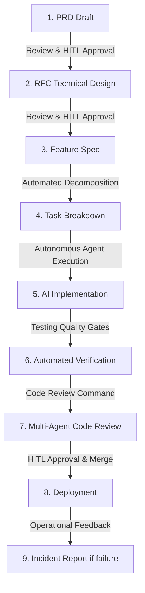

# LingoRoad Autonomous Orchestration Protocol (Giao thức Điều phối Tự động LingoRoad)

This document defines the execution flow, agent collaboration patterns, and Human-in-the-Loop (HITL) checkpoints for the LingoRoad AI Autonomous Workflow Engine. 
*(Tài liệu này định nghĩa luồng thực thi, các mô hình cộng tác của Agent AI, và các chốt chặn kiểm duyệt của con người (HITL) cho Hệ thống Điều phối tự động LingoRoad).*

---

## 1. Engine Life Cycle & State Machine (Vòng đời & Trạng thái Thực thi)

The workflow engine drives feature development through standard lifecycle stages. State transitions must be validated by the engine before proceeding.
*(Hệ thống điều phối dẫn dắt việc phát triển tính năng thông qua các giai đoạn tiêu chuẩn. Các chuyển đổi trạng thái phải được hệ thống xác thực trước khi tiếp tục).*

---

## 2. Multi-Agent Interaction Protocol (Giao thức Tương tác Đa Đặc vụ AI)

Development is orchestrated by specialized agents executing actions based on their identities.
*(Việc phát triển được điều phối bởi các Đặc vụ AI chuyên biệt, thực thi hành động dựa trên vai trò của chúng).*

### Communication Boundaries (Ranh giới Giao tiếp)

1. **Owner-Consultant Model (Mô hình Chủ sở hữu - Tư vấn):** 
Each domain file, database schema, or code module has an assigned Owner Agent. Other agents can review and suggest changes, but only the Owner Agent can commit modifications.
*(Mỗi file logic, schema CSDL, hoặc module code đều có một Đặc vụ làm chủ. Các đặc vụ khác chỉ được review và góp ý, tuyệt đối chỉ Đặc vụ Chủ sở hữu mới được sửa code).*

* **Lesson/Course Architect:** Bounded context of Learning lifecycle and tests. *(Xử lý logic vòng đời bài học và bài kiểm tra).*
* **Gamification Agent:** Calculations, Leaderboards, and Mastery points. *(Tính toán điểm số, xếp hạng và độ thành thạo).*
* **DevOps Agent:** Schema migrations, Cache strategy, Docker. *(Quản lý DB Schema, Cache, Docker).*
* **QA Agent:** Test specs, Integration tests. *(Chịu trách nhiệm viết Test).*

2. **Handoffs (Bàn giao):**
* Handoffs are documented in the task board state (`workflow-state.json`). *(Việc bàn giao được lưu trạng thái trong bảng tiến độ).*
* When an agent finishes a task, it marks the status as `DONE` and sets the next dependent task status to `READY`, triggering the dependent agent. *(Khi xong task, Agent đổi trạng thái thành DONE và kích hoạt Agent tiếp theo).*

3. **Conflict Resolution (Giải quyết Xung đột):**
* If two agents disagree on an architectural decision, they must evaluate against `AGENTS.md` and `tech-decision.md`. *(Nếu AI bất đồng quan điểm, phải đối chiếu lại với luật AGENTS.md).*
* If the conflict is unresolved, the engine halts and triggers a **HITL Escalation** to the human coordinator. *(Nếu không giải quyết được, AI sẽ dừng và gọi lập trình viên can thiệp).*

---

## 3. Human-in-the-Loop (HITL) Gateways (Các Chốt chặn Kiểm duyệt)

To guarantee safety and align system behavior with user intent, the engine enforces **blocking checkpoints** where human action is mandatory.
*(Để đảm bảo an toàn và đi đúng hướng, hệ thống bắt buộc phải dừng lại chờ con người phê duyệt ở các chốt chặn sau).*

| Stage (Giai đoạn) | Gateway Action (Hành động) | Pre-condition (Điều kiện) | Actionable Options for User (Quyết định của Người dùng) |
| :--- | :--- | :--- | :--- |
| **PRD** | PRD Validation | PRD markdown fully generated | `[Approve (Duyệt)]` / `[Request Edits (Yêu cầu Sửa)]` |
| **RFC** | Tech Design Sign-off | Database schemas & APIs defined | `[Approve]` / `[Modify Architecture (Sửa Kiến trúc)]` |
| **Task Breakdown**| Action Plan Approval | Sub-tasks decomposed, sizes estimated | `[Approve & Start (Bắt đầu)]` / `[Split Tasks (Chia nhỏ Task)]` |
| **Code Review** | Code Merge Approval | All tests pass, lint passes | `[Merge Squash (Gộp Code)]` / `[Reject & Re-code (Viết lại)]` |
| **Deployment** | Rollout Consent | Green build on staging | `[Deploy]` / `[Decline (Từ chối)]` |

---

## 4. Context & Workspace Management (Quản lý Bối cảnh & Không gian làm việc)

To prevent LLM context-window bloat and token exhaustion:
*(Để tránh việc AI bị đầy bộ nhớ context (ngốn token) dẫn đến quên logic):*

1. **State Archiving (Lưu trữ Trạng thái):** When moving from one phase to the next (e.g., RFC -> Implementation), intermediate discussion files must be summarized and archived. *(Khi sang giai đoạn mới, các file thảo luận nháp phải được tóm tắt và cất đi).*
2. **Strict File Inclusion (Giới hạn Đọc File):** Agents should only read files specified in their `Required Knowledge`. Reading the entire project directory tree is prohibited. *(AI chỉ được phép đọc các file thực sự liên quan đến task đang làm. Cấm đọc lướt toàn bộ project).*
3. **Session Cleansing (Dọn dẹp Phiên làm việc):** After completing a task branch, temporary scripts inside the `scratch/` directory must be deleted. *(Sau khi xong nhánh code, phải xóa sạch các script tạo nháp).*

---

## 5. Failure Recovery Protocol (Giao thức Phục hồi Sự cố)

If any step fails (Nếu có bất kỳ bước nào thất bại):

1. **Local Failure (Lỗi code tại máy):** Rollback local migration, log stack trace, and revert source code to the last stable state (`git stash` or `git restore`). *(Hủy bỏ migrate lỗi, ghi log và hoàn tác code về bản chạy tốt gần nhất).*
2. **Production Incident (Lỗi nghiêm trọng khi chạy demo/thực tế):**
   * Immediately trigger rollback strategy (revert commit). *(Lập tức revert commit bị lỗi).*
   * Create a Bug Report. *(Viết báo cáo Lỗi).*
   * Notify the human on-call operator and halt autonomous agent loops. *(Báo ngay cho người dùng và vô hiệu hóa vòng lặp code tự động của AI).*
