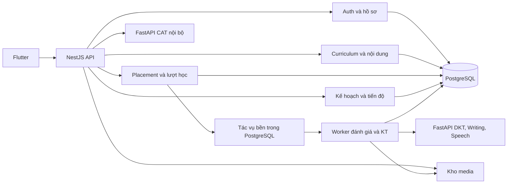

# Nghiên cứu backend cho app LingoRoad hiện tại

Ngày đối chiếu: **22/10/2026**. Workspace: nhánh `main`, HEAD `a05c456`, có nhiều thay đổi chưa commit. Báo cáo này đánh giá **các file đang có trong working tree**, gồm cả file chưa được Git theo dõi. Đây là nghiên cứu và đề xuất triển khai, không xác nhận những API đề xuất đã tồn tại.

Đã bổ sung xác minh bằng **Context Engine MCP / `codebase-retrieval`** tại thư mục gốc LingoRoad sau khi công cụ được kết nối: dùng `scope: code` cho luồng mobile, controller/backend, schema và ML; dùng `scope: docs` cho yêu cầu đồ án, đặc tả và các khác biệt tài liệu. Kết quả retrieval có đường dẫn/dòng và quan hệ gọi hàm; đây là tìm kiếm top-k, không phải bằng chứng đầy đủ rằng một symbol không tồn tại. Các nhận định thiếu model/caller còn được đối chiếu schema và tham chiếu định danh trong source.

## 1. Hướng đề xuất

Tiếp tục backend **NestJS + Prisma + PostgreSQL** hiện có, tổ chức các phân hệ trong cùng ứng dụng. Giữ **FastAPI** làm dịch vụ suy luận nội bộ. Ưu tiên nối vòng học thật:

**Đăng nhập → placement → kế hoạch → bài học → nộp bài → lưu tương tác → cập nhật hồ sơ/tiến độ → đề xuất tiếp theo.**

Phần cần xây chính là dữ liệu và nghiệp vụ phục vụ các màn học tập đã có. Nền tảng Auth, hồ sơ và placement có thể dùng tiếp. Đề xuất bắt đầu bằng một luồng bài học Ngữ pháp/Từ vựng hoàn chỉnh, sau đó mở rộng Nghe/Đọc và chấm Nói/Viết.

## 2. Hiện trạng đã kiểm tra

| Thành phần | Bằng chứng trong working tree | Ý nghĩa khi làm BE |
| --- | --- | --- |
| Auth và hồ sơ | `AuthController`, `ProfileService`, `SessionController`: register/login/refresh/logout/change-password, `GET/PATCH /auth/me` | Có nền tảng tài khoản và mobile gọi API; bổ sung preference còn thiếu khi làm kế hoạch. |
| Placement đang được controller sử dụng | `DemoPlacementService`: 10 câu, 5 Đọc + 5 Nghe, giữ câu đang làm, chống nộp lặp/xung đột, kết quả và review | Dùng tiếp luồng hiện tại; không thiết kế dựa trên use case cũ 15 câu. |
| Ngân hàng placement | `items.json` có 40 câu: mỗi kỹ năng 20 câu, mỗi mức A1/A2/B1/B2 có 5 câu | Đủ dữ liệu cho demo 10 câu; chưa phải ngân hàng đã hiệu chuẩn. Không còn giới hạn 12 câu như tài liệu cũ. |
| Điểm placement | `PROVISIONAL_RATIO_V1`, CEFR từ tỷ lệ đúng; `confidenceScore: null`; Nói/Viết `NOT_ASSESSED` | CAT đang chọn câu, nhưng CEFR cuối chưa suy ra từ theta đã liên kết với CEFR. |
| Trang chủ/Học/Luyện tập/Tiến độ | `LearningPreview`, `PreviewModel`, bài học và luyện tập dùng fixture; lưu bằng `SharedPreferences` | Cần API và dữ liệu theo tài khoản để thay phần dữ liệu mẫu. |
| Nói/Viết trên mobile | Nói mô phỏng ghi âm; Viết có nháp thật nhưng phản hồi cố định | Cần recorder/upload và dịch vụ đánh giá gắn với bài nộp thật. |
| Database | Schema có User/Profile/RefreshSession/PlacementSession/AssessmentItem/AssessmentResponse | Chưa có model bài học, lượt học, kế hoạch, lịch sử học dùng cho KT hay kết quả chấm Nói/Viết. |
| ML client | Có hàm CAT/KT/advisor/writing/speech | Chỉ có hàm client chưa chứng minh đã có luồng nghiệp vụ sử dụng. `predictKt()` chưa có caller nghiệp vụ trong backend. |
| KT được phục vụ | `/kt/predict` tải `SAINTPlus`; `DKTLstm` có file riêng | Chưa thể ghi nhận đã tích hợp DKT cho học viên LingoRoad. |

Các nguồn mã chính:

- [Module backend](../apps/backend/src/app.module.ts), [schema](../apps/backend/prisma/schema.prisma), [migration baseline](../apps/backend/prisma/migrations/20261019000000_demo_baseline/migration.sql).
- [Auth controller](../apps/backend/src/modules/auth/auth.controller.ts), [placement controller](../apps/backend/src/modules/placement/placement.controller.ts), [placement service đang sử dụng](../apps/backend/src/modules/placement/services/demo-placement.service.ts).
- [API client Flutter](../apps/mobile/lib/core/api/api_client.dart), [phiên đăng nhập](../apps/mobile/lib/features/auth/session_controller.dart), [model dữ liệu mẫu](../apps/mobile/lib/features/learning/preview_model.dart), [các tab học](../apps/mobile/lib/features/learning/learning_preview.dart), [luyện tập](../apps/mobile/lib/features/learning/practice_pages.dart).
- [KT serving](../apps/ml/lingoroad_ml/serving/kt_routes.py), [DKT](../apps/ml/lingoroad_ml/kt/dkt.py), [ngân hàng demo](../apps/backend/prisma/demo-content/items.json).

Các mốc cụ thể được MCP trả về để truy vết:

| Điểm cần xác minh | File và dòng | Kết luận |
| --- | --- | --- |
| Kết quả placement mở gì tiếp theo? | `placement_pages.dart:537–543` | Mở `LearningPreview(showPlan: true)`, chỉ truyền callback đăng xuất; chưa truyền learner state/API vào kế hoạch. |
| Kế hoạch và tiến độ đang lưu ở đâu? | `preview_model.dart:24–52` | Đọc/ghi preference, completed và nháp dưới prefix `lingoroad.uiPreview.`; không ghi lịch sử học qua BE. |
| Thời gian trên Home lấy từ đâu? | `learning_preview.dart:384–391` | Dùng `completed.length × 5` phút; cần thay bằng định nghĩa thời gian hoạt động khi nối BE. |
| Điểm trên Tiến độ có phải kết quả user? | `learning_preview.dart:689–705` | Đếm completed cục bộ và hiển thị A1 cố định kèm nhãn minh họa. |
| API danh sách cần có dạng nào? | `api_client.dart:90–96` | Client chỉ giữ `data` là Map; danh sách cần bọc trong object hoặc sửa contract client có chủ đích. |
| Mô hình KT đang tải? | `kt_routes.py:17–29` | Khởi tạo `SAINTPlus` từ checkpoint, không khởi tạo `DKTLstm`. |
| DKT đang dự đoán gì? | `dkt.py:15–24` | Dùng câu/đáp án trước để dự đoán câu hiện tại; không có đầu ra CEFR hoặc bốn kỹ năng trực tiếp. |

### Những điểm tài liệu cần thống nhất trước khi triển khai

1. `README.md` và `implementation_plan.md` còn mô tả snapshot cũ: chưa có mobile Auth, 15 câu và seed 12 câu. Không lấy các mô tả đó làm hiện trạng.
2. [Domain KT](spec/domain/05-knowledge-tracing-mastery.md) dùng BKT, trong khi [yêu cầu đồ án](../ProgressReport.md) ghi DKT. BKT có thể là baseline so sánh nếu thống nhất, không thay thế phần DKT của đề tài.
3. [Đặc tả radar](spec/features/13-knowledge-mastery-analytics/01-mastery-overview-radar/spec.md) dùng Ngữ pháp/Từ vựng/Đọc/Nghe; yêu cầu đồ án cần **Nghe/Nói/Đọc/Viết**. Ngữ pháp và Từ vựng vẫn cần để phân loại nội dung, nhưng phải tách khỏi bốn kỹ năng ngôn ngữ.
4. [Đặc tả hoàn tất bài](spec/features/11-lesson-attempt-lifecycle/02-idempotent-complete-attempt/spec.md) đã có `operationId`; cần bổ sung ràng buộc DB, kiểm tra đủ bài bắt buộc và quy tắc xử lý đồng thời khi hiện thực.

## 3. Kiến trúc phù hợp



Các khối trong NestJS là module của cùng backend, không yêu cầu triển khai thành các dịch vụ độc lập. Module nghiệp vụ sở hữu phần ghi dữ liệu của mình; controller xử lý HTTP, use case điều phối nghiệp vụ, repository truy cập DB. FastAPI nhận dữ liệu suy luận cần thiết, còn NestJS quản lý tài khoản, quyền truy cập và lịch sử học. Ranh giới provider/import/export được Nest hỗ trợ qua [module](https://docs.nestjs.com/modules); lựa chọn tổ chức trên là đề xuất cho quy mô dự án.

Đề xuất vận hành ban đầu: NestJS, PostgreSQL, FastAPI và một worker đơn giản. Tác vụ bền có thể dùng bảng PostgreSQL cùng cơ chế claim/retry; BullMQ/Redis là lựa chọn khi cần hàng đợi chuyên dụng. Redis hiện có trong Compose nhưng chưa có nghĩa app đã dùng cache/hàng đợi. Chỉ bổ sung cache sau khi có truy vấn thực tế cần tối ưu.

| Cơ chế | Khi phù hợp | Chi phí cần tính |
| --- | --- | --- |
| HTTP đồng bộ | CAT cần kết quả ngay, thời gian xử lý có giới hạn | Timeout/fallback và xử lý mất phản hồi. |
| Bảng job PostgreSQL | Muốn ghi bài nộp/job atomic trên DB đang có | Tự làm claim, lease, backoff và crash recovery. |
| BullMQ + Redis | Muốn dùng thư viện queue có retry/backoff sẵn | Vận hành Redis; giải quyết khoảng trống DB commit và enqueue, chẳng hạn outbox. |

`EventEmitter2` là cơ chế observer trong ứng dụng, không phải kho tác vụ bền. `async` listener không bổ sung khả năng phục hồi sau process crash. [Nest Events](https://docs.nestjs.com/techniques/events) và [Nest Queues](https://docs.nestjs.com/techniques/queues) mô tả hai cơ chế riêng. [FastAPI BackgroundTasks](https://fastapi.tiangolo.com/tutorial/background-tasks/) chạy sau response; với đánh giá cần lưu và khôi phục, đề xuất dùng một cơ chế job do Nest quản lý thay vì thêm một hàng đợi riêng bên Python.

Đây là chọn lựa có đánh đổi: job PostgreSQL giảm số thành phần hạ tầng nhưng không giảm công việc viết logic queue. Đợt bài học khách quan đầu tiên chưa cần worker nếu chưa có tác vụ ML bất đồng bộ.

## 4. Các phân hệ và API phục vụ màn hiện tại

**Ngoài Auth và Placement đã tồn tại, các API dưới đây đều là đề xuất.** Giữ tên `/path/today`, `/lessons`, `/lesson-attempts`, `/mastery` tương thích hướng đặc tả hiện có; chi tiết contract cần cập nhật theo nghiên cứu này.

| Màn/luồng | Module chịu trách nhiệm | API đề xuất | Dữ liệu cần trả |
| --- | --- | --- | --- |
| Trang chủ | LearningPlan, Progress | `GET /path/today` | Bài tiếp theo, lý do chọn, mục tiêu ngày, hoạt động đã làm, lượt học đang dở. |
| Học Ngữ pháp/Từ vựng | Curriculum | `GET /lessons?category=GRAMMAR`, `GET /lessons/:id` | Bài đã xuất bản, lý thuyết/thẻ từ/audio, trạng thái theo user, phiên bản nội dung. |
| Luyện Nghe/Đọc/Nói/Viết | Curriculum, Attempts | `GET /lessons?languageSkill=LISTENING` và các giá trị tương ứng | Nội dung, loại nhiệm vụ, yêu cầu audio/văn bản; không trả sẵn đáp án bài kiểm tra. |
| Học/luyện bài | Attempts | `POST /lessons/:id/attempts`, `GET /lesson-attempts/:id`, `POST /lesson-attempts/:id/exercises`, `POST /lesson-attempts/:id/complete` | Tiến độ làm bài, câu hiện tại, kết quả máy chủ chấm, trạng thái đánh giá. |
| Kế hoạch tuần | LearningPlan | `GET /path`, `PATCH /path/preferences` | Bài theo thứ tự, điều kiện mở khóa, nhóm cần luyện, phiên bản kế hoạch. |
| Nháp Viết | Attempts | `PATCH /lesson-attempts/:id/draft` | Nháp thuộc tài khoản, revision để phát hiện ghi đè giữa thiết bị. |
| Nộp bài Nói/Viết | Evaluations, Media | `POST /lesson-attempts/:id/evaluations`, `GET /evaluations/:id` | `202` và mã tác vụ; sau đó trạng thái chấm và phản hồi gắn đúng bài nộp. |
| Upload bài Nói | Media | `POST /media/audio` | Upload multipart có xác thực, trả `mediaId`; endpoint evaluation nhận ID này. |
| Tiến độ | Progress, KnowledgeTracing | `GET /progress?from=...&to=...`, `GET /mastery`, `GET /mastery/skills` | Lịch sử hoạt động, kết quả bốn kỹ năng, bằng chứng và trạng thái KT. |

### Quy tắc contract với Flutter

- Giữ envelope `{ success: true, data: { ... } }`; lỗi dùng `{ success: false, error: { code, message } }` tương thích client hiện tại.
- Danh sách trả `data: { items: [...], nextCursor: null }`. `ApiClient` hiện chỉ đọc `data` dạng Map; trả mảng trực tiếp sẽ bị chuyển thành object rỗng.
- Dùng mã kỹ năng ổn định như `READING`, `grammar.be.present`; không dùng nhãn tiếng Việt làm ID dữ liệu.
- Client cần thêm phương thức multipart khi triển khai upload. Trạng thái loading, rỗng, lỗi, đang chấm và chấm thất bại phải có contract riêng.
- Mọi truy vấn attempt, draft, evaluation, media phải kiểm tra chủ sở hữu từ JWT. Không tin `userId`, điểm hoặc `isCorrect` do client truyền.
- Viết OpenAPI/DTO cho từng luồng trước khi nối màn tương ứng; [Nest OpenAPI](https://docs.nestjs.com/openapi/introduction) hỗ trợ tạo tài liệu từ ứng dụng. Backend hiện chưa có cấu hình Swagger trong `main.ts` đã kiểm tra.

## 5. Mô hình dữ liệu đề xuất

Không đưa tất cả tính năng tương lai vào một migration. Thêm theo từng luồng có thể nghiệm thu.

| Nhóm | Model đề xuất | Trường/ràng buộc quan trọng |
| --- | --- | --- |
| Kiến thức | `KnowledgeComponent`, `Topic`, `SkillPrerequisite` | Mã KC ổn định; prerequisite không chu trình. Phân biệt `languageSkill` bốn kỹ năng với category Ngữ pháp/Từ vựng. |
| Nội dung | `Lesson`, `LessonVersion`, `Exercise`, `ExerciseVersion`, `LessonExercise`, `ExerciseKnowledgeComponent` | Draft/published; thứ tự; estimated duration; nhiều KC cho một câu khi cần; đáp án lưu phía server. |
| Từ vựng/media | `VocabularyEntry`, `MediaAsset` | Từ, nghĩa, ví dụ, pronunciation/audio; media public cho tài nguyên bài học, private cho bản thu người học. |
| Lượt học | `LessonAttempt`, `ExerciseSubmission` | User, contentVersion, trạng thái, version, điểm server; unique theo attempt/exercise cho lượt trả lời được tính. Retry luyện lại tạo attempt mới. |
| Chống ghi lặp | `OperationReceipt` | Unique `(userId, operationId)`, loại thao tác, resource, requestHash, response đã lưu; cùng key khác payload trả `409`. |
| Tương tác KT | `LearningInteraction` | Source và sourceId duy nhất, user, thứ tự server cấp theo user, exerciseVersion/KC, đúng/sai hoặc rubric, thời gian, lần học, dấu hiệu dùng gợi ý. Không sửa lịch sử để giả dữ liệu huấn luyện. |
| Kết quả mô hình | `LearnerSkillEstimate`, `EstimateSnapshot`, `ModelItemMapping` | EstimateType, source, modelVersion, mappingVersion, evidenceCount, lastInteractionSequence. Mapping đúng vocabulary của checkpoint. |
| Kế hoạch | `LearningPreference`, `DailyPlan`, `DailyPlanItem` | FocusSkills, dailyGoalMinutes, ngày địa phương, planVersion, lý do chọn, trạng thái hoàn thành. Giữ `UserProfile.dailyGoalMinutes` làm nguồn chuẩn duy nhất cho mục tiêu phút. |
| Chấm Nói/Viết | `Evaluation`, `EvaluationCriterion`, `BackgroundJob` | Input snapshot/hash, rubricVersion, evaluator/modelVersion, status, retry, timeout, kết quả; unique theo bài nộp/loại chấm/phiên bản. |
| Lịch sử học | `DailyActivity` | User + localDate duy nhất; tổng hoạt động/phút được ghi nhận, tách khỏi điểm năng lực. Có thể tổng hợp từ lịch sử trước khi cần bảng riêng. |

Phiên bản bài đã xuất bản phải bất biến; chỉnh nội dung tạo phiên bản mới. Attempt và kết quả tham chiếu đúng phiên bản đã làm. Seed dùng stable external ID và upsert cho dữ liệu phát triển, nhưng không ghi đè phiên bản đang được attempt tham chiếu.

Đề xuất giữ bảng placement hiện có trong bước đầu; thêm model học tập mà không ép Nói/Viết vào `AssessmentSkill` chỉ có Đọc/Nghe. Khi dùng lại cùng một nội dung ở placement và lesson, phải có định danh nội dung/KC và mapping chung để liên kết lịch sử, tránh coi cùng câu là hai tri thức khác nhau. Giá trị mặc định `UserProfile.targetCefr = B1` hiện tại là cấu hình hồ sơ, không chứng minh phạm vi nội dung B1 đã được chốt.

Nếu cần phát tác vụ sau một thay đổi DB, ghi job/outbox trong **cùng transaction** với thay đổi đó. Worker xử lý ít nhất một lần, còn unique key/receipt làm cho tác động nghiệp vụ không bị nhân đôi. Không kỳ vọng toàn chuỗi HTTP/worker/ML có bảo đảm “exactly once”.

## 6. Luồng học cần hiện thực trước

1. User hoàn tất placement; backend có thể khởi tạo kế hoạch từ kết quả đã lưu. Khi thêm module mới, cần backfill/lazy initialize cho tài khoản đã placement xong, không chỉ lắng nghe event tương lai.
2. `GET /path/today` chọn bài đã xuất bản và đủ prerequisite. Khởi đầu dùng quy tắc có thể giải thích: mức tham chiếu placement, nhóm cần luyện, ưu tiên cá nhân và thời lượng dự kiến. Có thể tính kế hoạch xác định từ dữ liệu đã lưu mà chưa cần bảng snapshot. Nếu lưu kế hoạch, khởi tạo/lập lại bằng use case rõ ràng khi placement, preference, lịch sử học hoặc ngày học thay đổi; GET chỉ đọc và tổng hợp.
3. Bắt đầu lesson attempt: pin contentVersion, trả danh sách/câu hiện tại đã bỏ đáp án. Lưu receipt cho thao tác bắt đầu để retry không tạo nhiều lượt học ngoài ý muốn.
4. Nộp bài tập: kiểm tra ownership, trạng thái, exercise thuộc attempt, đáp án hợp lệ; chấm phía server. Trong transaction ngắn, ghi submission + interaction + receipt và cập nhật version.
5. Trả phản hồi theo chế độ học: bài luyện có thể giải thích sau khi nộp; placement giữ quy tắc chỉ mở đáp án sau khi hoàn tất. Không làm lộ đáp án ở API tải bài ban đầu.
6. Complete: kiểm tra tất cả nhiệm vụ bắt buộc đã được nộp. Phân biệt `submissionStatus`, `evaluationStatus`, `completionStatus`; có thể đã nộp đủ nhưng còn chờ chấm. Chỉ chốt điểm/đạt khi các kết quả bắt buộc sẵn sàng. Mỗi attempt chỉ chốt một lần, kể cả client gửi operationId khác.
7. Trong transaction hoàn tất, ghi kết quả bất biến và job cần thiết. Tiến độ hoạt động cập nhật từ dữ liệu đã commit; worker KT/AI xử lý sau. Màn hình hiển thị trạng thái đang cập nhật nếu estimate mới chưa có.
8. Request bị mất phản hồi có thể gửi lại cùng operationId để lấy kết quả cũ. Xung đột revision trả `409` để client tải lại; user có thể xem kết quả sau khi mở lại app.

Không giữ transaction DB trong lúc gọi CAT/LLM/Whisper. Luồng placement hiện tại đã gọi CAT trước khi cập nhật và dùng version để kiểm soát tranh chấp; có thể áp dụng cùng nguyên tắc cho các use case mới.

[Tài liệu Prisma có mốc phiên bản](https://www.prisma.io/docs/orm/v6/prisma-client/queries/transactions) hỗ trợ `$transaction`, optimistic concurrency và thiết kế idempotency; điều kiện update có trường version khả dụng trong Prisma 5. Cần dùng API đúng Prisma 5 đang cài, tránh sao chép cú pháp Prisma mới từ tài liệu mặc định. Retry lỗi cạnh tranh/deadlock phải hữu hạn, không mặc định mọi use case cần isolation Serializable.

Unique constraints/index là lớp bảo vệ dữ liệu dưới concurrency; kiểm tra trước bằng một câu SELECT không thay thế ràng buộc DB. [PostgreSQL 16: unique indexes](https://www.postgresql.org/docs/16/indexes-unique.html) và [row locks](https://www.postgresql.org/docs/16/explicit-locking.html). Nếu insert gặp unique violation, đọc kết quả sau rollback hoặc bằng thao tác xử lý conflict phù hợp; không tiếp tục dùng transaction đã lỗi.

Mục tiêu phút/ngày phải dựa trên định nghĩa thời gian học: khoảng hoạt động có giới hạn idle, không cộng toàn bộ thời gian app chạy nền và không lấy `số bài × 5 phút` như preview. Lưu timestamps UTC; nhóm ngày theo `Asia/Ho_Chi_Minh`. Bài hoàn tất sau nửa đêm tính vào ngày hoàn tất; không lọc theo `startedAt` như đặc tả cũ.

## 7. CAT và DKT trong backend

### Vai trò và điểm nối

CAT trong phép đo dùng lịch sử đáp án và ngân hàng đã hiệu chuẩn để chọn câu có ích cho ước lượng năng lực. Khả năng áp dụng kết quả đo vào chọn bài/chủ đề cần thêm chính sách gợi ý nội dung của app. [Nguồn: IACAT](https://iacat.org/introduction-to-cat/).

DKT dùng chuỗi tương tác học để mô hình hóa thay đổi trạng thái và dự đoán kết quả tương tác. Với LingoRoad, đề xuất dùng **cùng lịch sử câu hỏi–đáp án có định danh/phiên bản** để nối placement với quá trình học. Câu trả lời placement có thể làm lịch sử ban đầu khi tương thích với mapping và dữ liệu huấn luyện; không cần gán theta trực tiếp vào hidden state. Đây là thiết kế đề xuất dựa trên nhiệm vụ KT trong [nghiên cứu DKT gốc](https://papers.nips.cc/paper_files/paper/2015/hash/bac9162b47c56fc8a4d2a519803d51b3-Abstract.html).

### Những việc bắt buộc trước khi gọi đó là DKT tích hợp

1. Xác định unit dự đoán: câu hỏi cụ thể hay KC. Model hiện tại dùng embedding question ID; mã KC không thể tự thay vào checkpoint question-based.
2. Xây mapping giữa nội dung LingoRoad và vocabulary của mô hình. ID mới gán tùy ý vào chỉ số EdNet không tạo ra ý nghĩa học thuật đúng. Với nội dung mới cần huấn luyện/fine-tune tương thích hoặc mô hình có đặc trưng nội dung phù hợp, rồi đánh giá lại.
3. Phục vụ đúng DKT nếu bám yêu cầu đề tài. `/kt/predict` hiện chỉ nhận sequence và trả xác suất theo các bước trong sequence; không có contract riêng cho danh sách candidate chưa làm hoặc vector mastery bốn kỹ năng.
4. Contract tương lai nên có history watermark, modelVersion, mappingVersion, candidate IDs và prediction cho từng candidate. Tách dự đoán xác suất trả lời đúng khỏi CEFR/rubric; cần kiểm thử không dùng đáp án của câu đang dự đoán làm feature.
5. Đưa interaction placement vào lịch sử chung bằng sourceId duy nhất; backfill và chạy lại không sinh bản sao. Lưu thứ tự theo server, không dựa riêng vào timestamp client.
6. Worker theo user phải bảo toàn thứ tự/watermark; kết quả job cũ không ghi đè estimate mới. Khi model đổi phải có khả năng replay history với version mới.
7. Cold start hoặc item chưa có mapping: trả `INSUFFICIENT_DATA`/`MODEL_UNAVAILABLE` cùng lý do và dùng quy tắc nội dung đã định nghĩa. Không tạo mastery hoặc CEFR giả để lấp chỗ trống.
8. Đánh giá tách theo người học, dự đoán tương lai, so baseline đơn giản; xem discrimination, calibration và lỗi theo nhóm kỹ năng. Kết quả trên EdNet là bằng chứng thực nghiệm riêng, chưa chứng minh hiệu quả trên nội dung/người học LingoRoad.

Không tự áp dụng ngưỡng như “p đúng 0.7 = đã thành thạo” hoặc “theta X = A2” khi chưa có cơ sở đánh giá. Phạm vi DKT cho Nói/Viết cần thống nhất với giảng viên; rubric có thể được lưu riêng trước khi có cách biểu diễn và dữ liệu huấn luyện phù hợp.

## 8. Chấm Nói/Viết thật

### Xử lý bất đồng bộ

Mobile hiện có receive timeout 20 giây, trong khi ML client cho Writing ít nhất 25 giây, Speaking ít nhất 30 giây. Một request HTTP chờ toàn bộ quá trình dễ khiến người học không biết bài đã được ghi nhận hay chưa. Đề xuất:

**Nộp input → lưu Evaluation/job → trả 202 với evaluationId → worker gọi ML → lưu kết quả → app polling có backoff.**

Job có `PENDING/RUNNING/SUCCEEDED/FAILED`, số lần thử, thời điểm thử lại, lease hết hạn để khôi phục sau crash. Cần phân biệt lỗi có thể retry với dữ liệu không hợp lệ; giới hạn retry và thời gian xử lý. Mỗi kết quả gắn input snapshot, tránh phản hồi của bản nháp cũ bị hiển thị cho bản mới. Lỗi chấm trả trạng thái thất bại và cho thử lại; không fallback thành phản hồi cố định.

### Nói

- Flutter cần ghi âm thật, xử lý quyền micro và thu hồi quyền, gián đoạn app, tệp rỗng và phát lại đúng bản thu.
- Upload giới hạn byte, định dạng thực và thời lượng sau decode; không chỉ tin extension/MIME. Media người dùng có chủ sở hữu, đường dẫn do server tạo, không phục vụ cùng thư mục public của audio bài học.
- Backend lấy đề/reference text từ exerciseVersion. Không để client tự thay đề của bài đang được chấm.
- Endpoint speech hiện phù hợp **đọc thành tiếng**. Bài nói mở như “giới thiệu bản thân” cần đánh giá đúng nhiệm vụ, độ dễ hiểu, ngôn ngữ và mạch lạc; không tái sử dụng điểm khớp transcript như thước đo đầy đủ cho kỹ năng Nói.
- Cần chính sách giữ/xóa bản thu và cleanup job, tách vòng đời media với kết quả rubric đã lưu.

Nest cung cấp interceptor, giới hạn Multer và validator cho upload. Cần giới hạn lúc nhận file thay vì chỉ kiểm tra sau khi đã buffer toàn bộ. [Nest File Upload](https://docs.nestjs.com/techniques/file-upload). Đối chiếu API với NestJS 10/Express đang dùng vì tài liệu Nest hiện hành có cả hành vi thuộc phiên bản mới hơn.

### Viết

- Nháp lưu theo tài khoản/attempt, có revision. Nộp bài tạo snapshot văn bản, prompt và rubricVersion; backend kiểm tra độ dài theo loại nhiệm vụ.
- Lưu điểm từng tiêu chí và phản hồi có cấu trúc. Output LLM cần được validate schema/range trước khi ghi nhận là kết quả hợp lệ.
- Màn Viết hiện hiển thị nhận xét theo tiêu chí, không yêu cầu thêm band điểm lên UI. Rubric cần theo mục tiêu bài học/nhóm người học đã thống nhất; không mặc định IELTS hoặc TOEIC. Điểm nội bộ nếu có và nhận xét định tính phải phân biệt rõ.
- Dữ liệu bài viết được xử lý như nội dung người học; không để câu lệnh nằm trong bài viết thay đổi rubric hoặc quyền xử lý của hệ thống.
- Đối chiếu mẫu với giảng viên/người chấm; không gọi kết quả tự động là CEFR chuẩn khi chưa có quá trình liên kết và kiểm chứng. [Council of Europe mô tả quy trình liên kết bài thi với CEFR và các grid riêng cho Nói/Viết/Nghe/Đọc](https://www.coe.int/en/web/common-european-framework-reference-languages/relating-examinations-to-the-cefr).

## 9. Tiến độ và hồ sơ năng lực

Tách ít nhất ba loại chỉ số:

| Chỉ số | Dữ liệu đầu vào | Cách diễn giải |
| --- | --- | --- |
| Hoạt động | Lượt học đã hoàn tất, thời gian hoạt động, ngày học | Người học đã học bao nhiêu; không phải trình độ. |
| Kết quả nhiệm vụ | Điểm Đọc/Nghe, rubric Nói/Viết, ngày chấm | Thành tích ở nhiệm vụ cụ thể, kèm loại đề và bằng chứng. |
| Estimate mô hình | DKT/CAT, modelVersion, evidenceCount, watermark | Ước lượng phục vụ cá nhân hóa, kèm trạng thái và giới hạn. |

Bốn nhóm kỹ năng chính là `LISTENING`, `SPEAKING`, `READING`, `WRITING`; vocabulary/grammar là chiều kiến thức bổ trợ. Chưa đánh giá trả `value: null`, `status: NOT_ASSESSED`; chưa đủ bằng chứng trả `INSUFFICIENT_DATA`. Không biến thành điểm 0, không dùng bốn A1 cố định, không lấy trung bình các thang đo khác nhau để tạo CEFR tổng.

Ví dụ contract dự kiến cho một kỹ năng:

```json
{
  "skill": "SPEAKING",
  "estimatedCefr": null,
  "status": "NOT_ASSESSED",
  "evidenceCount": 0,
  "source": null,
  "assessedAt": null
}
```

Lịch sử tiến bộ phải dùng snapshot có thời điểm, nguồn và phiên bản. Nếu hai model/rubric không cùng thang, không nối số trực tiếp thành một đường tiến bộ mà không giải thích sự thay đổi phép đo.

## 10. Thứ tự triển khai và tiêu chí nghiệm thu

| Đợt | Công việc | Điều kiện hoàn thành |
| --- | --- | --- |
| 1. Một bài học thật | Curriculum tối thiểu, seed một chủ đề, lesson attempts/submissions, nối màn Ngữ pháp/Từ vựng | Tài khoản mới học và chấm bài qua API; đóng/mở app tiếp tục đúng; retry không tạo kết quả trùng; user khác không xem được. |
| 2. Kế hoạch và tiến độ thật | Preferences, `/path/today`, trạng thái catalogue, `/progress`, bridge placement | Home và Tiến độ cùng đọc dữ liệu đã lưu; không còn số phút/trạng thái fixture trong luồng thật; đổi mục tiêu có hiệu lực. |
| 3. Nghe/Đọc và dữ liệu KT | Thêm nội dung/audio có version, interaction history, mapping và hợp đồng DKT | Có lịch sử xuyên placement–learning; không lộ đáp án; pipeline DKT chạy đúng model và báo rõ trường hợp thiếu mapping/dữ liệu. Đánh giá chất lượng mô hình là gate riêng. |
| 4. Nói/Viết | Recorder, upload private, evaluation worker, rubric và nháp theo user | Chấm đúng input đã nộp; restart không mất job; không dùng phản hồi mẫu; có kết quả theo từng tiêu chí và xử lý lỗi. |
| 5. Cá nhân hóa và đánh giá | Kết hợp estimate đã kiểm chứng vào chọn nội dung, lịch sử bốn kỹ năng, so baseline | Đề xuất có lý do truy vết được; có dữ liệu đánh giá và giới hạn khoa học rõ; hoàn tất các tiêu chí đồ án đã thống nhất. |

**Ưu tiên thực hiện tiếp:** đợt 1, đồng thời xác định vocabulary/mapping và nguồn dữ liệu DKT ngay từ đầu. Không đợi đến khi hoàn thiện toàn bộ UI mới giải quyết khoảng trống mô hình.

Các phần FSRS, XP/streak thưởng, leaderboard, advisor chat và Web Admin có thể triển khai sau vòng học cốt lõi. Nội dung ban đầu có thể dùng seed/import có validation; chưa cần xây đủ CMS mới học được. Đây là ưu tiên đề xuất, không thay đổi yêu cầu giảng viên.

### Kiểm chứng đã chạy trong lần nghiên cứu này

- `npm.cmd run build` trong `apps/backend`: **thành công**.
- `npm.cmd run test -- --runInBand`: **13 suites, 82 tests đạt**.
- Đã kiểm tra cấu trúc/đếm ngân hàng JSON: **40 câu, 20 Đọc + 20 Nghe**.
- Chưa chạy lại HTTP E2E, Flutter integration, ML inference/huấn luyện hoặc kiểm tra DB đang chạy. Các test hiện có bao gồm cả use case placement cũ, không chứng minh vòng học đề xuất hay mô hình DKT đã hoạt động.

### Các kiểm chứng cần có khi triển khai

- HTTP E2E trên PostgreSQL riêng: ownership, retry cùng payload, cùng key khác payload, complete đồng thời, đủ nhiệm vụ bắt buộc và rollback khi lỗi.
- Kiểm thử resume sau khi mất phản hồi/mở lại app; cache và nháp phải theo tài khoản, không chuyển trạng thái `uiPreview` thành kết quả học thật.
- Job retry/crash recovery, kết quả KT đến sai thứ tự, snapshot/version và tác động nghiệp vụ không nhân đôi.
- Contract test NestJS–FastAPI; ML unavailable, dữ liệu không có mapping, output không hợp lệ; giữ luồng học với fallback được công bố.
- Kiểm tra mốc ngày Việt Nam, bài qua nửa đêm, ngày không hoạt động và kỹ năng chưa được đánh giá.
- Migration thêm dữ liệu/cột theo từng bước; kiểm tra DB hiện tại, sao lưu và giữ index SQL có điều kiện. Không reset/drop DB để đưa schema mới vào.
- Bind rate limiting cho route public và route upload/ML theo chi phí: hiện có `ThrottlerModule` nhưng chưa thấy `ThrottlerGuard`/`APP_GUARD` trong source. Import module chưa đủ để áp giới hạn; [Nest Rate Limiting](https://docs.nestjs.com/security/rate-limiting) yêu cầu bind guard. Kiểm tra bằng HTTP test khi triển khai.

## 11. Các quyết định còn mở

1. Phạm vi nội dung chính A1–A2 hay đến B1? A1–A2 là lựa chọn giảm phạm vi được đề xuất trước đây, chưa phải quyết định đã chốt. Không mặc định TOEIC/IELTS chỉ vì dùng EdNet.
2. “DKT ước lượng trình độ đầu vào” được nghiệm thu là sau chuỗi câu trả lời chẩn đoán hay trước mọi đáp án? Cần thống nhất cách diễn giải và minh chứng với giảng viên.
3. DKT bắt buộc bao phủ đủ bốn kỹ năng hay có thể mô hình hóa tương tác khách quan, còn Nói/Viết dùng rubric và hồ sơ bằng chứng riêng?
4. Kết quả CEFR dùng để định hướng học hay cần liên kết với bài đo/người chấm tham chiếu? Điều này quyết định dữ liệu và quy trình đánh giá cần thu.
5. Nguồn nội dung, người duyệt và mẫu dữ liệu học viên để đánh giá là gì? Đây là phụ thuộc thực tế của cả CAT lẫn DKT, không chỉ là công việc viết API.

Các quyết định này ảnh hưởng phạm vi nội dung và mô hình; vẫn có thể bắt đầu schema/luồng bài học, chống ghi lặp, ownership và lưu interaction theo thiết kế trên.
