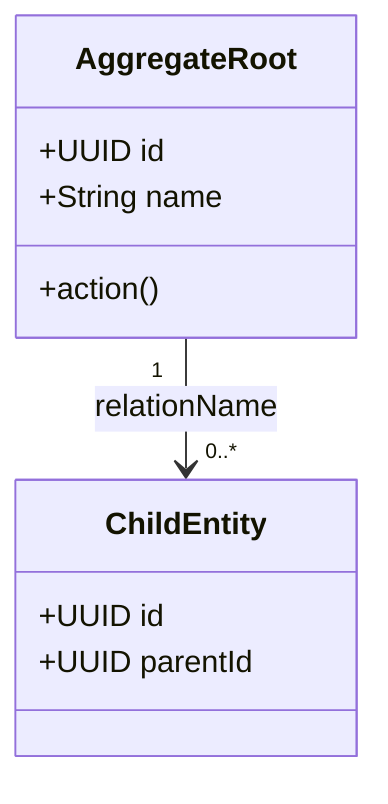
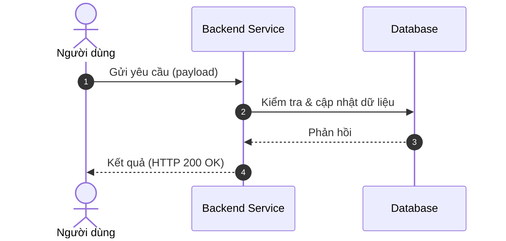

# Domain Specification Template

## Mission

Tài liệu Domain Specification định nghĩa ngôn ngữ thống nhất (Ubiquitous Language), các Aggregate Root, Entity, logic nghiệp vụ cốt lõi và các luồng nghiệp vụ vĩ mô của một phân hệ (Domain).

Đây là tài liệu gốc ở cấp độ cao nhất. Từ tài liệu này, các tính năng con sẽ được bóc tách để viết thành các tài liệu PRD, Feature Spec, RFC và Task cụ thể.

---

# 1. Domain Overview (Tổng quan phân hệ)

Mô tả bài toán nghiệp vụ mà phân hệ này giải quyết, ranh giới và các mục tiêu cốt lõi.

- Phân hệ này giải quyết vấn đề gì của doanh nghiệp/người dùng?
- Các mục tiêu cốt lõi (Core Objectives) cần đạt được là gì?
- **Stack Công nghệ & Tích hợp (Technology Stack & Integrations)**: Các công nghệ đặc thù hoặc các bên thứ ba tích hợp trong phân hệ này (ví dụ: Azure OpenAI, Callio, S3).

---

# 2. Sub-systems & Feature Breakdown (Các phân hệ con & Phân rã tính năng)

Phân tách phân hệ lớn thành các phân hệ con hoặc các nhóm tính năng cốt lõi. Đây là cầu nối trực tiếp để phân rã ra các tài liệu PRD chi tiết sau này.

- So sánh các phân hệ con (nếu có, ví dụ: Vận hành vs AI, Mobile vs Desktop).
- Bản đồ chức năng cốt lõi (Core feature groups).

---

# 3. Ubiquitous Language (Ngôn ngữ Thống nhất)

Định nghĩa bảng thuật ngữ thống nhất giữa kỹ thuật (Engineering), nghiệp vụ (Product) và các AI Agent để tránh sự mơ hồ.

| Thuật ngữ (English) | Thuật ngữ Tiếng Việt | Định nghĩa & Phạm vi sử dụng |
| :--- | :--- | :--- |
| **ExampleTerm** | Thuật ngữ ví dụ | Mô tả chi tiết thuật ngữ, vai trò và cách nó tương tác trong hệ thống. |
| **AnotherTerm** | Thuật ngữ khác | Mô tả chi tiết thuật ngữ, vai trò và cách nó tương tác trong hệ thống. |

---

# 4. Architecture Design & Core Decisions (Thiết kế Kiến trúc & Quyết định cốt lõi)

Mô tả các quyết định kiến trúc cốt lõi của phân hệ này (ví dụ: cơ chế phân cấp cây đệ quy, phân tách thông tin bảo mật, tích hợp phân quyền tự động, hoặc kiến trúc decoupled identity).

- Giải pháp thiết kế cho các bài toán phức tạp trong phân hệ.
- Lý do lựa chọn giải pháp (Design Rationale).
- Ảnh hưởng của kiến trúc này tới các phân hệ khác (nếu có).

---

# 5. Domain Model & Entities (Mô hình Miền & Thực thể)

Định nghĩa các thực thể cốt lõi, mối quan hệ và cấu trúc dữ liệu.

## 5.1 Class Diagram (Mermaid)

Sử dụng sơ đồ lớp (Class Diagram) để biểu diễn trực quan các Entity, Aggregate Root và mối quan hệ giữa chúng.



## 5.2 Entity Specifications / Schema Draft

Liệt kê chi tiết các trường dữ liệu, kiểu dữ liệu, các ràng buộc nghiệp vụ hoặc bản dự thảo database schema (ví dụ: Prisma Schema hoặc MongoDB Collections).

- **Entity A (e.g., Aggregate Root)**:
  - `id`: UUID (Primary Key)
  - `name`: String (Unique, constraints)
  - `status`: Enum (`ACTIVE`, `INACTIVE`)
- **Entity B (Entity / Value Object)**:
  - `id`: UUID (Primary Key)
  - `parentId`: UUID (Foreign Key)

---

# 6. Core Workflows (Quy trình Vận hành Cốt lõi)

Mô tả luồng xử lý và tương tác giữa các bên cho các nghiệp vụ chính bằng Sequence Diagram hoặc Flowchart.

## 6.1 Quy trình A: [Tên Quy trình]

Mô tả chi tiết các bước trong quy trình.



---

# 7. Business Rules (Quy tắc Nghiệp vụ)

Định nghĩa các ràng buộc nghiệp vụ, logic kiểm tra tính hợp lệ và cơ chế phân quyền bắt buộc phải tuân thủ trong mọi trường hợp.

- Quy tắc ràng buộc dữ liệu và trạng thái (ví dụ: Một tài khoản cá nhân chỉ được liên kết với một Personal Workspace).
- Cơ chế bảo mật và phân quyền (ví dụ: Chỉ Admin hoặc Trưởng phòng mới có quyền thao tác dữ liệu nhạy cảm).
- Các chính sách nghiệp vụ đặc thù khác (ví dụ: Quy tắc ẩn/hiển thị mặt nạ dữ liệu).

---

# 8. Draft API Requirements (Dự thảo Yêu cầu API)

Bản thảo sơ bộ các API endpoints quan trọng nhất của phân hệ để làm cầu nối cho các bên.

## 8.1 [Tên API Endpoint]

- **Endpoint**: `POST /api/v1/...`
- **Mô tả**: Mô tả ngắn gọn chức năng của API.
- **Request Body**:
  ```json
  {
    "field": "value"
  }
  ```
- **Response**: `200 OK`
  ```json
  {
    "success": true,
    "data": {}
  }
  ```

---

# 9. Product Recommendations & Future Improvements (Đề xuất cải tiến & Lộ trình)

Nơi ghi lại các ý tưởng, đề xuất phát triển sản phẩm trong tương lai, nợ kỹ thuật hoặc các nâng cấp về AI giúp định hướng lộ trình sản phẩm.

---

# Output Rule (Quy tắc Đầu ra)

Tài liệu Domain Specification phải tập trung vào mô hình nghiệp vụ, ngôn ngữ thống nhất và các thiết kế vĩ mô.

- **KHÔNG** đưa vào các chi tiết triển khai cụ thể của Frontend (UI cụ thể, thư viện CSS).
- **KHÔNG** viết code chi tiết hay cấu hình môi trường cụ thể.
- Tài liệu này là gốc để phân tích ra thành các **PRD** (Cho các tính năng con), từ đó phát triển thành **Feature Spec**, **RFC** và **Task Breakdown**.

# End