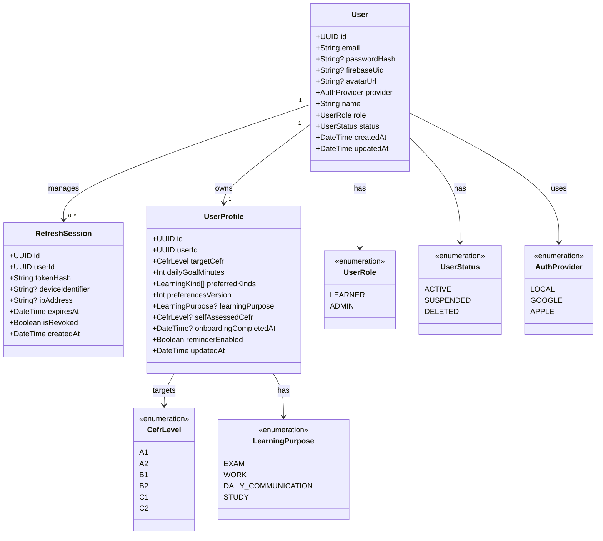
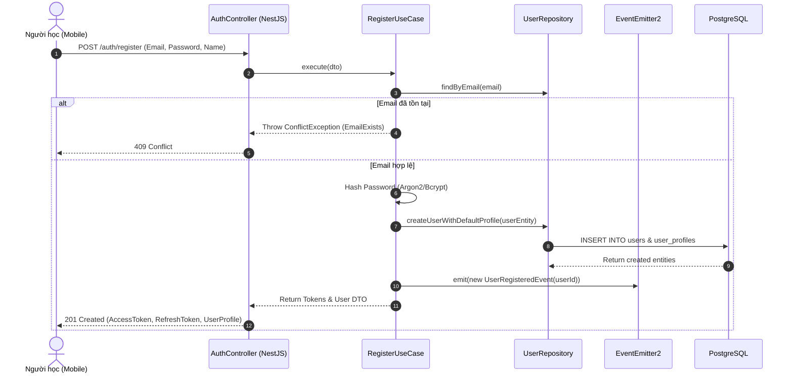
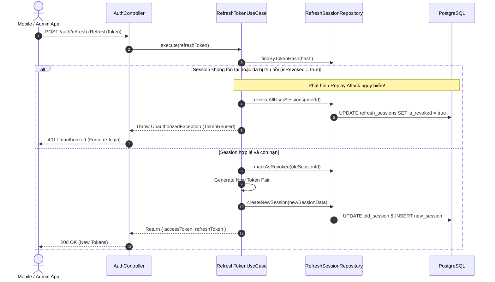

# Domain Specification: 01. Identity & Access Management (IAM)

## Mission

Tài liệu Domain Specification định nghĩa ngôn ngữ thống nhất (Ubiquitous Language), các Aggregate Root, Entity, logic nghiệp vụ cốt lõi, cơ chế bảo mật phiên (Session & Token Rotation) và quản lý hồ sơ người học (Learner Profile) cho phân hệ Identity & Access Management trong hệ sinh thái LingoRoad trên nền tảng **NestJS**.

---

# 1. Domain Overview (Tổng quan phân hệ)

Phân hệ Identity & Access Management (IAM) chịu trách nhiệm quản lý toàn bộ vòng đời danh tính người dùng, kiểm soát truy cập phân quyền dựa trên vai trò (Role-Based Access Control - RBAC), bảo mật xác thực với cơ chế xoay vòng Refresh Token (Token Rotation) và lưu trữ mục tiêu học tập cá nhân hóa.

- **Vấn đề giải quyết**: Đảm bảo định danh người học an toàn, chống giả mạo token, ngăn chặn truy cập trái phép vào các tài nguyên nội dung/quản trị, và duy trì tính nhất quán của trạng thái phiên đăng nhập trên đa thiết bị (Mobile App & Admin Web).
- **Mục tiêu cốt lõi (Core Objectives)**:
  - Hỗ trợ kiến trúc xác thực kép **Dual Auth Mode** (`AUTH_PROVIDER=firebase|legacy`, mặc định `firebase`):
    - **Chế độ `firebase` (Mặc định)**: `JwtAuthGuard` xác thực Bearer Firebase ID Token qua `FirebaseTokenService.verify()` (`verifyIdToken(token, true)`) và đồng bộ/khởi tạo tự động `User` + `UserProfile` trên PostgreSQL qua `FirebaseUserService.resolve()`. Các endpoint mật khẩu nội bộ (`/auth/register`, `/auth/login`, `/auth/refresh`, `/auth/logout`, `/auth/change-password`) bị chặn với lỗi `400 AUTH_USE_FIREBASE`.
    - **Chế độ `legacy`**: Sử dụng JWT Access Token nội bộ ngắn hạn (15 phút) + Refresh Token dài hạn (30 ngày, băm SHA-256 trong `RefreshSession`) theo cơ chế Token Rotation + băm mật khẩu `Argon2id` (`PasswordService`).
  - Phân quyền nghiêm ngặt giữa hai nhóm người dùng chính: `LEARNER` (Người học) và `ADMIN` (Quản trị viên).
  - Quản lý hồ sơ cá nhân hóa (`targetCefr`, `dailyGoalMinutes`, `learningPurpose`, `selfAssessedCefr`, `preferredKinds`, `preferencesVersion`, `onboardingCompletedAt`).
  - Cung cấp cơ chế thu hồi phiên tức thời (Session Revocation) qua Firebase `revokeRefreshTokens(uid)` hoặc thu hồi toàn bộ `RefreshSession` trong DB.
- **Stack Công nghệ & Tích hợp (Technology Stack & Integrations)**:
  - **Framework**: NestJS (TypeScript) với Clean Architecture / DDD.
  - **Database & ORM**: PostgreSQL qua Prisma ORM.
  - **Identity Provider**: Firebase Admin SDK (`firebase-admin/auth`) kết hợp JWT nội bộ (`@nestjs/jwt`, `@nestjs/passport`).
  - **Cryptography**: `argon2` (`argon2id`) cho băm mật khẩu (`PasswordService`), `crypto` (SHA-256) cho Refresh Token hash (`TokenService`).
  - **Event Dispatcher**: `@nestjs/event-emitter` cho các sự kiện miền nội bộ (e.g. `UserRegisteredEvent`, `PasswordChangedEvent`).

---

# 2. Sub-systems & Feature Breakdown (Các phân hệ con & Phân rã tính năng)

Phân hệ IAM được chia thành 3 phân hệ con chính:

```
                          ┌──────────────────────────────────────────────┐
                          │     Identity & Access Management (IAM)       │
                          └──────────────────────┬───────────────────────┘
                                                 │
            ┌────────────────────────────────────┼────────────────────────────────────┐
            │                                    │                                    │
            ▼                                    ▼                                    ▼
┌────────────────────────┐           ┌────────────────────────┐           ┌────────────────────────┐
│ Authentication &       │           │ Authorization & RBAC   │           │ User Profile &         │
│ Session Management     │           │ Management             │           │ Preferences            │
├────────────────────────┤           ├────────────────────────┤           ├────────────────────────┤
│ • Register / Login     │           │ • Role Guard (Admin vs │           │ • Target CEFR Goal     │
│ • Refresh Token Rotate │           │   Learner)             │           │ • Daily Minutes Target │
│ • Revoke / Logout All  │           │ • Resource Ownership   │           │ • Interface Settings   │
│ • Password Reset/Change│           │ • Sensitive Action Log │           │ • Gamification Baseline│
└────────────────────────┘           └────────────────────────┘           └────────────────────────┘
```

---

# 3. Ubiquitous Language (Ngôn ngữ Thống nhất)

| Thuật ngữ (English) | Thuật ngữ Tiếng Việt | Định nghĩa & Phạm vi sử dụng |
| :--- | :--- | :--- |
| **User (Aggregate Root)** | Người dùng | Thực thể gốc đại diện cho tài khoản định danh trong hệ thống LingoRoad. |
| **Learner** | Người học | Vai trò người dùng chính tham gia học tập, làm bài test và tương tác với lộ trình học. |
| **Admin** | Quản trị viên | Vai trò quản lý nội dung bài học, ngân hàng câu hỏi, và cấu hình hệ thống. |
| **Access Token / Firebase ID Token** | Mã truy cập | Trong chế độ `firebase`: Firebase ID Token được xác thực qua `verifyIdToken(token, true)`. Trong chế độ `legacy`: JWT nội bộ có thời hạn ngắn (15 phút). |
| **Refresh Session / Token** | Phiên / Mã làm mới | Chuỗi ngẫu nhiên bảo mật lưu dưới dạng SHA-256 hash trong bảng `RefreshSession` có thời hạn dài (30 ngày, chế độ `legacy`), dùng để cấp Access Token mới theo cơ chế Token Rotation. |
| **Family / Session Rotation** | Cơ chế Xoay vòng Phiên | Kỹ thuật hủy bỏ token cũ và cấp token mới sau mỗi lần làm mới. Nếu phát hiện token cũ bị dùng lại (Replay Attack), toàn bộ Session Family sẽ bị thu hồi. |
| **Target CEFR** | Mục tiêu CEFR | Trình độ khung chuẩn châu Âu mà người học đặt mục tiêu hướng tới (A1, A2, B1, B2, C1, C2). |
| **Daily Goal** | Mục tiêu ngày | Thời gian học mục tiêu mỗi ngày (mặc định 10 phút, từ 5 đến 120 phút) dùng để lập kế hoạch học tập hàng ngày (`PlanningService`). |

---

# 4. Architecture Design & Core Decisions (Thiết kế Kiến trúc & Quyết định cốt lõi)

### 4.1. Quyết định 1: Refresh Token Rotation & Replay Attack Prevention
- **Giải pháp**: Mỗi Refresh Token chỉ được sử dụng đúng 1 lần. Khi client gọi endpoint `/auth/refresh`, hệ thống sẽ:
  1. Kiểm tra mã hash của Refresh Token gửi lên có khớp trong bảng `RefreshSession` không.
  2. Nếu token đã từng bị thu hồi hoặc đã bị thay thế trước đó, hệ thống kích hoạt cơ chế phát hiện Replay Attack: lập tức thu hồi toàn bộ các phiên hoạt động của người dùng đó (Revoke all active sessions) và yêu cầu đăng nhập lại.
  3. Nếu hợp lệ, hệ thống tạo cặp Access Token & Refresh Token mới, cập nhật lại phiên trong DB/Redis và trả về cho client.
- **Lý do**: Ngăn ngừa hoàn toàn rủi ro bị chiếm quyền điều khiển tài khoản khi Refresh Token bị lộ qua log mạng hoặc bộ nhớ tạm của thiết bị.

### 4.2. Quyết định 2: Tách biệt Authentication Service và Profile Domain
- **Giải pháp**: Quá trình xác thực (Auth) chỉ phụ thuộc vào `User` credential (`email`, `password_hash`, `role`, `status`). Dữ liệu hồ sơ học tập (`target_cefr`, `daily_goal_minutes`) được quản lý thông qua Aggregate `UserProfile` hoặc liên kết 1-1, cho phép cập nhật cài đặt người dùng mà không cần tái tạo token xác thực.

### 4.3. Quyết định 3: Dual Auth Mode (`JwtAuthGuard`) & RBAC (`RolesGuard`)
- **Giải pháp**:
  - `JwtAuthGuard` hỗ trợ 2 chế độ theo biến môi trường `AUTH_PROVIDER` (`firebase` hoặc `legacy`, mặc định `firebase`):
    - Khi `firebase.enabled = true`: Trích xuất Bearer token, gọi `FirebaseTokenService.verify(token)` (`verifyIdToken(token, true)`) và `FirebaseUserService.resolve(decodedToken)` để tìm hoặc tự động khởi tạo `User` + `UserProfile` trong PostgreSQL theo `firebaseUid`. Không bao giờ tự động gộp tài khoản chỉ dựa trên email (nếu trùng email với tài khoản cũ sẽ trả về `409 AUTH_ACCOUNT_LINK_REQUIRED`).
    - Khi `firebase.enabled = false` (`legacy`): Ủy quyền cho Passport `JwtStrategy` xác thực JWT nội bộ.
  - Kết hợp `RolesGuard` và decorator `@Roles(...)` để kiểm tra quyền hạn khai báo (declarative) ở tầng Controller.

---

# 5. Domain Model & Entities (Mô hình Miền & Thực thể)

## 5.1 Class Diagram (Mermaid)



## 5.2 Prisma Schema (NestJS Infrastructure)

```prisma
enum UserRole {
  LEARNER
  ADMIN
}

enum UserStatus {
  ACTIVE
  SUSPENDED
  DELETED
}

enum CefrLevel {
  A1
  A2
  B1
  B2
  C1
  C2
}

enum AuthProvider {
  LOCAL
  GOOGLE
  APPLE
}

enum LearningPurpose {
  EXAM
  WORK
  DAILY_COMMUNICATION
  STUDY
}

model User {
  id           String         @id @default(uuid()) @db.Uuid
  email        String         @unique @db.VarChar(255)
  passwordHash String?        @map("password_hash") @db.VarChar(255)
  firebaseUid  String?        @unique @map("firebase_uid") @db.VarChar(128)
  avatarUrl    String?        @map("avatar_url") @db.VarChar(500)
  provider     AuthProvider   @default(LOCAL)
  name         String         @db.VarChar(100)
  role         UserRole       @default(LEARNER)
  status       UserStatus     @default(ACTIVE)
  createdAt    DateTime       @default(now()) @map("created_at")
  updatedAt    DateTime       @updatedAt @map("updated_at")

  profile         UserProfile?
  refreshSessions RefreshSession[]

  @@map("users")
}

model UserProfile {
  id                    String           @id @default(uuid()) @db.Uuid
  userId                String           @unique @map("user_id") @db.Uuid
  targetCefr            CefrLevel        @default(B1) @map("target_cefr")
  dailyGoalMinutes      Int              @default(10) @map("daily_goal_minutes")
  preferredKinds        LearningKind[]   @default([GRAMMAR, VOCABULARY, READING, LISTENING]) @map("preferred_kinds")
  preferencesVersion    Int              @default(0) @map("preferences_version")
  learningPurpose       LearningPurpose? @map("learning_purpose")
  selfAssessedCefr      CefrLevel?       @map("self_assessed_cefr")
  onboardingCompletedAt DateTime?        @map("onboarding_completed_at")
  reminderEnabled       Boolean          @default(true) @map("reminder_enabled")
  updatedAt             DateTime         @updatedAt @map("updated_at")

  user User @relation(fields: [userId], references: [id], onDelete: Cascade)

  @@map("user_profiles")
}

model RefreshSession {
  id               String   @id @default(uuid()) @db.Uuid
  userId           String   @map("user_id") @db.Uuid
  tokenHash        String   @unique @map("token_hash") @db.VarChar(255)
  deviceIdentifier String?  @map("device_identifier") @db.VarChar(150)
  ipAddress        String?  @map("ip_address") @db.VarChar(45)
  expiresAt        DateTime @map("expires_at")
  isRevoked        Boolean  @default(false) @map("is_revoked")
  createdAt        DateTime @default(now()) @map("created_at")

  user User @relation(fields: [userId], references: [id], onDelete: Cascade)

  @@index([userId, isRevoked])
  @@index([tokenHash])
  @@map("refresh_sessions")
}
```

---

# 6. Core Workflows (Quy trình Vận hành Cốt lõi)

## 6.1 Quy trình Đăng ký & Khởi tạo Tài khoản



## 6.2 Quy trình Làm mới Token (Refresh Token Rotation)



---

# 7. Business Rules (Quy tắc Nghiệp vụ)

1. **Ràng buộc Mật khẩu (Password Complexity - Chế độ `legacy`)**:
   - Mật khẩu từ 8 đến 64 ký tự, phải bao gồm ít nhất 1 chữ thường và 1 chữ số (`/(?=.*[a-z])(?=.*\d)/`).
   - Băm mật khẩu bằng thuật toán `Argon2id` (`PasswordService` tại `src/modules/security/password.service.ts`).
2. **Chế độ Xác thực & Thời hạn Token (Dual Auth Mode & Token Lifespan)**:
   - **Chế độ `firebase` (`AUTH_PROVIDER=firebase`, mặc định)**:
     - Xác thực request bằng Firebase ID Token qua `FirebaseTokenService.verify()` (`verifyIdToken(token, true)`).
     - Đồng bộ người dùng qua `FirebaseUserService.resolve()`.
     - Các endpoint `/auth/register`, `/auth/login`, `/auth/refresh`, `/auth/logout`, `/auth/change-password` ném lỗi `400 AUTH_USE_FIREBASE`.
   - **Chế độ `legacy` (`AUTH_PROVIDER=legacy`)**:
     - `Access Token`: 15 phút (chứa `sub: userId`, `role`, `email`).
     - `Refresh Token`: 30 ngày (lưu trữ dưới dạng SHA-256 hash trong bảng `RefreshSession`).
3. **Phân quyền và Kiểm soát vai trò (RBAC Invariants)**:
   - Tài khoản có vai trò `ADMIN` được bảo vệ bằng `RolesGuard` (`AUTH_INSUFFICIENT_PERMISSIONS`); người dùng `LEARNER` truy cập bất kỳ route yêu cầu quyền `ADMIN` nào đều nhận mã lỗi `403 Forbidden`.
   - Nếu người dùng có `status !== ACTIVE` (`SUSPENDED` hoặc `DELETED`), yêu cầu xác thực sẽ bị từ chối ngay lập tức (`403 AUTH_USER_SUSPENDED` / `401 AUTH_USER_INACTIVE`).
4. **Thu hồi phiên khi thay đổi bảo mật (Security Invalidation)**:
   - Khi gọi `POST /auth/logout-all`: Nếu ở chế độ `firebase`, hệ thống gọi `FirebaseTokenService.revoke(firebaseUid)` (`revokeRefreshTokens`); nếu ở chế độ `legacy`, hệ thống gọi `LogoutAllUseCase` để đánh dấu `is_revoked = true` cho toàn bộ `RefreshSession` của người dùng.
   - Khi đổi mật khẩu (`POST /auth/change-password` ở chế độ `legacy`), toàn bộ `RefreshSession` hiện có của người dùng BẮT BUỘC được đánh dấu `is_revoked = true`.

---

# 8. API Specification (Đặc tả API Hiện hành)

## 8.1 Lấy & Cập nhật Hồ sơ Cá nhân (`ProfileService`)
- **GET `/auth/me`**:
  - **Headers**: `Authorization: Bearer <token>`
  - **Response**: `200 OK` trả về thông tin tài khoản an toàn (`id`, `name`, `email`, `role`, `status`, `avatarUrl`, `provider`, `createdAt`, `profile`).
- **PATCH `/auth/me`**:
  - **Headers**: `Authorization: Bearer <token>`
  - **Request Body (`UpdateProfileDto`)**:
    ```json
    {
      "name": "Nguyen Van A",
      "learningPurpose": "WORK",
      "dailyGoalMinutes": 15,
      "selfAssessedCefr": "B1"
    }
    ```
  - **Hành vi**: Tự động thiết lập `onboardingCompletedAt` khi có đủ `learningPurpose` và `dailyGoalMinutes`; tăng `preferencesVersion` và đồng bộ lại kế hoạch học tập qua `PlanningService.updateAccountProfile` khi `dailyGoalMinutes` thay đổi.

## 8.2 Đăng nhập Google qua Firebase (`POST /auth/google`)
- **Endpoint**: `POST /auth/google` (Rate limit: 10 req / 60s)
- **Request Body (`GoogleLoginDto`)**:
  ```json
  {
    "idToken": "<firebase_google_id_token>"
  }
  ```
- **Response**: `200 OK`
  ```json
  {
    "success": true,
    "message": "Đăng nhập Google thành công",
    "data": {
      "user": {
        "id": "c3b9b4a1-8d2a-4b6c-9e22-112233445566",
        "email": "learner@lingoroad.com",
        "name": "Nguyen Van A",
        "role": "LEARNER",
        "status": "ACTIVE",
        "avatarUrl": "https://lh3.googleusercontent.com/...",
        "provider": "GOOGLE",
        "createdAt": "2026-10-06T09:00:00.000Z",
        "profile": {
          "targetCefr": "B1",
          "dailyGoalMinutes": 10
        }
      }
    }
  }
  ```

## 8.3 Đăng xuất Toàn bộ Thiết bị (`POST /auth/logout-all`)
- **Endpoint**: `POST /auth/logout-all`
- **Headers**: `Authorization: Bearer <token>`
- **Hành vi**: Thu hồi refresh token trên Firebase (`FirebaseTokenService.revoke(firebaseUid)`) trong chế độ `firebase`, hoặc thu hồi toàn bộ `RefreshSession` trong DB (`LogoutAllUseCase`) trong chế độ `legacy`.

## 8.4 Các Endpoint Chế độ `legacy` (`AUTH_PROVIDER=legacy`)
> Khi `AUTH_PROVIDER=firebase`, các endpoint dưới đây trả về `400 Bad Request` với mã `AUTH_USE_FIREBASE`.

- **POST `/auth/register`** (Rate limit: 10 req / 60s): Đăng ký tài khoản mới, khởi tạo `UserProfile` với `targetCefr: "B1"` và `dailyGoalMinutes: 10`, trả về `accessToken`, `refreshToken`, `user`.
- **POST `/auth/login`** (Rate limit: 10 req / 60s): Đăng nhập bằng `email` và `password`, trả về `accessToken`, `refreshToken`, `user`.
- **POST `/auth/refresh`**: Xoay vòng Refresh Token (`RefreshTokenDto`), phát hiện Replay Attack (`AUTH_TOKEN_COMPROMISED`).
- **POST `/auth/logout`**: Thu hồi phiên làm việc hiện tại theo `refreshToken`.
- **POST `/auth/change-password`**: Đổi mật khẩu (`currentPassword`, `newPassword`) và thu hồi toàn bộ `RefreshSession` của người dùng.

---

# 9. Product Recommendations & Future Improvements

1. **OAuth2 / Social Sign-In**: Tích hợp đăng nhập bằng Google và Apple ID (Sign in with Apple) hỗ trợ xác thực nhanh và tăng tỉ lệ chuyển đổi trên thiết bị di động.
2. **Magic Link / Passwordless Authentication**: Cung cấp tùy chọn đăng nhập không cần mật khẩu qua email OTP để nâng cao trải nghiệm người dùng.
3. **Multi-Factor Authentication (MFA)**: Kích hoạt bảo mật 2 lớp qua TOTP Authenticator dành riêng cho tài khoản có vai trò `ADMIN`.
4. **Device Management UI**: Cho phép người học xem danh sách các thiết bị đang đăng nhập tài khoản của mình và chủ động bấm đăng xuất từ xa từng thiết bị.

# End
