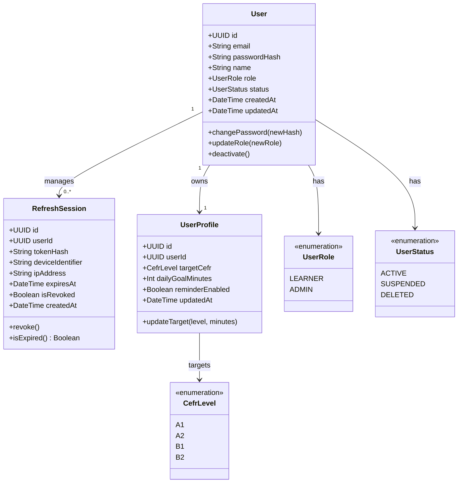
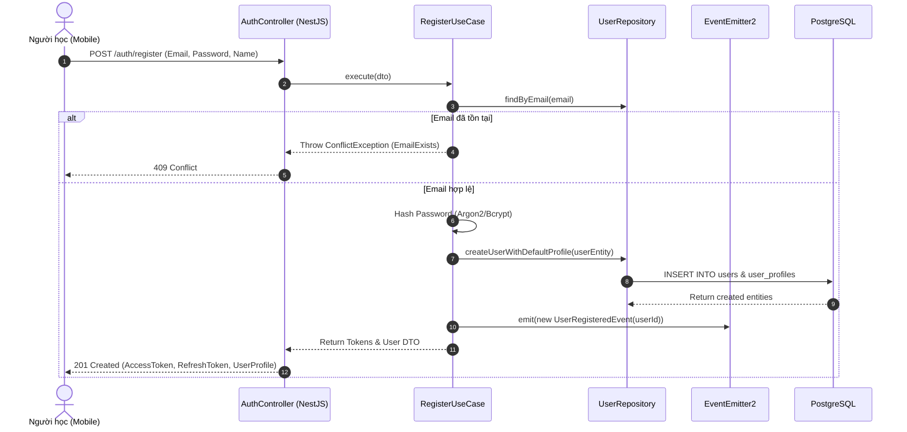
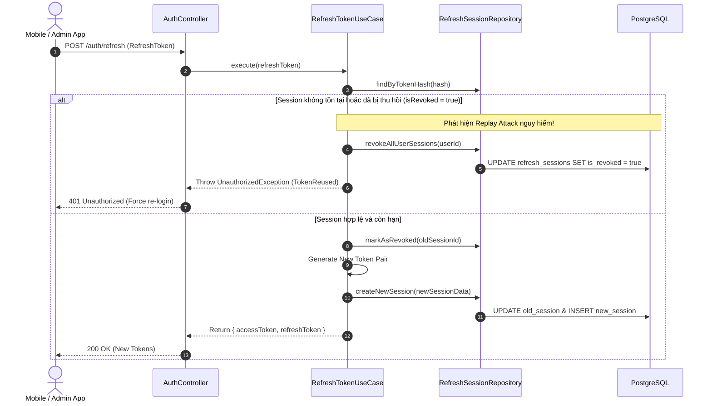

# Domain Specification: 01. Identity & Access Management (IAM)

## Mission

Tài liệu Domain Specification định nghĩa ngôn ngữ thống nhất (Ubiquitous Language), các Aggregate Root, Entity, logic nghiệp vụ cốt lõi, cơ chế bảo mật phiên (Session & Token Rotation) và quản lý hồ sơ người học (Learner Profile) cho phân hệ Identity & Access Management trong hệ sinh thái LingoRoad trên nền tảng **NestJS**.

---

# 1. Domain Overview (Tổng quan phân hệ)

Phân hệ Identity & Access Management (IAM) chịu trách nhiệm quản lý toàn bộ vòng đời danh tính người dùng, kiểm soát truy cập phân quyền dựa trên vai trò (Role-Based Access Control - RBAC), bảo mật xác thực với cơ chế xoay vòng Refresh Token (Token Rotation) và lưu trữ mục tiêu học tập cá nhân hóa.

- **Vấn đề giải quyết**: Đảm bảo định danh người học an toàn, chống giả mạo token, ngăn chặn truy cập trái phép vào các tài nguyên nội dung/quản trị, và duy trì tính nhất quán của trạng thái phiên đăng nhập trên đa thiết bị (Mobile App & Admin Web).
- **Mục tiêu cốt lõi (Core Objectives)**:
  - Cung cấp cơ chế xác thực kép (Access Token ngắn hạn + Refresh Token dài hạn xoay vòng).
  - Phân quyền nghiêm ngặt giữa hai nhóm người dùng chính: `LEARNER` (Người học) và `ADMIN` (Quản trị viên).
  - Quản lý hồ sơ cá nhân hóa (Target CEFR level, Daily study goal, Notification preferences).
  - Cung cấp cơ chế thu hồi phiên tức thời (Session Revocation) khi đổi mật khẩu hoặc đăng xuất toàn bộ.
- **Stack Công nghệ & Tích hợp (Technology Stack & Integrations)**:
  - **Framework**: NestJS (TypeScript) với Clean Architecture / DDD.
  - **Database & ORM**: PostgreSQL qua Prisma ORM.
  - **Caching & Session Store**: Redis (quản lý token blacklist, refresh session lookup & rate limiting).
  - **Cryptography**: `argon2` hoặc `bcrypt` cho băm mật khẩu, `@nestjs/jwt` cho xác thực JWT (RS256/HS256).
  - **Event Dispatcher**: `@nestjs/event-emitter` cho các sự kiện miền nội bộ (e.g. `UserRegisteredEvent`, `PasswordChangedEvent`).

---

# 2. Sub-systems & Feature Breakdown (Các phân hệ con & Phân rã tính năng)

Phân hệ IAM được chia thành 3 phân hệ con chính:

```
                          ┌──────────────────────────────────────────────┐
                          │     Identity & Access Management (IAM)       │
                          └──────────────────────┬───────────────────────┘
                                                 │
            ┌────────────────────────────────────┼────────────────────────────────────┐
            │                                    │                                    │
            ▼                                    ▼                                    ▼
┌────────────────────────┐           ┌────────────────────────┐           ┌────────────────────────┐
│ Authentication &       │           │ Authorization & RBAC   │           │ User Profile &         │
│ Session Management     │           │ Management             │           │ Preferences            │
├────────────────────────┤           ├────────────────────────┤           ├────────────────────────┤
│ • Register / Login     │           │ • Role Guard (Admin vs │           │ • Target CEFR Goal     │
│ • Refresh Token Rotate │           │   Learner)             │           │ • Daily Minutes Target │
│ • Revoke / Logout All  │           │ • Resource Ownership   │           │ • Interface Settings   │
│ • Password Reset/Change│           │ • Sensitive Action Log │           │ • Gamification Baseline│
└────────────────────────┘           └────────────────────────┘           └────────────────────────┘
```

---

# 3. Ubiquitous Language (Ngôn ngữ Thống nhất)

| Thuật ngữ (English) | Thuật ngữ Tiếng Việt | Định nghĩa & Phạm vi sử dụng |
| :--- | :--- | :--- |
| **User (Aggregate Root)** | Người dùng | Thực thể gốc đại diện cho tài khoản định danh trong hệ thống LingoRoad. |
| **Learner** | Người học | Vai trò người dùng chính tham gia học tập, làm bài test và tương tác với lộ trình học. |
| **Admin** | Quản trị viên | Vai trò quản lý nội dung bài học, ngân hàng câu hỏi, và cấu hình hệ thống. |
| **Access Token** | Mã truy cập | JWT có thời hạn ngắn (15 phút), dùng để xác thực quyền gọi các API bảo vệ. |
| **Refresh Session / Token** | Phiên / Mã làm mới | Chuỗi ngẫu nhiên bảo mật lưu trong DB/Redis có thời hạn dài (30 ngày), dùng để cấp Access Token mới theo cơ chế Token Rotation. |
| **Family / Session Rotation** | Cơ chế Xoay vòng Phiên | Kỹ thuật hủy bỏ token cũ và cấp token mới sau mỗi lần làm mới. Nếu phát hiện token cũ bị dùng lại (Replay Attack), toàn bộ Session Family sẽ bị thu hồi. |
| **Target CEFR** | Mục tiêu CEFR | Trình độ khung chuẩn châu Âu mà người học đặt mục tiêu hướng tới (A1, A2, B1, B2). |
| **Daily Goal** | Mục tiêu ngày | Thời gian học mục tiêu mỗi ngày (ví dụ: 10, 15, 30 phút) dùng để tính chuỗi Streak và Quests. |

---

# 4. Architecture Design & Core Decisions (Thiết kế Kiến trúc & Quyết định cốt lõi)

### 4.1. Quyết định 1: Refresh Token Rotation & Replay Attack Prevention
- **Giải pháp**: Mỗi Refresh Token chỉ được sử dụng đúng 1 lần. Khi client gọi endpoint `/auth/refresh`, hệ thống sẽ:
  1. Kiểm tra mã hash của Refresh Token gửi lên có khớp trong bảng `RefreshSession` không.
  2. Nếu token đã từng bị thu hồi hoặc đã bị thay thế trước đó, hệ thống kích hoạt cơ chế phát hiện Replay Attack: lập tức thu hồi toàn bộ các phiên hoạt động của người dùng đó (Revoke all active sessions) và yêu cầu đăng nhập lại.
  3. Nếu hợp lệ, hệ thống tạo cặp Access Token & Refresh Token mới, cập nhật lại phiên trong DB/Redis và trả về cho client.
- **Lý do**: Ngăn ngừa hoàn toàn rủi ro bị chiếm quyền điều khiển tài khoản khi Refresh Token bị lộ qua log mạng hoặc bộ nhớ tạm của thiết bị.

### 4.2. Quyết định 2: Tách biệt Authentication Service và Profile Domain
- **Giải pháp**: Quá trình xác thực (Auth) chỉ phụ thuộc vào `User` credential (`email`, `password_hash`, `role`, `status`). Dữ liệu hồ sơ học tập (`target_cefr`, `daily_goal_minutes`) được quản lý thông qua Aggregate `UserProfile` hoặc liên kết 1-1, cho phép cập nhật cài đặt người dùng mà không cần tái tạo token xác thực.

### 4.3. Quyết định 3: NestJS Guard kết hợp Custom Decorators
- **Giải pháp**: Triển khai `JwtAuthGuard` để trích xuất payload từ Bearer Token, và `RolesGuard` với metadata decorator `@Roles(Role.ADMIN)` để kiểm tra quyền hạn một cách khai báo (declarative) ở tầng Controller.

---

# 5. Domain Model & Entities (Mô hình Miền & Thực thể)

## 5.1 Class Diagram (Mermaid)



## 5.2 Prisma Schema Draft (NestJS Infrastructure)

```prisma
enum UserRole {
  LEARNER
  ADMIN
}

enum UserStatus {
  ACTIVE
  SUSPENDED
  DELETED
}

enum CefrLevel {
  A1
  A2
  B1
  B2
}

model User {
  id           String         @id @default(uuid()) @db.Uuid
  email        String         @unique @db.VarChar(255)
  passwordHash String         @map("password_hash") @db.VarChar(255)
  name         String         @db.VarChar(100)
  role         UserRole       @default(LEARNER)
  status       UserStatus     @default(ACTIVE)
  createdAt    DateTime       @default(now()) @map("created_at")
  updatedAt    DateTime       @updatedAt @map("updated_at")

  profile         UserProfile?
  refreshSessions RefreshSession[]

  @@map("users")
}

model RefreshSession {
  id               String   @id @default(uuid()) @db.Uuid
  userId           String   @map("user_id") @db.Uuid
  tokenHash        String   @unique @map("token_hash") @db.VarChar(255)
  deviceIdentifier String?  @map("device_identifier") @db.VarChar(150)
  ipAddress        String?  @map("ip_address") @db.VarChar(45)
  expiresAt        DateTime @map("expires_at")
  isRevoked        Boolean  @default(false) @map("is_revoked")
  createdAt        DateTime @default(now()) @map("created_at")

  user User @relation(fields: [userId], references: [id], onDelete: Cascade)

  @@index([userId, isRevoked])
  @@map("refresh_sessions")
}

model UserProfile {
  id               String    @id @default(uuid()) @db.Uuid
  userId           String    @unique @map("user_id") @db.Uuid
  targetCefr       CefrLevel @default(B1) @map("target_cefr")
  dailyGoalMinutes Int       @default(15) @map("daily_goal_minutes")
  reminderEnabled  Boolean   @default(true) @map("reminder_enabled")
  updatedAt        DateTime  @updatedAt @map("updated_at")

  user User @relation(fields: [userId], references: [id], onDelete: Cascade)

  @@map("user_profiles")
}
```

---

# 6. Core Workflows (Quy trình Vận hành Cốt lõi)

## 6.1 Quy trình Đăng ký & Khởi tạo Tài khoản



## 6.2 Quy trình Làm mới Token (Refresh Token Rotation)



---

# 7. Business Rules (Quy tắc Nghiệp vụ)

1. **Ràng buộc Mật khẩu (Password Complexity)**:
   - Mật khẩu tối thiểu 8 ký tự, phải bao gồm ít nhất 1 chữ hoa, 1 chữ thường và 1 chữ số.
   - Băm mật khẩu bằng thuật toán an toàn (`Argon2id` hoặc `Bcrypt` với salt factor ≥ 10).
2. **Thời hạn Token (Token Lifespan)**:
   - `Access Token`: 15 phút (chứa `sub: userId`, `role`, `email`).
   - `Refresh Token`: 30 ngày (lưu trữ dưới dạng SHA-256 hash trong database).
3. **Phân quyền và Kiểm soát vai trò (RBAC Invariants)**:
   - Tài khoản có vai trò `ADMIN` được bảo vệ bằng guard server-enforced; người dùng `LEARNER` truy cập bất kỳ route `/admin/*` nào đều phải nhận mã lỗi `403 Forbidden`.
   - Quyền hạn của người dùng được xác thực trên mỗi request thông qua JWT payload; nếu người dùng bị `SUSPENDED` hoặc `DELETED`, phiên làm việc sẽ bị từ chối ngay lập tức thông qua Redis Active User Filter hoặc Database lookup.
4. **Thu hồi phiên khi thay đổi bảo mật (Security Invalidation)**:
   - Khi người dùng thực hiện đổi mật khẩu (`POST /auth/change-password`), toàn bộ `RefreshSession` hiện có của người dùng đó BẮT BUỘC phải được đánh dấu `is_revoked = true`.

---

# 8. Draft API Requirements (Dự thảo Yêu cầu API)

## 8.1 Đăng ký tài khoản (Register)
- **Endpoint**: `POST /auth/register`
- **Request Body**:
  ```json
  {
    "email": "learner@lingoroad.com",
    "password": "SecurePassword123!",
    "name": "Nguyen Van A"
  }
  ```
- **Response**: `201 Created`
  ```json
  {
    "success": true,
    "data": {
      "accessToken": "eyJhbGciOi...",
      "refreshToken": "d8f7e2c1...",
      "user": {
        "id": "c3b9b4a1-8d2a-4b6c-9e22-112233445566",
        "email": "learner@lingoroad.com",
        "name": "Nguyen Van A",
        "role": "LEARNER",
        "profile": {
          "targetCefr": "B1",
          "dailyGoalMinutes": 15
        }
      }
    }
  }
  ```

## 8.2 Đăng nhập (Login)
- **Endpoint**: `POST /auth/login`
- **Request Body**:
  ```json
  {
    "email": "learner@lingoroad.com",
    "password": "SecurePassword123!"
  }
  ```
- **Response**: `200 OK` (Cấu trúc tương tự Register)

## 8.3 Làm mới Access Token (Refresh)
- **Endpoint**: `POST /auth/refresh`
- **Request Body**:
  ```json
  {
    "refreshToken": "d8f7e2c1..."
  }
  ```
- **Response**: `200 OK`
  ```json
  {
    "success": true,
    "data": {
      "accessToken": "eyJhbGciOi...new",
      "refreshToken": "e9a8f3b2...new"
    }
  }
  ```

## 8.4 Cập nhật Hồ sơ & Mục tiêu học tập
- **Endpoint**: `PATCH /auth/me`
- **Headers**: `Authorization: Bearer <accessToken>`
- **Request Body**:
  ```json
  {
    "name": "Nguyen Van A (Updated)",
    "targetCefr": "B2",
    "dailyGoalMinutes": 20,
    "reminderEnabled": true
  }
  ```
- **Response**: `200 OK`

---

# 9. Product Recommendations & Future Improvements

1. **OAuth2 / Social Sign-In**: Tích hợp đăng nhập bằng Google và Apple ID (Sign in with Apple) hỗ trợ xác thực nhanh và tăng tỉ lệ chuyển đổi trên thiết bị di động.
2. **Magic Link / Passwordless Authentication**: Cung cấp tùy chọn đăng nhập không cần mật khẩu qua email OTP để nâng cao trải nghiệm người dùng.
3. **Multi-Factor Authentication (MFA)**: Kích hoạt bảo mật 2 lớp qua TOTP Authenticator dành riêng cho tài khoản có vai trò `ADMIN`.
4. **Device Management UI**: Cho phép người học xem danh sách các thiết bị đang đăng nhập tài khoản của mình và chủ động bấm đăng xuất từ xa từng thiết bị.

# End
