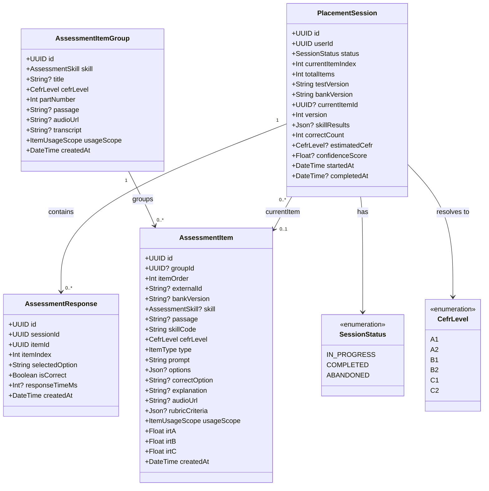
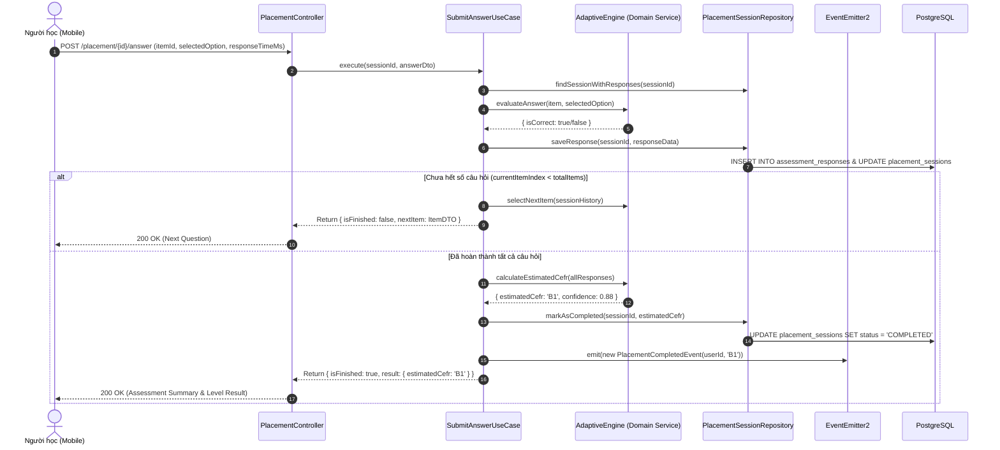

# Domain Specification: 02. Placement & Assessment

## Mission

Tài liệu Domain Specification định nghĩa ngôn ngữ thống nhất (Ubiquitous Language), các Aggregate Root, Entity, quy trình đánh giá trình độ thích ứng (Adaptive Assessment) và thuật toán ước lượng trình độ CEFR tổng thể (A1, A2, B1, B2) cho người học mới trong hệ sinh thái LingoRoad trên nền tảng **NestJS**.

---

# 1. Domain Overview (Tổng quan phân hệ)

Phân hệ Placement & Assessment chịu trách nhiệm khảo sát và xác định trình độ đầu vào của người học, làm tiền đề cốt lõi để hệ thống xây dựng lộ trình học tập cá nhân hóa (Learning Path) và khởi tạo đồ thị năng lực (Mastery Level).

- **Vấn đề giải quyết**: Người học tiếng Anh có trình độ khởi điểm rất đa dạng. Việc bắt đầu từ bài học quá dễ gây nhàm chán, hoặc quá khó gây nản lòng. Phân hệ này cung cấp bài test thích ứng tinh gọn (10 câu hỏi trong chế độ `READING_LISTENING_V1` hiện hành gồm 5 Reading + 5 Listening, hoặc 15 câu hỏi trong luồng UseCase mở rộng) để định vị chính xác năng lực trong thời gian ngắn nhất.
- **Mục tiêu cốt lõi (Core Objectives)**:
  - Cung cấp bài kiểm tra thích ứng ngắn gọn: Dịch vụ đang hoạt động `DemoPlacementService` (`READING_LISTENING_V1`, ngân hàng `demo-v1`) đánh giá 10 câu hỏi chia làm 2 phần kỹ năng (`READING`: 5 câu có đoạn văn `passage`, `LISTENING`: 5 câu có file âm thanh `/media/placement/*.wav`), khởi đầu mỗi kỹ năng ở mức `A2` và chọn câu kế tiếp qua `MlClientService.selectNextCatItem` (kèm `InProcessCatFallback`), song hành cùng bộ UseCase 15 câu (`StartPlacementUseCase`, `SubmitAnswerUseCase`, `CefrScoringService`).
  - Ước lượng chuẩn xác trình độ tổng thể và theo từng kỹ năng theo Khung tham chiếu trình độ ngôn ngữ chung châu Âu (CEFR: A1, A2, B1, B2) thông qua cơ chế chấm điểm `PROVISIONAL_RATIO_V1` lưu kết quả chi tiết vào `skillResults` (JSONB).
  - Khởi tạo điểm thành thạo ban đầu (Initial Mastery Scores) và phát sự kiện `placement.completed` (`PlacementCompletedEvent`) để đồng bộ lộ trình học tập.
  - Đảm bảo tính toàn vẹn và chống gian lận: câu hỏi hiện tại được khóa cứng theo phiên (`currentItemId` và optimistic concurrency `version`), chính sách 1 phiên hoàn thành duy nhất (`409 PLACEMENT_STATE_CONFLICT`), ngăn chặn gửi lại đáp án sai lệch và hỗ trợ xem lại bài làm (`GET /placement/:sessionId/review`) chỉ tiết lộ đáp án sau khi `COMPLETED`.
- **Stack Công nghệ & Tích hợp (Technology Stack & Integrations)**:
  - **Framework**: NestJS (TypeScript) với Clean Architecture / DDD (`DemoPlacementService` & UseCases).
  - **Database & ORM**: PostgreSQL qua Prisma ORM (với khóa dòng `SELECT ... FOR UPDATE` khi khởi tạo và kiểm soát đồng thời bằng `version`).
  - **Assessment Engine**: Python FastAPI ML Microservice (`POST /cat/select`) với thuật toán 3PL EAP IRT và Fisher Information; tích hợp cơ chế `InProcessCatFallback` trong NestJS khi ML service offline.
  - **ML Client**: `MlClientService` (`@nestjs/axios`) với xác thực `x-internal-token`.
  - **Event Dispatcher**: `@nestjs/event-emitter` (phát sự kiện `placement.completed` với `PlacementCompletedEvent` để kích hoạt khởi tạo Learning Path).

---

# 2. Sub-systems & Feature Breakdown (Các phân hệ con & Phân rã tính năng)

```
                       ┌──────────────────────────────────────────────┐
                       │           Placement & Assessment             │
                       └──────────────────────┬───────────────────────┘
                                              │
         ┌────────────────────────────────────┼────────────────────────────────────┐
         │                                    │                                    │
         ▼                                    ▼                                    ▼
┌────────────────────────┐        ┌────────────────────────┐        ┌────────────────────────┐
│ Test Session Engine    │        │ CEFR Scoring & IRT     │        │ Initial Baseline Setup │
├────────────────────────┤        ├────────────────────────┤        ├────────────────────────┤
│ • Start Assessment     │        │ • Realtime Response    │        │ • Skill Mastery Seeding│
│ • Adaptive Item Curation│       │   Evaluation           │        │ • Path Generation Event│
│ • State Persistence    │        │ • CEFR Cutoff Mapping  │        │ • Diagnostic Summary   │
│ • Timeout / Abandonment│        │ • Confidence Score     │        │ • Assessment History   │
└────────────────────────┘        └────────────────────────┘        └────────────────────────┘
```

---

# 3. Ubiquitous Language (Ngôn ngữ Thống nhất)

| Thuật ngữ (English) | Thuật ngữ Tiếng Việt | Định nghĩa & Phạm vi sử dụng |
| :--- | :--- | :--- |
| **Placement Session (Aggregate Root)** | Phiên Kiểm tra Đầu vào | Phiên làm việc duy nhất ghi nhận toàn bộ quá trình làm bài kiểm tra đầu vào của một người học. |
| **Assessment Item** | Câu hỏi Đánh giá | Câu hỏi trắc nghiệm/điền từ được gán nhãn độ khó theo thang CEFR (A1–B2) và thuộc tính phân biệt. |
| **Adaptive Sequencing** | Điều phối Thích ứng | Cơ chế chọn câu hỏi tiếp theo dựa trên độ chính xác của các câu trả lời trước đó nhằm thu hẹp khoảng tin cậy trình độ. |
| **Estimated CEFR** | Trình độ CEFR Ước lượng | Kết quả cấp độ ngoại ngữ cuối cùng của bài test (A1, A2, B1, hoặc B2). |
| **Placement State** | Trạng thái Đánh giá | Trạng thái hiện tại của người học: `NOT_STARTED`, `IN_PROGRESS`, hoặc `COMPLETED`. |
| **Initial Mastery Seed** | Hạt giống Năng lực Đầu vào | Điểm số năng lực ban đầu (0.0 → 1.0) được gán cho các kỹ năng trong cây tri thức dựa trên kết quả bài test. |

---

# 4. Architecture Design & Core Decisions (Thiết kế Kiến trúc & Quyết định cốt lõi)

### 4.1. Quyết định 1: Session-Bound Test Item Delivery & Per-Skill CAT Selection
- **Giải pháp**: Client không nhận toàn bộ danh sách câu hỏi ngay từ đầu. Thay vào đó:
  1. Khi người học bấm bắt đầu (`POST /placement/start`), `DemoPlacementService` kiểm tra phiên `IN_PROGRESS` (nếu có thì khôi phục trạng thái câu hiện tại) hoặc kiểm tra phiên `COMPLETED` (nếu đã hoàn thành thì trả về `409 PLACEMENT_STATE_CONFLICT`). Khi tạo mới, hệ thống khóa dòng user (`SELECT id FROM users WHERE id = ... FOR UPDATE`), chọn câu hỏi đầu tiên ở cấp độ `A2` của phần `READING` từ ngân hàng `demo-v1`, và lưu `currentItemId` vào `PlacementSession`.
  2. Bài kiểm tra `READING_LISTENING_V1` gồm 10 câu chia làm 2 phần: câu 0–4 là `READING` (5 câu) và câu 5–9 là `LISTENING` (5 câu). Câu đầu tiên của mỗi kỹ năng luôn được lọc ở mức `A2`; các câu tiếp theo trong cùng kỹ năng được chọn thích ứng qua `MlClientService.selectNextCatItem` (3PL IRT EAP + Maximum Fisher Information, có `InProcessCatFallback`).
  3. Đáp án đúng (`correctOption`) và lời giải thích (`explanation`) tuyệt đối KHÔNG được gửi về client khi phiên đang `IN_PROGRESS`.

### 4.2. Quyết định 2: Đảm bảo tính Bất biến, Optimistic Locking & Xử lý Idempotency
- **Giải pháp**:
  - Mỗi câu trả lời đi kèm `itemId` và `itemIndex`. Nếu client gửi lại đúng cặp `(itemId, itemIndex, selectedOption)` đã ghi nhận trong `AssessmentResponse`, server trả về kết quả idempotent hiện tại mà không chấm lại. Nếu gửi trùng `itemId` hoặc `itemIndex` nhưng khác thông số, hoặc không khớp với `(currentItemId, currentItemIndex)` của phiên, hệ thống ném lỗi `409 PLACEMENT_STATE_CONFLICT`.
  - Cập nhật trạng thái phiên sử dụng optimistic locking qua trường `version` (`updateMany` với điều kiện `version: session.version, currentItemId: item.id, currentItemIndex: dto.itemIndex`).

### 4.3. Quyết định 3: Chấm điểm Provisional (`PROVISIONAL_RATIO_V1`) & Event-Driven Triggering
- **Giải pháp**: Khi hoàn thành câu thứ 10 (`nextIndex === totalItems`), `DemoPlacementService` tính trình độ `estimatedCefr` tổng thể và từng kỹ năng (`skillResults` JSONB: `reading`, `listening` ở trạng thái `PROVISIONAL`, `speaking`, `writing` ở trạng thái `NOT_ASSESSED`), đồng thời phát sự kiện `placement.completed` (`PlacementCompletedEvent`).

---

# 5. Domain Model & Entities (Mô hình Miền & Thực thể)

## 5.1 Class Diagram (Mermaid)



## 5.2 Prisma Schema (NestJS Infrastructure)

```prisma
enum AssessmentSkill {
  READING
  LISTENING
  WRITING
  SPEAKING
}

enum SessionStatus {
  IN_PROGRESS
  COMPLETED
  ABANDONED
}

enum ItemType {
  MULTIPLE_CHOICE
  CLOZE
  SENTENCE_REORDER
  MATCHING
  GAP_FILL
  ESSAY
  SPEAKING_PROMPT
}

enum ItemUsageScope {
  PLACEMENT
  MOCK_EXAM
  PRACTICE
  ALL
}

model PlacementSession {
  id               String        @id @default(uuid()) @db.Uuid
  userId           String        @map("user_id") @db.Uuid
  status           SessionStatus @default(IN_PROGRESS)
  currentItemIndex Int           @default(0) @map("current_item_index")
  totalItems       Int           @default(10) @map("total_items")
  testVersion      String        @default("READING_LISTENING_V1") @map("test_version")
  bankVersion      String        @default("demo-v1") @map("bank_version")
  currentItemId    String?       @map("current_item_id") @db.Uuid
  version          Int           @default(0)
  skillResults     Json?         @map("skill_results") @db.JsonB
  correctCount     Int           @default(0) @map("correct_count")
  estimatedCefr    CefrLevel?    @map("estimated_cefr")
  confidenceScore  Float?        @map("confidence_score")
  startedAt        DateTime      @default(now()) @map("started_at")
  completedAt      DateTime?     @map("completed_at")

  responses   AssessmentResponse[]
  user        User                 @relation(fields: [userId], references: [id], onDelete: Cascade)
  currentItem AssessmentItem?      @relation(fields: [currentItemId], references: [id], onDelete: Restrict)

  @@index([userId, status])
  @@map("placement_sessions")
}

model AssessmentItemGroup {
  id          String           @id @default(uuid()) @db.Uuid
  skill       AssessmentSkill
  title       String?          @db.VarChar(200)
  cefrLevel   CefrLevel        @map("cefr_level")
  partNumber  Int              @map("part_number")
  passage     String?          @db.Text
  audioUrl    String?          @map("audio_url") @db.VarChar(500)
  transcript  String?          @db.Text
  usageScope  ItemUsageScope   @default(ALL) @map("usage_scope")
  createdAt   DateTime         @default(now()) @map("created_at")
  items       AssessmentItem[]

  @@index([skill, cefrLevel])
  @@index([usageScope, skill, cefrLevel])
  @@map("assessment_item_groups")
}

model AssessmentItem {
  id              String               @id @default(uuid()) @db.Uuid
  groupId         String?              @map("group_id") @db.Uuid
  itemOrder       Int                  @default(1) @map("item_order")
  group           AssessmentItemGroup? @relation(fields: [groupId], references: [id], onDelete: SetNull)
  externalId      String?              @unique @map("external_id") @db.VarChar(100)
  bankVersion     String?              @map("bank_version") @db.VarChar(100)
  skill           AssessmentSkill?
  passage         String?              @db.Text
  skillCode       String               @map("skill_code") @db.VarChar(100)
  cefrLevel       CefrLevel            @map("cefr_level")
  type            ItemType             @default(MULTIPLE_CHOICE)
  prompt          String               @db.Text
  options         Json?                @db.JsonB
  correctOption   String?              @map("correct_option") @db.Text
  explanation     String?              @db.Text
  audioUrl        String?              @map("audio_url") @db.VarChar(500)
  rubricCriteria  Json?                @map("rubric_criteria") @db.JsonB
  usageScope      ItemUsageScope       @default(ALL) @map("usage_scope")
  irtA            Float                @default(1.0) @map("irt_a")
  irtB            Float                @default(0.0) @map("irt_b")
  irtC            Float                @default(0.25) @map("irt_c")
  createdAt       DateTime             @default(now()) @map("created_at")
  responses       AssessmentResponse[]
  currentSessions PlacementSession[]

  @@index([groupId])
  @@index([usageScope, skill, cefrLevel])
  @@index([skillCode, cefrLevel])
  @@index([cefrLevel])
  @@index([bankVersion, skill])
  @@index([skill, cefrLevel])
  @@map("assessment_items")
}

model AssessmentResponse {
  id             String           @id @default(uuid()) @db.Uuid
  sessionId      String           @map("session_id") @db.Uuid
  itemId         String           @map("item_id") @db.Uuid
  itemIndex      Int              @map("item_index")
  selectedOption String           @map("selected_option") @db.VarChar(500)
  isCorrect      Boolean          @map("is_correct")
  responseTimeMs Int?             @map("response_time_ms")
  createdAt      DateTime         @default(now()) @map("created_at")

  session PlacementSession @relation(fields: [sessionId], references: [id], onDelete: Cascade)
  item    AssessmentItem   @relation(fields: [itemId], references: [id], onDelete: Restrict)

  @@unique([sessionId, itemIndex])
  @@unique([sessionId, itemId])
  @@map("assessment_responses")
}
```

---

# 6. Core Workflows (Quy trình Vận hành Cốt lõi)

## 6.1 Quy trình Làm bài Kiểm tra Đầu vào Thích ứng (Adaptive Test Flow)



---

# 7. Business Rules (Quy tắc Nghiệp vụ)

1. **Quy tắc Một phiên Hoạt động & Một phiên Hoàn thành (Single Active & Completed Session Policy)**:
   - Một người học chỉ có tối đa 1 phiên kiểm tra ở trạng thái `IN_PROGRESS`. Khi gọi `POST /placement/start`, nếu đã có phiên `IN_PROGRESS`, hệ thống trả về trạng thái của phiên đó để tiếp tục làm bài.
   - Nếu người học đã có phiên `COMPLETED`, việc gọi `POST /placement/start` sẽ bị từ chối với lỗi `409 Conflict` (`PLACEMENT_STATE_CONFLICT`).
2. **Quy tắc Cố định Kết quả (Immutability of Completed Tests)**:
   - Khi bài test đã hoàn thành (`status = 'COMPLETED'`), kết quả `estimatedCefr` và `skillResults` không thể bị ghi đè hay thay đổi bởi bất kỳ request nộp bài nào thêm.
3. **Thang điểm Ước lượng CEFR (`PROVISIONAL_RATIO_V1` & `CefrScoringService`)**:
   - Trong `DemoPlacementService` (`PROVISIONAL_RATIO_V1`, 10 câu = 5 Reading + 5 Listening), tỷ lệ đúng `ratio = correct / total` (áp dụng cho cả điểm tổng và từng phần kỹ năng):
     - **A1**: `ratio < 0.40`
     - **A2**: `0.40 ≤ ratio < 0.65`
     - **B1**: `0.65 ≤ ratio < 0.85`
     - **B2**: `ratio ≥ 0.85`
   - Trong `CefrScoringService` (weighted scoring theo trọng số cấp độ A1=1.0, A2=1.5, B1=2.2, B2=3.0), quy đổi tỷ lệ điểm trọng số sang A1/A2/B1/B2 kèm `confidenceScore`.
4. **Không tiết lộ Đáp án đúng khi đang làm bài (Zero Solution Leakage)**:
   - API trả về câu hỏi chỉ bao gồm: `id`, `index`, `type`, `prompt`, `passage`, `options: string[]`, `mediaUrl`, `skill`, `sectionIndex`, `sectionTotal`. Tuyệt đối không kèm trường `correctOption` hay `explanation` khi phiên đang `IN_PROGRESS`.

---

# 8. API Specification (Đặc tả API Hiện hành)

## 8.1 Kiểm tra trạng thái Placement của người học
- **Endpoint**: `GET /placement/status`
- **Headers**: `Authorization: Bearer <token>`
- **Response**: `200 OK`
  ```json
  {
    "success": true,
    "data": {
      "hasCompleted": false,
      "currentSessionId": "7e2a91f4-3d12-4c22-b5e8-8a9d12345678",
      "status": "IN_PROGRESS",
      "currentIndex": 4,
      "totalItems": 10
    }
  }
  ```

## 8.2 Bắt đầu hoặc Tiếp tục phiên kiểm tra (Start Placement)
- **Endpoint**: `POST /placement/start`
- **Headers**: `Authorization: Bearer <token>`
- **Response**: `201 Created`
  ```json
  {
    "success": true,
    "message": "Khởi tạo phiên kiểm tra thành công",
    "data": {
      "sessionId": "7e2a91f4-3d12-4c22-b5e8-8a9d12345678",
      "totalItems": 10,
      "currentIndex": 0,
      "currentSkill": "READING",
      "sectionIndex": 0,
      "sectionTotal": 5,
      "firstItem": {
        "id": "e1f2a3b4-1111-2222-3333-444455556666",
        "index": 0,
        "type": "MULTIPLE_CHOICE",
        "prompt": "What is the main purpose of the notice?",
        "passage": "The library will close at 5 PM this Friday for system maintenance.",
        "options": [
          "To announce early closing hours",
          "To hire new library staff",
          "To advertise new books",
          "To change library membership fees"
        ],
        "mediaUrl": null,
        "skill": "READING",
        "sectionIndex": 0,
        "sectionTotal": 5
      }
    }
  }
  ```

## 8.3 Nộp câu trả lời & Nhận câu tiếp theo (Submit Answer)
- **Endpoint**: `POST /placement/{sessionId}/answer`
- **Headers**: `Authorization: Bearer <token>`
- **Request Body**:
  ```json
  {
    "itemId": "e1f2a3b4-1111-2222-3333-444455556666",
    "itemIndex": 0,
    "selectedOption": "To announce early closing hours",
    "responseTimeMs": 4200
  }
  ```
- **Response**: `200 OK`
  ```json
  {
    "success": true,
    "data": {
      "isFinished": false,
      "nextItem": {
        "id": "f2a3b4c5-2222-3333-4444-555566667777",
        "index": 1,
        "type": "MULTIPLE_CHOICE",
        "prompt": "According to the email, when does the meeting start?",
        "passage": "Dear team, please note our Monday meeting is moved to 10:30 AM.",
        "options": ["9:00 AM", "10:00 AM", "10:30 AM", "11:00 AM"],
        "mediaUrl": null,
        "skill": "READING",
        "sectionIndex": 1,
        "sectionTotal": 5
      },
      "result": null
    }
  }
  ```

## 8.4 Xem kết quả kiểm tra (Get Result)
- **Endpoint**: `GET /placement/{sessionId}/result`
- **Headers**: `Authorization: Bearer <token>`
- **Response**: `200 OK`
  ```json
  {
    "success": true,
    "data": {
      "sessionId": "7e2a91f4-3d12-4c22-b5e8-8a9d12345678",
      "estimatedCefr": "B1",
      "confidenceScore": null,
      "completionRate": 1,
      "resultStatus": "PROVISIONAL",
      "scoringMethod": "PROVISIONAL_RATIO_V1",
      "correctCount": 7,
      "totalItems": 10,
      "completedAt": "2026-10-06T09:00:00.000Z",
      "skills": {
        "reading": {
          "estimatedCefr": "B1",
          "correctCount": 4,
          "totalItems": 5,
          "status": "PROVISIONAL"
        },
        "listening": {
          "estimatedCefr": "A2",
          "correctCount": 3,
          "totalItems": 5,
          "status": "PROVISIONAL"
        },
        "speaking": {
          "estimatedCefr": null,
          "status": "NOT_ASSESSED"
        },
        "writing": {
          "estimatedCefr": null,
          "status": "NOT_ASSESSED"
        }
      }
    }
  }
  ```

## 8.5 Xem lại chi tiết các câu đã trả lời (Review Session)
- **Endpoint**: `GET /placement/{sessionId}/review`
- **Headers**: `Authorization: Bearer <token>`
- **Hành vi**: Trả về danh sách các câu đã trả lời trong phiên kèm `selectedOption`. Chỉ khi `status === 'COMPLETED'`, hệ thống mới trả thêm `isCorrect`, `correctOption` và `explanation`.
- **Response**: `200 OK`
  ```json
  {
    "success": true,
    "data": {
      "sessionId": "7e2a91f4-3d12-4c22-b5e8-8a9d12345678",
      "status": "COMPLETED",
      "items": [
        {
          "id": "e1f2a3b4-1111-2222-3333-444455556666",
          "index": 0,
          "type": "MULTIPLE_CHOICE",
          "prompt": "What is the main purpose of the notice?",
          "passage": "The library will close at 5 PM this Friday for system maintenance.",
          "options": [
            "To announce early closing hours",
            "To hire new library staff",
            "To advertise new books",
            "To change library membership fees"
          ],
          "mediaUrl": null,
          "skill": "READING",
          "sectionIndex": 0,
          "sectionTotal": 5,
          "selectedOption": "To announce early closing hours",
          "isCorrect": true,
          "correctOption": "To announce early closing hours",
          "explanation": "The notice explicitly states the library will close at 5 PM for maintenance."
        }
      ]
    }
  }
  ```

---

# 9. Product Recommendations & Future Improvements

1. **Computerized Adaptive Testing (CAT) với 2PL/3PL IRT Model**: Nâng cấp thuật toán chọn câu hỏi dựa trên hàm thông tin mục vị (Item Information Function - IIF) của lý thuyết ứng đáp câu hỏi (Item Response Theory).
2. **Kỹ năng Nghe & Phát âm trong Placement**: Bổ sung 2–3 câu hỏi nghe ngắn (Short Listening Comprehension) để tăng độ chuẩn xác phân loại cấp độ B1–B2.
3. **Retake Assessment Policy**: Cho phép người học kiểm tra lại định kỳ sau mỗi 30–60 ngày hoặc sau khi hoàn thành 80% lộ trình của cấp độ hiện tại để đo lường độ tiến bộ.

# End
