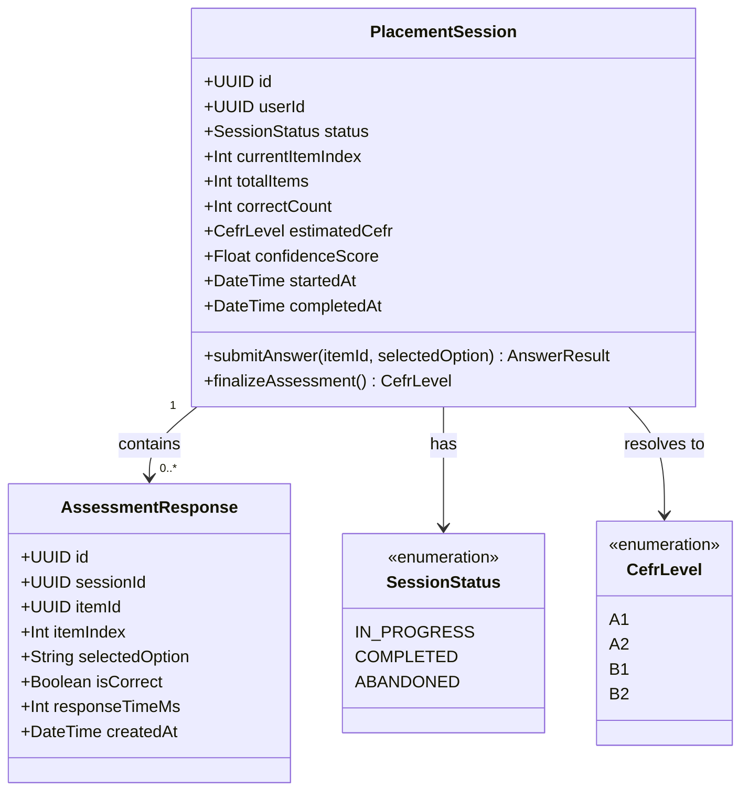
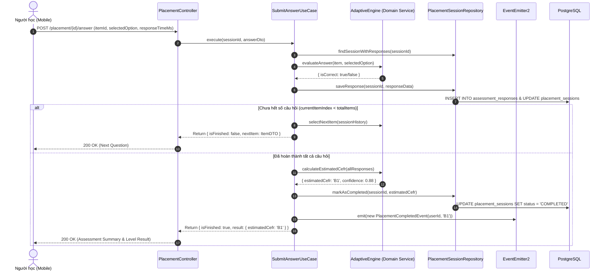

# Domain Specification: 02. Placement & Assessment

## Mission

Tài liệu Domain Specification định nghĩa ngôn ngữ thống nhất (Ubiquitous Language), các Aggregate Root, Entity, quy trình đánh giá trình độ thích ứng (Adaptive Assessment) và thuật toán ước lượng trình độ CEFR tổng thể (A1, A2, B1, B2) cho người học mới trong hệ sinh thái LingoRoad trên nền tảng **NestJS**.

---

# 1. Domain Overview (Tổng quan phân hệ)

Phân hệ Placement & Assessment chịu trách nhiệm khảo sát và xác định trình độ đầu vào của người học, làm tiền đề cốt lõi để hệ thống xây dựng lộ trình học tập cá nhân hóa (Learning Path) và khởi tạo đồ thị năng lực (Mastery Level).

- **Vấn đề giải quyết**: Người học tiếng Anh có trình độ khởi điểm rất đa dạng. Việc bắt đầu từ bài học quá dễ gây nhàm chán, hoặc quá khó gây nản lòng. Phân hệ này cung cấp bài test tinh gọn (15–20 câu hỏi) để định vị chính xác năng lực trong thời gian ngắn nhất.
- **Mục tiêu cốt lõi (Core Objectives)**:
  - Cung cấp bài kiểm tra thích ứng ngắn gọn, đánh giá toàn diện các kỹ năng ngữ pháp, từ vựng và đọc hiểu cơ bản.
  - Ước lượng chuẩn xác trình độ tổng thể theo Khung tham chiếu trình độ ngôn ngữ chung châu Âu (CEFR: A1, A2, B1, B2).
  - Khởi tạo điểm thành thạo ban đầu (Initial Mastery Scores) cho các nút kỹ năng trong Knowledge Graph.
  - Đảm bảo tính toàn vẹn và chống gian lận: câu hỏi được cấp theo phiên (Session-bound), ngăn chặn việc gửi lại đáp án hai lần (Idempotent answer grading).
- **Stack Công nghệ & Tích hợp (Technology Stack & Integrations)**:
  - **Framework**: NestJS (TypeScript) với Clean Architecture / DDD.
  - **Database & ORM**: PostgreSQL qua Prisma ORM.
  - **Caching / Session Buffer**: Redis (lưu session state tạm thời để phản hồi nhanh chóng).
  - **Assessment Engine**: Python FastAPI ML Microservice (`POST /cat/select`) với thuật toán 3PL EAP IRT và Fisher Information; tích hợp cơ chế `InProcessCatFallback` trong NestJS Domain Service khi ML service offline.
  - **ML Client**: `MlClientService` (`@nestjs/axios`) với xác thực `x-internal-token`.
  - **Event Dispatcher**: `@nestjs/event-emitter` (phát sự kiện `PlacementCompletedEvent` để kích hoạt khởi tạo Learning Path và Gamification Bonus).

---

# 2. Sub-systems & Feature Breakdown (Các phân hệ con & Phân rã tính năng)

```
                       ┌──────────────────────────────────────────────┐
                       │           Placement & Assessment             │
                       └──────────────────────┬───────────────────────┘
                                              │
         ┌────────────────────────────────────┼────────────────────────────────────┐
         │                                    │                                    │
         ▼                                    ▼                                    ▼
┌────────────────────────┐        ┌────────────────────────┐        ┌────────────────────────┐
│ Test Session Engine    │        │ CEFR Scoring & IRT     │        │ Initial Baseline Setup │
├────────────────────────┤        ├────────────────────────┤        ├────────────────────────┤
│ • Start Assessment     │        │ • Realtime Response    │        │ • Skill Mastery Seeding│
│ • Adaptive Item Curation│       │   Evaluation           │        │ • Path Generation Event│
│ • State Persistence    │        │ • CEFR Cutoff Mapping  │        │ • Diagnostic Summary   │
│ • Timeout / Abandonment│        │ • Confidence Score     │        │ • Assessment History   │
└────────────────────────┘        └────────────────────────┘        └────────────────────────┘
```

---

# 3. Ubiquitous Language (Ngôn ngữ Thống nhất)

| Thuật ngữ (English) | Thuật ngữ Tiếng Việt | Định nghĩa & Phạm vi sử dụng |
| :--- | :--- | :--- |
| **Placement Session (Aggregate Root)** | Phiên Kiểm tra Đầu vào | Phiên làm việc duy nhất ghi nhận toàn bộ quá trình làm bài kiểm tra đầu vào của một người học. |
| **Assessment Item** | Câu hỏi Đánh giá | Câu hỏi trắc nghiệm/điền từ được gán nhãn độ khó theo thang CEFR (A1–B2) và thuộc tính phân biệt. |
| **Adaptive Sequencing** | Điều phối Thích ứng | Cơ chế chọn câu hỏi tiếp theo dựa trên độ chính xác của các câu trả lời trước đó nhằm thu hẹp khoảng tin cậy trình độ. |
| **Estimated CEFR** | Trình độ CEFR Ước lượng | Kết quả cấp độ ngoại ngữ cuối cùng của bài test (A1, A2, B1, hoặc B2). |
| **Placement State** | Trạng thái Đánh giá | Trạng thái hiện tại của người học: `NOT_STARTED`, `IN_PROGRESS`, hoặc `COMPLETED`. |
| **Initial Mastery Seed** | Hạt giống Năng lực Đầu vào | Điểm số năng lực ban đầu (0.0 → 1.0) được gán cho các kỹ năng trong cây tri thức dựa trên kết quả bài test. |

---

# 4. Architecture Design & Core Decisions (Thiết kế Kiến trúc & Quyết định cốt lõi)

### 4.1. Quyết định 1: Session-Bound Test Item Delivery (Không lộ ngân hàng câu hỏi)
- **Giải pháp**: Client không nhận toàn bộ danh sách câu hỏi ngay từ đầu. Thay vào đó:
  1. Khi người học bấm bắt đầu (`POST /placement/start`), hệ thống tạo một `PlacementSession` và chỉ trả về câu hỏi đầu tiên.
  2. Mỗi lần người học nộp câu trả lời (`POST /placement/{id}/answer`), server chấm điểm độc lập, lưu trạng thái và trả về câu hỏi kế tiếp theo thuật toán thích ứng.
  3. Đáp án đúng tuyệt đối KHÔNG được gửi về client trong quá trình làm bài test để chống inspect network hoặc sửa đổi dữ liệu trên thiết bị.
- **Lý do**: Đảm bảo tính công bằng, bảo mật ngân hàng câu hỏi và phục vụ thuật toán thích ứng (Adaptive Testing).

### 4.2. Quyết định 2: Đảm bảo tính Bất biến & Xử lý Idempotency
- **Giải pháp**: Mỗi câu trả lời đi kèm `item_index` hoặc `operation_id`. Nếu request bị gửi lại do mạng chập chờn, server kiểm tra và trả về kết quả đã ghi nhận thay vì cộng điểm hay chuyển câu hai lần.

### 4.3. Quyết định 3: Event-Driven Initial Path Triggering
- **Giải pháp**: Khi hoàn thành bài test (`is_completed = true`), `PlacementService` phát ra domain event `PlacementCompletedEvent` chứa `{ userId, estimatedCefr, score }`. Các domain khác (Learning Path, Mastery, Gamification) lắng nghe sự kiện này để tự động thiết lập lộ trình học mà không làm tắc nghẽn HTTP response.

---

# 5. Domain Model & Entities (Mô hình Miền & Thực thể)

## 5.1 Class Diagram (Mermaid)



## 5.2 Prisma Schema Draft (NestJS Infrastructure)

```prisma
enum SessionStatus {
  IN_PROGRESS
  COMPLETED
  ABANDONED
}

enum CefrLevel {
  A1
  A2
  B1
  B2
}

model PlacementSession {
  id              String        @id @default(uuid()) @db.Uuid
  userId          String        @map("user_id") @db.Uuid
  status          SessionStatus @default(IN_PROGRESS)
  currentItemIndex Int          @default(0) @map("current_item_index")
  totalItems      Int           @default(15) @map("total_items")
  correctCount    Int           @default(0) @map("correct_count")
  estimatedCefr   CefrLevel?    @map("estimated_cefr")
  confidenceScore Float?        @map("confidence_score")
  startedAt       DateTime      @default(now()) @map("started_at")
  completedAt     DateTime?     @map("completed_at")

  responses       AssessmentResponse[]

  user            User          @relation(fields: [userId], references: [id], onDelete: Cascade)

  @@index([userId, status])
  @@map("placement_sessions")
}

model AssessmentItem {
  id            String    @id @default(uuid()) @db.Uuid
  skillCode     String    @map("skill_code") @db.VarChar(100)
  cefrLevel     CefrLevel @map("cefr_level")
  type          ItemType  @default(MULTIPLE_CHOICE)
  prompt        String    @db.Text
  options       Json      @db.JsonB
  correctOption String    @map("correct_option") @db.Text
  explanation   String?   @db.Text
  audioUrl      String?   @map("audio_url") @db.VarChar(500)
  irtA          Float     @default(1.0) @map("irt_a")
  irtB          Float     @default(0.0) @map("irt_b")
  irtC          Float     @default(0.25) @map("irt_c")
  createdAt     DateTime  @default(now()) @map("created_at")

  responses     AssessmentResponse[]

  @@index([skillCode, cefrLevel])
  @@index([cefrLevel])
  @@map("assessment_items")
}

model AssessmentResponse {
  id             String           @id @default(uuid()) @db.Uuid
  sessionId      String           @map("session_id") @db.Uuid
  itemId         String           @map("item_id") @db.Uuid
  itemIndex      Int              @map("item_index")
  selectedOption String           @map("selected_option") @db.VarChar(500)
  isCorrect      Boolean          @map("is_correct")
  responseTimeMs Int?             @map("response_time_ms")
  createdAt      DateTime         @default(now()) @map("created_at")

  session        PlacementSession @relation(fields: [sessionId], references: [id], onDelete: Cascade)
  item           AssessmentItem   @relation(fields: [itemId], references: [id], onDelete: Restrict)

  @@unique([sessionId, itemIndex])
  @@map("assessment_responses")
}
```

---

# 6. Core Workflows (Quy trình Vận hành Cốt lõi)

## 6.1 Quy trình Làm bài Kiểm tra Đầu vào Thích ứng (Adaptive Test Flow)



---

# 7. Business Rules (Quy tắc Nghiệp vụ)

1. **Quy tắc Một phiên Hoạt động (Single Active Session)**:
   - Một người học chỉ có tối đa 1 phiên kiểm tra ở trạng thái `IN_PROGRESS`. Khi bắt đầu bài test mới, nếu đã có phiên dở dang, hệ thống sẽ trả về trạng thái của phiên đó để tiếp tục làm bài.
2. **Quy tắc Cố định Kết quả (Immutability of Completed Tests)**:
   - Khi bài test đã hoàn thành (`status = 'COMPLETED'`), kết quả `estimatedCefr` không thể bị ghi đè hay thay đổi bởi bất kỳ request nộp bài nào thêm.
3. **Thang điểm Ước lượng CEFR (CEFR Cutoff Rules)**:
   - Tỷ lệ đúng trên độ khó A1: Tỷ lệ đạt ≥ 75% → Thử thách câu hỏi cấp A2.
   - Trình độ phân định:
     - **A1**: Điểm quy đổi năng lực < 40% chuẩn A2.
     - **A2**: Năng lực đạt 40% → 65% trên ngân hàng A2/B1.
     - **B1**: Năng lực đạt 65% → 85% trên ngân hàng B1.
     - **B2**: Năng lực đạt ≥ 85% trên ngân hàng câu hỏi B1/B2.
4. **Không tiết lộ Đáp án đúng (Zero Solution Leakage)**:
   - API trả về câu hỏi chỉ bao gồm: `id`, `prompt`, `type`, `options: string[]`, `audioUrl` (nếu có). Tuyệt đối không kèm trường `correctOption` hay `explanation`.

---

# 8. Draft API Requirements (Dự thảo Yêu cầu API)

## 8.1 Kiểm tra trạng thái Placement của người học
- **Endpoint**: `GET /placement/status`
- **Headers**: `Authorization: Bearer <accessToken>`
- **Response**: `200 OK`
  ```json
  {
    "success": true,
    "data": {
      "hasCompleted": false,
      "currentSessionId": "7e2a91f4-3d12-4c22-b5e8-8a9d12345678",
      "status": "IN_PROGRESS",
      "currentIndex": 4,
      "totalItems": 15
    }
  }
  ```

## 8.2 Bắt đầu phiên kiểm tra mới (Start Placement)
- **Endpoint**: `POST /placement/start`
- **Headers**: `Authorization: Bearer <accessToken>`
- **Response**: `201 Created`
  ```json
  {
    "success": true,
    "data": {
      "sessionId": "7e2a91f4-3d12-4c22-b5e8-8a9d12345678",
      "totalItems": 15,
      "firstItem": {
        "id": "e1f2a3b4-1111-2222-3333-444455556666",
        "index": 0,
        "type": "MULTIPLE_CHOICE",
        "prompt": "Choose the correct sentence to complete the conversation.",
        "options": ["She don't like tea", "She doesn't likes tea", "She doesn't like tea", "She no like tea"],
        "mediaUrl": null
      }
    }
  }
  ```

## 8.3 Nộp câu trả lời & Nhận câu tiếp theo (Submit Answer)
- **Endpoint**: `POST /placement/{sessionId}/answer`
- **Headers**: `Authorization: Bearer <accessToken>`
- **Request Body**:
  ```json
  {
    "itemId": "e1f2a3b4-1111-2222-3333-444455556666",
    "itemIndex": 0,
    "selectedOption": "She doesn't like tea",
    "responseTimeMs": 4200
  }
  ```
- **Response**: `200 OK`
  ```json
  {
    "success": true,
    "data": {
      "isFinished": false,
      "nextItem": {
        "id": "f2a3b4c5-2222-3333-4444-555566667777",
        "index": 1,
        "type": "CLOZE",
        "prompt": "Fill in the blank: Yesterday, I ___ to the cinema with my friend.",
        "options": ["go", "went", "gone", "going"],
        "mediaUrl": null
      }
    }
  }
  ```

## 8.4 Xem kết quả kiểm tra (Get Result)
- **Endpoint**: `GET /placement/{sessionId}/result`
- **Headers**: `Authorization: Bearer <accessToken>`
- **Response**: `200 OK`
  ```json
  {
    "success": true,
    "data": {
      "sessionId": "7e2a91f4-3d12-4c22-b5e8-8a9d12345678",
      "status": "COMPLETED",
      "estimatedCefr": "B1",
      "correctCount": 12,
      "totalItems": 15,
      "completedAt": "2026-10-06T09:00:00.000Z"
    }
  }
  ```

---

# 9. Product Recommendations & Future Improvements

1. **Computerized Adaptive Testing (CAT) với 2PL/3PL IRT Model**: Nâng cấp thuật toán chọn câu hỏi dựa trên hàm thông tin mục vị (Item Information Function - IIF) của lý thuyết ứng đáp câu hỏi (Item Response Theory).
2. **Kỹ năng Nghe & Phát âm trong Placement**: Bổ sung 2–3 câu hỏi nghe ngắn (Short Listening Comprehension) để tăng độ chuẩn xác phân loại cấp độ B1–B2.
3. **Retake Assessment Policy**: Cho phép người học kiểm tra lại định kỳ sau mỗi 30–60 ngày hoặc sau khi hoàn thành 80% lộ trình của cấp độ hiện tại để đo lường độ tiến bộ.

# End
