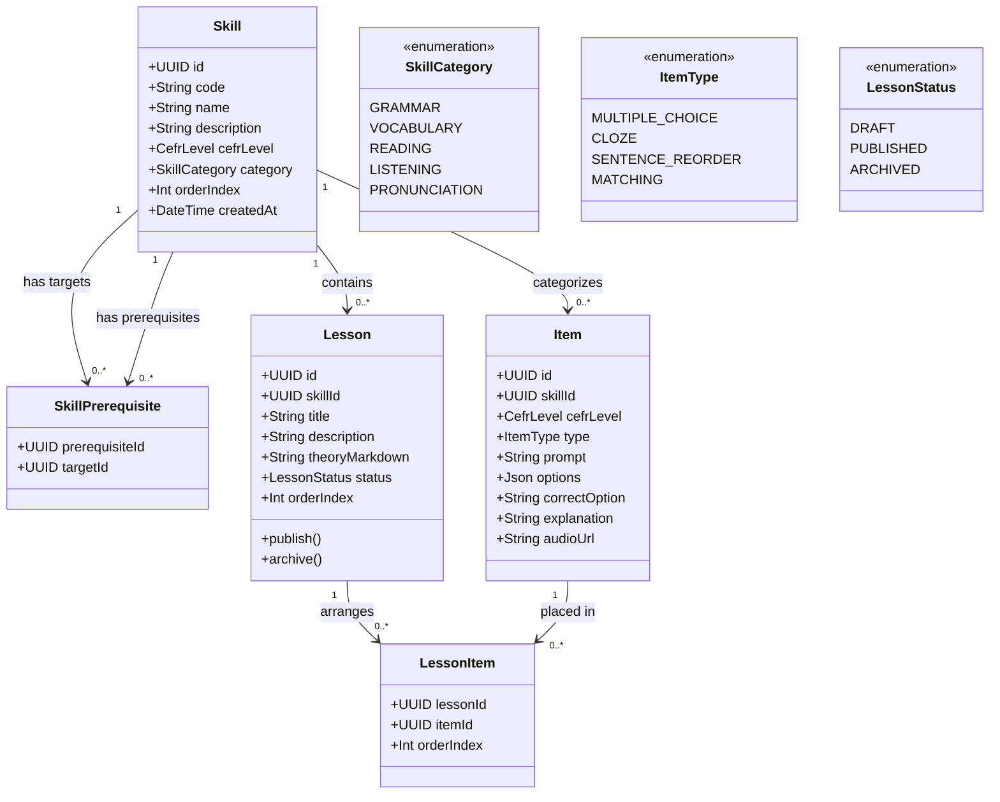
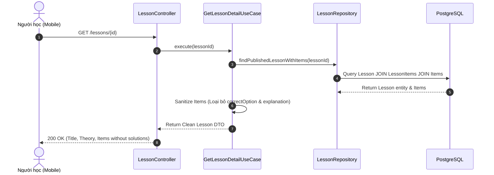

# Domain Specification: 03. Curriculum & Knowledge Graph

## Mission

Tài liệu Domain Specification định nghĩa ngôn ngữ thống nhất (Ubiquitous Language), các Aggregate Root, Entity, cấu trúc đồ thị kỹ năng có hướng không chu trình (DAG - Directed Acyclic Graph), ngân hàng câu hỏi (Item Bank) và cấu trúc bài học (Curriculum Hierarchy) trong hệ sinh thái LingoRoad trên nền tảng **NestJS**.

---

# 1. Domain Overview (Tổng quan phân hệ)

Phân hệ Curriculum & Knowledge Graph là xương sống kiến thức của toàn bộ nền tảng LingoRoad. Phân hệ này mô hình hóa toàn bộ chương trình học tiếng Anh theo chuẩn CEFR thành một mạng lưới quan hệ tiên quyết (Prerequisites) giữa các kỹ năng ngôn ngữ, liên kết chặt chẽ với ngân hàng câu hỏi và các đơn vị bài học.

- **Vấn đề giải quyết**: Việc học ngôn ngữ mang tính lũy tiến (Cumulative Learning); người học không thể hiểu câu điều kiện nếu chưa nắm vững thì quá khứ hoặc hiện tại đơn. Phân hệ này tạo ra cấu trúc đồ thị tri thức để điều hướng lộ trình một cách khoa học.
- **Mục tiêu cốt lõi (Core Objectives)**:
  - Cung cấp cấu trúc tri thức phân cấp: `CEFR Level` → `Domain / Category` → `Skill (Node)` → `Lesson` → `Item / Exercise`.
  - Quản lý mối quan hệ tiên quyết giữa các kỹ năng dưới dạng Đồ thị có hướng không chu trình (DAG).
  - Quản lý ngân hàng câu hỏi đa dạng (Multiple Choice, Cloze / Điền từ, Sentence Reordering / Sắp xếp câu).
  - Tách biệt câu hỏi bài học (Practice Items), câu hỏi đánh giá (Placement Items) và câu hỏi ôn tập (Review Items).
- **Stack Công nghệ & Tích hợp (Technology Stack & Integrations)**:
  - **Framework**: NestJS (TypeScript) với Clean Architecture / DDD.
  - **Database & ORM**: PostgreSQL qua Prisma ORM (hỗ trợ đệ quy truy vấn đồ thị `WITH RECURSIVE`).
  - **Caching Store**: Redis (lưu cấu trúc DAG và danh sách bài học đã compile để truy vấn sub-millisecond).
  - **Validation**: `class-validator` cho định dạng JSON cấu trúc câu hỏi.

---

# 2. Sub-systems & Feature Breakdown (Các phân hệ con & Phân rã tính năng)

```
                       ┌──────────────────────────────────────────────┐
                       │        Curriculum & Knowledge Graph          │
                       └──────────────────────┬───────────────────────┘
                                              │
         ┌────────────────────────────────────┼────────────────────────────────────┐
         │                                    │                                    │
         ▼                                    ▼                                    ▼
┌────────────────────────┐        ┌────────────────────────┐        ┌────────────────────────┐
│ Skill Graph & DAG      │        │ Lesson Management      │        │ Item Bank (Ngân hàng)  │
├────────────────────────┤        ├────────────────────────┤        ├────────────────────────┤
│ • Skill Node Registry  │        │ • Lesson Metadata      │        │ • Question Multi-type  │
│ • Prerequisite Linker  │        │ • Lesson-Skill Mapping │        │ • CEFR Item Tagging    │
│ • Cycle Detection Check│        │ • Publishing Lifecycle │        │ • Asset/Audio Binding  │
│ • Topological Sort     │        │ • Step Sequencing      │        │ • Solution & Explains  │
└────────────────────────┘        └────────────────────────┘        └────────────────────────┘
```

---

# 3. Ubiquitous Language (Ngôn ngữ Thống nhất)

| Thuật ngữ (English) | Thuật ngữ Tiếng Việt | Định nghĩa & Phạm vi sử dụng |
| :--- | :--- | :--- |
| **Skill (Aggregate Root)** | Kỹ năng / Nút tri thức | Một đơn vị năng lực ngôn ngữ cụ thể (ví dụ: *Present Perfect*, *Phasal Verbs with Get*), gắn liền với 1 CEFR level. |
| **Skill Graph (DAG)** | Đồ thị Kỹ năng | Cấu trúc đồ thị có hướng không chu trình thể hiện sự phụ thuộc giữa các kỹ năng (`PrerequisiteSkill → TargetSkill`). |
| **Lesson** | Bài học | Đơn vị học tập bao gồm phần lý thuyết tóm tắt và một tập hợp các bài tập rèn luyện (Exercises). |
| **Item** | Câu hỏi / Đề mục | Một câu hỏi cụ thể trong ngân hàng nội dung kèm đáp án đúng và lời giải thích chi tiết. |
| **Item Type** | Dạng câu hỏi | Định dạng tương tác: `MULTIPLE_CHOICE`, `CLOZE`, `SENTENCE_REORDER`, `MATCHING`. |
| **Prerequisite** | Kỹ năng Tiên quyết | Nút kỹ năng bắt buộc người học phải đạt ngưỡng độ thành thạo (Mastery) trước khi mở khóa kỹ năng tiếp theo. |

---

# 4. Architecture Design & Core Decisions (Thiết kế Kiến trúc & Quyết định cốt lõi)

### 4.1. Quyết định 1: Đồ thị DAG và Cơ chế Phát hiện Vòng lặp (Cycle Detection)
- **Giải pháp**: Mỗi quan hệ tiên quyết được lưu trong bảng quan hệ `SkillPrerequisite` (`prerequisiteId`, `targetId`). Khi Admin thêm hoặc sửa liên kết tiên quyết qua API, hệ thống chạy thuật toán DFS (Depth-First Search) hoặc Kahn's Algorithm để phát hiện chu trình (Cycle Detection).
- **Ràng buộc**: Nếu phát hiện vòng lặp (ví dụ: $A \rightarrow B \rightarrow C \rightarrow A$), NestJS Service sẽ từ chối thao tác với lỗi `BadRequestException('Circular dependency detected in Skill Graph')`.

### 4.2. Quyết định 2: Tách rời Item Bank khỏi Lesson (Many-to-Many via LessonItem)
- **Giải pháp**: Câu hỏi (`Item`) tồn tại độc lập trong ngân hàng tri thức và được liên kết với `Skill`. Một bài học (`Lesson`) liên kết với tập hợp câu hỏi thông qua thực thể trung gian `LessonItem` với thứ tự `order_index`.
- **Lợi ích**: Tái sử dụng câu hỏi cho cả bài học chính khóa, bài kiểm tra Placement và các phiên ôn tập FSRS.

### 4.3. Quyết định 3: Lifecycle Bài học (Draft vs Published)
- **Giải pháp**: Bài học có vòng đời quản lý rõ ràng (`DRAFT`, `PUBLISHED`, `ARCHIVED`). Mobile App của người học chỉ truy vấn được các bài học có trạng thái `PUBLISHED` và có tối thiểu 5 câu hỏi hợp lệ.

---

# 5. Domain Model & Entities (Mô hình Miền & Thực thể)

## 5.1 Class Diagram (Mermaid)



## 5.2 Prisma Schema Draft (NestJS Infrastructure)

```prisma
enum SkillCategory {
  GRAMMAR
  VOCABULARY
  READING
  LISTENING
  PRONUNCIATION
}

enum ItemType {
  MULTIPLE_CHOICE
  CLOZE
  SENTENCE_REORDER
  MATCHING
}

enum LessonStatus {
  DRAFT
  PUBLISHED
  ARCHIVED
}

model Skill {
  id          String        @id @default(uuid()) @db.Uuid
  code        String        @unique @db.VarChar(50)
  name        String        @db.VarChar(150)
  description String?       @db.Text
  cefrLevel   CefrLevel     @map("cefr_level")
  category    SkillCategory @default(GRAMMAR)
  orderIndex  Int           @default(0) @map("order_index")
  createdAt   DateTime      @default(now()) @map("created_at")

  lessons       Lesson[]
  items         Item[]
  prerequisites SkillPrerequisite[] @relation("TargetSkill")
  dependents    SkillPrerequisite[] @relation("PrerequisiteSkill")

  @@index([cefrLevel, category])
  @@map("skills")
}

model SkillPrerequisite {
  prerequisiteId String @map("prerequisite_id") @db.Uuid
  targetId       String @map("target_id") @db.Uuid

  prerequisite   Skill  @relation("PrerequisiteSkill", fields: [prerequisiteId], references: [id], onDelete: Cascade)
  target         Skill  @relation("TargetSkill", fields: [targetId], references: [id], onDelete: Cascade)

  @@id([prerequisiteId, targetId])
  @@map("skill_prerequisites")
}

model Lesson {
  id             String       @id @default(uuid()) @db.Uuid
  skillId        String       @map("skill_id") @db.Uuid
  title          String       @db.VarChar(200)
  description    String?      @db.Text
  theoryMarkdown String?      @map("theory_markdown") @db.Text
  status         LessonStatus @default(DRAFT)
  orderIndex     Int          @default(0) @map("order_index")
  createdAt      DateTime     @default(now()) @map("created_at")
  updatedAt      DateTime     @updatedAt @map("updated_at")

  skill          Skill        @relation(fields: [skillId], references: [id], onDelete: Restrict)
  lessonItems    LessonItem[]

  @@index([skillId, status])
  @@map("lessons")
}

model Item {
  id            String    @id @default(uuid()) @db.Uuid
  skillId       String    @map("skill_id") @db.Uuid
  cefrLevel     CefrLevel @map("cefr_level")
  type          ItemType  @default(MULTIPLE_CHOICE)
  prompt        String    @db.Text
  options       Json      @db.JsonB
  correctOption String    @map("correct_option") @db.Text
  explanation   String?   @db.Text
  audioUrl      String?   @map("audio_url") @db.VarChar(500)
  createdAt     DateTime  @default(now()) @map("created_at")

  skill         Skill        @relation(fields: [skillId], references: [id], onDelete: Restrict)
  lessonItems   LessonItem[]

  @@index([skillId, cefrLevel, type])
  @@map("items")
}

model LessonItem {
  lessonId   String @map("lesson_id") @db.Uuid
  itemId     String @map("item_id") @db.Uuid
  orderIndex Int    @default(0) @map("order_index")

  lesson     Lesson @relation(fields: [lessonId], references: [id], onDelete: Cascade)
  item       Item   @relation(fields: [itemId], references: [id], onDelete: Restrict)

  @@id([lessonId, itemId])
  @@map("lesson_items")
}
```

---

# 6. Core Workflows (Quy trình Vận hành Cốt lõi)

## 6.1 Quy trình Truy xuất Chi tiết Bài học dành cho Người học



---

# 7. Business Rules (Quy tắc Nghiệp vụ)

1. **Bảo mật Đáp án trong Client Payload (Solution Sanitization)**:
   - Khi trả dữ liệu bài học hoặc bài tập cho người học (`Role.LEARNER`), trường `correctOption` và `explanation` TUYỆT ĐỐI KHÔNG được xuất hiện trong JSON response. Việc chấm điểm chỉ được thực hiện tại server khi submit.
2. **Quy tắc Xuất bản Bài học (Publishing Invariants)**:
   - Một bài học chỉ được chuyển trạng thái sang `PUBLISHED` nếu:
     - Đã liên kết với một `Skill` hợp lệ.
     - Có ít nhất 5 câu hỏi (`Item`) trong danh sách `lessonItems`.
     - Tất cả câu hỏi phải có đáp án đúng nằm trong danh sách các lựa chọn (`options`).
3. **Bất biến Đồ thị Tri thức (DAG Constraint)**:
   - Đồ thị kỹ năng không được chứa bất kỳ chu trình khép kín nào. Mọi thao tác thêm cạnh tiên quyết đều phải qua bước kiểm tra Cycle Detection.

---

# 8. Draft API Requirements (Dự thảo Yêu cầu API)

## 8.1 Lấy danh sách cây kỹ năng (Skill Graph)
- **Endpoint**: `GET /skills`
- **Headers**: `Authorization: Bearer <accessToken>`
- **Response**: `200 OK`
  ```json
  {
    "success": true,
    "data": [
      {
        "id": "a1b2c3d4-0001-0000-0000-000000000001",
        "code": "GRAM-A1-01",
        "name": "Present Simple (To Be)",
        "cefrLevel": "A1",
        "category": "GRAMMAR",
        "prerequisites": []
      },
      {
        "id": "a1b2c3d4-0001-0000-0000-000000000002",
        "code": "GRAM-A1-02",
        "name": "Present Simple (Action Verbs)",
        "cefrLevel": "A1",
        "category": "GRAMMAR",
        "prerequisites": ["a1b2c3d4-0001-0000-0000-000000000001"]
      }
    ]
  }
  }
  ```

## 8.2 Lấy thông tin bài học làm bài (Get Lesson Detail)
- **Endpoint**: `GET /lessons/{id}`
- **Headers**: `Authorization: Bearer <accessToken>`
- **Response**: `200 OK`
  ```json
  {
    "success": true,
    "data": {
      "id": "b2c3d4e5-1111-2222-3333-444455556666",
      "title": "Mastering Present Simple Tense",
      "theoryMarkdown": "# Present Simple\n\nWe use the present simple to talk about habits...",
      "skillId": "a1b2c3d4-0001-0000-0000-000000000001",
      "items": [
        {
          "id": "c3d4e5f6-1111-2222-3333-444455556666",
          "type": "MULTIPLE_CHOICE",
          "prompt": "She ___ a doctor at the city hospital.",
          "options": ["is", "are", "am", "be"],
          "orderIndex": 0
        }
      ]
    }
  }
  ```

---

# 9. Product Recommendations & Future Improvements

1. **Rich Media Interactive Items**: Mở rộng các dạng câu hỏi phong phú hơn như *Speaking Shadowing*, *Audio-assisted Dictation* và *Drag-and-Drop Picture Matching*.
2. **Dynamic Skill Prerequisite Weighting**: Thêm trọng số ảnh hưởng (influence weight $0.0 \rightarrow 1.0$) cho các liên kết tiên quyết để mô hình hóa mối quan hệ tri thức mờ (Fuzzy Knowledge Graph).
3. **Automated Curriculum Sanity Audit**: Xây dựng background worker kiểm tra tự động hàng tuần để phát hiện các bài học bị mồ côi (Orphan Lessons) hoặc các nút kỹ năng chưa có câu hỏi kiểm tra.

# End
