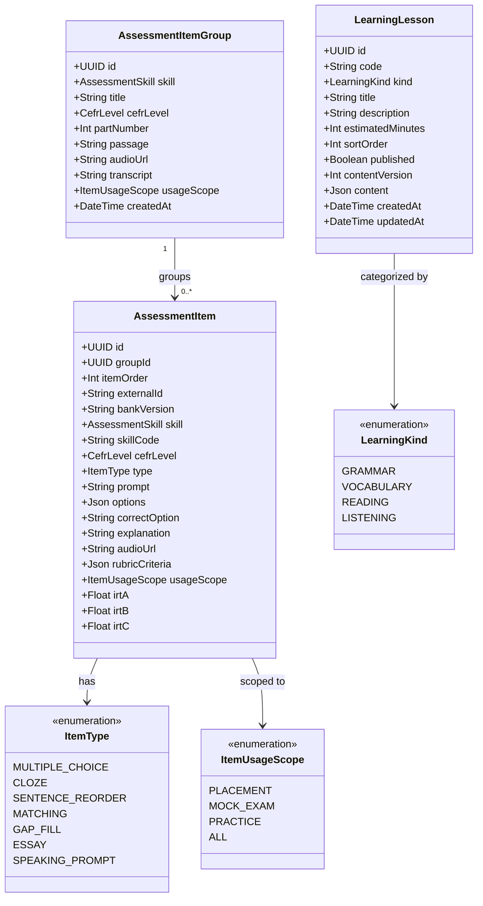
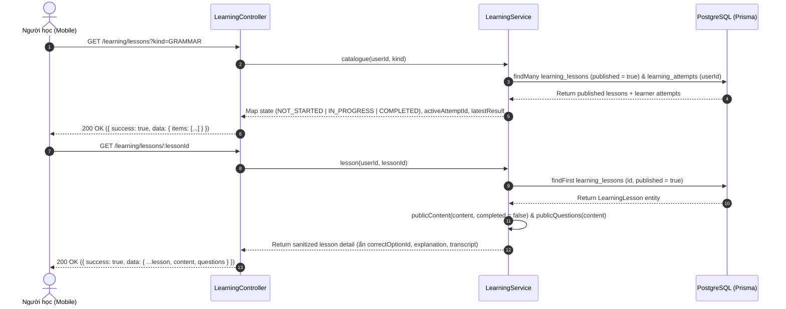

# Domain Specification: 03. Curriculum & Knowledge Graph

## Mission

Tài liệu Domain Specification định nghĩa ngôn ngữ thống nhất (Ubiquitous Language), các Aggregate Root, Entity, cấu trúc bài học chính khóa (`LearningLesson`), ngân hàng câu hỏi đánh giá (`AssessmentItemGroup`, `AssessmentItem`) và định hướng mở rộng đồ thị kỹ năng có hướng không chu trình (DAG - Directed Acyclic Graph) trong hệ sinh thái LingoRoad trên nền tảng **NestJS**.

---

# 1. Domain Overview (Tổng quan phân hệ)

Phân hệ Curriculum & Knowledge Graph là xương sống nội dung học tập và đánh giá của toàn bộ nền tảng LingoRoad. Phân hệ này quản lý danh mục bài học rèn luyện theo kỹ năng (`LearningLesson` thuộc `LearningKind`: `GRAMMAR`, `VOCABULARY`, `READING`, `LISTENING`), ngân hàng câu hỏi kiểm tra năng lực CEFR chuẩn hóa 3PL IRT (`AssessmentItemGroup`, `AssessmentItem`), cùng mô hình đồ thị kỹ năng tiên quyết (Prerequisites).

- **Vấn đề giải quyết**: Việc học ngôn ngữ mang tính lũy tiến (Cumulative Learning); nội dung bài học cần được chuẩn hóa chặt chẽ về cấu trúc bước học (Study Steps), câu hỏi kiểm tra (Quiz Questions), ngữ liệu đọc/nghe (Passage/Audio/Transcript) và tách biệt đáp án khi phân phối cho người học.
- **Mục tiêu cốt lõi (Core Objectives)**:
  - Cung cấp danh mục bài học chính khóa (`LearningLesson`) sắp xếp theo `kind` (`GRAMMAR`, `VOCABULARY`, `READING`, `LISTENING`) và `sortOrder`, với nội dung JSONB được kiểm định nghiêm ngặt qua `validateLearningContent()`.
  - Quản lý ngân hàng câu hỏi đánh giá (`AssessmentItemGroup`, `AssessmentItem`) hỗ trợ 7 dạng `ItemType` (`MULTIPLE_CHOICE`, `CLOZE`, `SENTENCE_REORDER`, `MATCHING`, `GAP_FILL`, `ESSAY`, `SPEAKING_PROMPT`), tham số 3PL IRT (`irtA`, `irtB`, `irtC`), `skillCode` và `usageScope` (`PLACEMENT`, `MOCK_EXAM`, `PRACTICE`, `ALL`).
  - Bảo mật tuyệt đối đáp án và lời giải thích (`correctOptionId`, `explanation`, `transcript`) trong các API phân phối bài học cho Learner (`publicContent`, `publicQuestions`, `publicAttempt`).
  - Định hình kiến trúc đồ thị kỹ năng tiên quyết (DAG `Skill` / `SkillPrerequisite` mở rộng cho Admin CMS, và mô phỏng khóa tiên quyết trong `ToyLearnerEnv` của `apps/ml`).
- **Stack Công nghệ & Tích hợp (Technology Stack & Integrations)**:
  - **Framework**: NestJS (TypeScript) với `LearningModule` (`learning.controller.ts`, `learning.service.ts`, `learning.types.ts`).
  - **Database & ORM**: PostgreSQL qua Prisma ORM (`learning_lessons`, `assessment_item_groups`, `assessment_items`).
  - **Validation & Content Seeding**: `class-validator`, `validateLearningContent()` (`learning.types.ts`), `prisma/demo-content/validate.ts`, `prisma/seed-learning.ts`, `prisma/seed-placement.ts`, `prisma/seed-cefr-bank.ts`.

---

# 2. Sub-systems & Feature Breakdown (Các phân hệ con & Phân rã tính năng)

```
                       ┌──────────────────────────────────────────────┐
                       │        Curriculum & Knowledge Graph          │
                       └──────────────────────┬───────────────────────┘
                                              │
         ┌────────────────────────────────────┼────────────────────────────────────┐
         │                                    │                                    │
         ▼                                    ▼                                    ▼
┌────────────────────────┐        ┌────────────────────────┐        ┌────────────────────────┐
│ Skill Ordering & DAG   │        │ LearningLesson Content │        │ Assessment Item Bank   │
├────────────────────────┤        ├────────────────────────┤        ├────────────────────────┤
│ • LearningKind & Order │        │ • Lesson Metadata      │        │ • 7 ItemTypes & Groups │
│ • Assessment skillCode │        │ • Steps & 5×4 Questions│        │ • CEFR & 3PL IRT Params│
│ • RL Prerequisite Gate │        │ • Published Filtering  │        │ • Audio/Passage Binding│
│ • Planned Admin CMS DAG│        │ • Solution Sanitization│        │ • Usage Scope Tagging  │
└────────────────────────┘        └────────────────────────┘        └────────────────────────┘
```

---

# 3. Ubiquitous Language (Ngôn ngữ Thống nhất)

| Thuật ngữ (English) | Thuật ngữ Tiếng Việt | Định nghĩa & Phạm vi sử dụng |
| :--- | :--- | :--- |
| **LearningLesson (Aggregate Root)** | Bài học Chính khóa | Đơn vị bài học trong bảng `learning_lessons`, định danh bởi `code`, phân loại theo `LearningKind` (`GRAMMAR`, `VOCABULARY`, `READING`, `LISTENING`), có cờ `published`, `contentVersion` và payload `content` JSONB. |
| **LearningContent** | Nội dung Bài học | Cấu trúc JSONB bên trong `LearningLesson` gồm danh sách bước lý thuyết (`steps: LearningStep[]`), đúng 5 câu hỏi (`questions: LearningQuestion[]`, mỗi câu 4 lựa chọn), cùng `passage`, `audioUrl`, `transcript` tùy chọn. |
| **AssessmentItemGroup** | Nhóm Câu hỏi Đánh giá | Đơn vị ngữ cảnh dùng chung (`assessment_item_groups`) cho bài đọc hoặc bài nghe nhiều câu hỏi (`passage`, `audioUrl`, `transcript`, `partNumber`, `skill`, `cefrLevel`). |
| **AssessmentItem** | Câu hỏi Đánh giá | Một câu hỏi trong ngân hàng `assessment_items` gắn với `skillCode`, `cefrLevel`, `type` (`ItemType`), tham số 3PL IRT (`irtA`, `irtB`, `irtC`) và `usageScope`. |
| **ItemType** | Dạng câu hỏi | Định dạng tương tác trong ngân hàng đánh giá: `MULTIPLE_CHOICE`, `CLOZE`, `SENTENCE_REORDER`, `MATCHING`, `GAP_FILL`, `ESSAY`, `SPEAKING_PROMPT`. |
| **Skill / SkillPrerequisite (Planned CMS / RL)** | Kỹ năng & Tiên quyết | Trong MVP hiện tại, kỹ năng bài học được phân nhóm qua `LearningLesson.kind` + `sortOrder` và mã kỹ năng câu hỏi `AssessmentItem.skillCode`; cơ chế khóa tiên quyết được mô hình hóa trong `ToyLearnerEnv` (`apps/ml/lingoroad_ml/rl/env.py`), còn bảng quan hệ `Skill` / `SkillPrerequisite` là lộ trình mở rộng cho Admin CMS. |

---

# 4. Architecture Design & Core Decisions (Thiết kế Kiến trúc & Quyết định cốt lõi)

### 4.1. Quyết định 1: Cấu trúc Bài học Tự chứa (Self-contained JSONB `LearningContent`) và Kiểm định Bất biến
- **Giải pháp**: Mỗi bản ghi `LearningLesson` lưu trữ cấu trúc bài học trong cột `content` (JSONB) kèm `contentVersion`. Hàm `validateLearningContent()` tại `apps/backend/src/modules/learning/learning.types.ts` kiểm định nghiêm ngặt cấu trúc trước khi seed và trước khi khởi tạo lượt học (`LearningService.start()`):
  - `steps`: Mảng `LearningStep[]` với `id` duy nhất, `title` và `body` không rỗng, cùng các trường từ vựng/âm thanh tùy chọn (`word`, `phonetic`, `meaning`, `example`, `audioUrl`).
  - `questions`: Bắt buộc đúng **5 câu hỏi** (`questions.length === 5`), mỗi câu hỏi có `id` duy nhất, `prompt`, `explanation` không rỗng, đúng **4 lựa chọn** (`options.length === 4`) có `id` duy nhất và `correctOptionId` phải khớp với một `option.id`.

### 4.2. Quyết định 2: Tách biệt Ngân hàng Đánh giá (`AssessmentItemGroup` & `AssessmentItem`) với Tham số 3PL IRT
- **Giải pháp**: Các câu hỏi phục vụ Placement Test và đánh giá CEFR được quản lý trong `assessment_item_groups` và `assessment_items`. Mỗi `AssessmentItem` lưu trữ đầy đủ thông số mô hình 3PL IRT (`irtA` độ phân biệt, `irtB` độ khó, `irtC` xác suất đoán mò), `skillCode`, `cefrLevel`, `rubricCriteria` (cho Writing/Speaking) và `usageScope` (`PLACEMENT`, `MOCK_EXAM`, `PRACTICE`, `ALL`).

### 4.3. Quyết định 3: Bảo mật Đáp án & Transcript theo Trạng thái Lượt học (Solution Sanitization)
- **Giải pháp**: `LearningService` (`learning.service.ts`) sử dụng ba phương thức lọc dữ liệu đầu ra:
  - `publicContent(content, completed)`: Chỉ trả `transcript` của bài Nghe khi lượt học đã ở trạng thái `COMPLETED` (`completed === true`). Khi xem chi tiết bài học hoặc đang làm bài, `transcript` bị ẩn hoàn toàn.
  - `publicQuestions(content)`: Loại bỏ `correctOptionId` và `explanation` khỏi toàn bộ câu hỏi trong danh mục và chi tiết bài học.
  - `publicAttempt(attempt)`: Chỉ tiết lộ `isCorrect`, `correctOptionId` và `explanation` cho từng câu hỏi sau khi người học đã gọi API khóa đáp án của câu hỏi đó (`answer.checked === true`).

### 4.4. Quyết định 4: Quản lý Thứ tự Kỹ năng & Định hướng Đồ thị DAG
- **Giải pháp**: Trong bản triển khai hiện tại:
  - Thứ tự bài học chính khóa được điều phối qua `LearningLesson` (`kind: LearningKind`, `sortOrder`, `code`) kết hợp điểm thành phần Placement (`PlanningService.chooseDailyItems()`).
  - Ràng buộc kỹ năng tiên quyết chuỗi (chained prerequisite gating: kỹ năng `i` yêu cầu kỹ năng `i - 1` đạt độ thành thạo ≥ 0.50) được hiện thực hóa trong môi trường Reinforcement Learning `ToyLearnerEnv` (`apps/ml/lingoroad_ml/rl/env.py`).
  - Các bảng quan hệ `Skill` và `SkillPrerequisite` với thuật toán kiểm tra chu trình (Cycle Detection `A → B → C → A`) được định nghĩa sẵn cho giai đoạn mở rộng cổng quản trị Admin CMS.

---

# 5. Domain Model & Entities (Mô hình Miền & Thực thể)

## 5.1 Class Diagram (Mermaid)



## 5.2 Prisma Schema (Implemented in `apps/backend/prisma/schema.prisma`)

```prisma
enum LearningKind {
  GRAMMAR
  VOCABULARY
  READING
  LISTENING
}

enum ItemType {
  MULTIPLE_CHOICE
  CLOZE
  SENTENCE_REORDER
  MATCHING
  GAP_FILL
  ESSAY
  SPEAKING_PROMPT
}

enum ItemUsageScope {
  PLACEMENT
  MOCK_EXAM
  PRACTICE
  ALL
}

model LearningLesson {
  id               String            @id @default(uuid()) @db.Uuid
  code             String            @unique @db.VarChar(100)
  kind             LearningKind
  title            String            @db.VarChar(200)
  description      String            @db.Text
  estimatedMinutes Int               @map("estimated_minutes")
  sortOrder        Int               @map("sort_order")
  published        Boolean           @default(false)
  contentVersion   Int               @default(1) @map("content_version")
  content          Json              @db.JsonB
  createdAt        DateTime          @default(now()) @map("created_at")
  updatedAt        DateTime          @updatedAt @map("updated_at")
  attempts         LearningAttempt[]

  @@index([published, sortOrder])
  @@map("learning_lessons")
}

model AssessmentItemGroup {
  id          String           @id @default(uuid()) @db.Uuid
  skill       AssessmentSkill
  title       String?          @db.VarChar(200)
  cefrLevel   CefrLevel        @map("cefr_level")
  partNumber  Int              @map("part_number")
  passage     String?          @db.Text
  audioUrl    String?          @map("audio_url") @db.VarChar(500)
  transcript  String?          @db.Text
  usageScope  ItemUsageScope   @default(ALL) @map("usage_scope")
  createdAt   DateTime         @default(now()) @map("created_at")
  items       AssessmentItem[]

  @@index([skill, cefrLevel])
  @@index([usageScope, skill, cefrLevel])
  @@map("assessment_item_groups")
}

model AssessmentItem {
  id              String               @id @default(uuid()) @db.Uuid
  groupId         String?              @map("group_id") @db.Uuid
  itemOrder       Int                  @default(1) @map("item_order")
  group           AssessmentItemGroup? @relation(fields: [groupId], references: [id], onDelete: SetNull)
  externalId      String?              @unique @map("external_id") @db.VarChar(100)
  bankVersion     String?              @map("bank_version") @db.VarChar(100)
  skill           AssessmentSkill?
  passage         String?              @db.Text
  skillCode       String               @map("skill_code") @db.VarChar(100)
  cefrLevel       CefrLevel            @map("cefr_level")
  type            ItemType             @default(MULTIPLE_CHOICE)
  prompt          String               @db.Text
  options         Json?                @db.JsonB
  correctOption   String?              @map("correct_option") @db.Text
  explanation     String?              @db.Text
  audioUrl        String?              @map("audio_url") @db.VarChar(500)
  rubricCriteria  Json?                @map("rubric_criteria") @db.JsonB
  usageScope      ItemUsageScope       @default(ALL) @map("usage_scope")
  irtA            Float                @default(1.0) @map("irt_a")
  irtB            Float                @default(0.0) @map("irt_b")
  irtC            Float                @default(0.25) @map("irt_c")
  createdAt       DateTime             @default(now()) @map("created_at")
  responses       AssessmentResponse[]
  currentSessions PlacementSession[]

  @@index([groupId])
  @@index([usageScope, skill, cefrLevel])
  @@index([skillCode, cefrLevel])
  @@index([cefrLevel])
  @@index([bankVersion, skill])
  @@index([skill, cefrLevel])
  @@map("assessment_items")
}
```

> **Ghi chú Mở rộng (Planned Admin CMS Relational DAG)**: Các bảng quan hệ `Skill` (`skills`) và `SkillPrerequisite` (`skill_prerequisites`) được thiết kế làm bước mở rộng khi xây dựng giao diện quản trị cây kỹ năng đa nhánh trên Admin CMS.

---

# 6. Core Workflows (Quy trình Vận hành Cốt lõi)

## 6.1 Quy trình Truy xuất Danh mục & Chi tiết Bài học dành cho Người học



---

# 7. Business Rules (Quy tắc Nghiệp vụ)

1. **Bảo mật Đáp án trong Client Payload (Solution Sanitization)**:
   - Khi trả dữ liệu bài học qua `GET /learning/lessons/:lessonId` hoặc khi bắt đầu lượt học qua `POST /learning/lessons/:lessonId/attempts`, hàm `publicQuestions()` chỉ giữ lại `id`, `prompt`, và `options` (`id`, `text`). Các trường `correctOptionId` và `explanation` bị loại bỏ hoàn toàn cho đến khi câu hỏi đó được khóa đáp án (`checked = true`).
   - Đối với bài học Nghe (`LISTENING`), trường `transcript` trong `publicContent()` bị ẩn khi chưa hoàn thành bài học (`completed = false`) và chỉ được trả về sau khi đã nộp bài thành công (`status = COMPLETED`).
2. **Quy tắc Kiểm định Nội dung Bài học (`validateLearningContent` Invariants)**:
   - Một `LearningLesson` hợp lệ bắt buộc phải có mảng `steps` (mỗi step có `id` duy nhất, `title`, `body` không rỗng) và mảng `questions` có **đúng 5 câu hỏi**.
   - Mỗi câu hỏi trong `questions` phải có `id` duy nhất, `prompt` và `explanation` không rỗng, mảng `options` có **đúng 4 lựa chọn** với `option.id` duy nhất, và `correctOptionId` phải thuộc 1 trong 4 lựa chọn đó.
3. **Chỉ Hiển thị Bài học Đã Xuất bản (`published = true`)**:
   - Mọi truy vấn danh mục (`catalogue`), chi tiết bài học (`lesson`) và khởi tạo lượt học (`start`) chỉ lấy các bản ghi có `published = true`, sắp xếp theo `sortOrder ASC, code ASC`.

---

# 8. API Specifications (Đặc tả API Đã Triển khai)

## 8.1 Lấy danh mục bài học kèm trạng thái học tập của người dùng
- **Endpoint**: `GET /learning/lessons?kind=GRAMMAR` (`kind` tùy chọn: `GRAMMAR` | `VOCABULARY` | `READING` | `LISTENING`)
- **Headers**: `Authorization: Bearer <accessToken>`
- **Response**: `200 OK`
  ```json
  {
    "success": true,
    "data": {
      "items": [
        {
          "id": "b2c3d4e5-1111-2222-3333-444455556666",
          "code": "grammar-present-simple-habits",
          "kind": "GRAMMAR",
          "title": "Hiện tại đơn cho thói quen hằng ngày",
          "description": "Cách dùng thì hiện tại đơn để diễn tả lịch trình và thói quen công việc.",
          "estimatedMinutes": 5,
          "contentVersion": 1,
          "state": "NOT_STARTED",
          "activeAttemptId": null,
          "latestResult": null
        }
      ]
    }
  }
  ```

## 8.2 Lấy thông tin chi tiết bài học đã lọc đáp án (Get Sanitized Lesson Detail)
- **Endpoint**: `GET /learning/lessons/:lessonId`
- **Headers**: `Authorization: Bearer <accessToken>`
- **Response**: `200 OK`
  ```json
  {
    "success": true,
    "data": {
      "id": "b2c3d4e5-1111-2222-3333-444455556666",
      "code": "grammar-present-simple-habits",
      "kind": "GRAMMAR",
      "title": "Hiện tại đơn cho thói quen hằng ngày",
      "description": "Cách dùng thì hiện tại đơn để diễn tả lịch trình và thói quen công việc.",
      "estimatedMinutes": 5,
      "contentVersion": 1,
      "state": "NOT_STARTED",
      "activeAttemptId": null,
      "latestResult": null,
      "content": {
        "steps": [
          {
            "id": "step-1",
            "title": "Cấu trúc khẳng định",
            "body": "Với chủ ngữ số ít (he/she/it), động từ thêm -s hoặc -es."
          }
        ]
      },
      "questions": [
        {
          "id": "q-1",
          "prompt": "She ___ the project status every morning.",
          "options": [
            { "id": "a", "text": "check" },
            { "id": "b", "text": "checks" },
            { "id": "c", "text": "checking" },
            { "id": "d", "text": "checked" }
          ]
        }
      ]
    }
  }
  ```

---

# 9. Product Recommendations & Future Improvements

1. **Admin CMS Relational Skill DAG Management**: Triển khai đầy đủ bảng `Skill` và `SkillPrerequisite` kèm giao diện kéo-thả đồ thị DAG trên Web Admin và kiểm tra chu trình (Cycle Detection).
2. **Dynamic Skill Prerequisite Weighting**: Thêm trọng số ảnh hưởng (influence weight 0.0 → 1.0) cho các liên kết tiên quyết để mô hình hóa mối quan hệ tri thức mờ (Fuzzy Knowledge Graph).
3. **Automated Curriculum Sanity Audit**: Mở rộng bộ kiểm tra `validateLearningContent()` và `prisma/demo-content/validate.ts` thành pipeline CI kiểm định tự động toàn bộ media và ngân hàng câu hỏi.

# End
