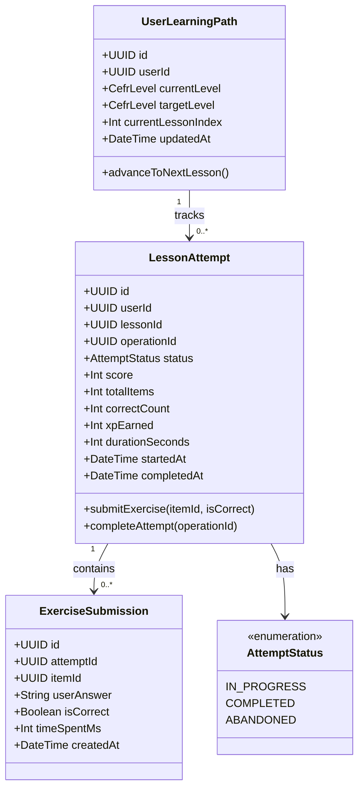
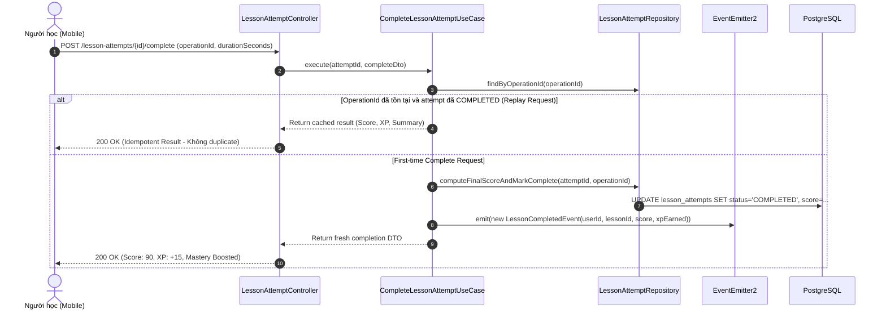

# Domain Specification: 04. Learning Path & Adaptive Sequencing

## Mission

Tài liệu Domain Specification định nghĩa ngôn ngữ thống nhất (Ubiquitous Language), các Aggregate Root, Entity, thuật toán lập kế hoạch học tập hàng ngày (Today's Plan) và cơ chế điều phối bài học thích ứng (Adaptive Path Sequencing) trong hệ sinh thái LingoRoad trên nền tảng **NestJS**.

---

# 1. Domain Overview (Tổng quan phân hệ)

Phân hệ Learning Path & Adaptive Sequencing đóng vai trò là "người hoa tiêu" cá nhân hóa cho mỗi người học. Dựa trên kết quả bài kiểm tra đầu vào (Placement), mục tiêu CEFR và độ thành thạo kỹ năng thời gian thực (Mastery), phân hệ này tự động sắp xếp và đề xuất các bài học phù hợp nhất cho từng ngày.

- **Vấn đề giải quyết**: Người học thường bị quá tải hoặc bối rối trước hàng trăm bài học nếu không có một lộ trình học có thứ tự rõ ràng. Phân hệ này đơn giản hóa trải nghiệm học tập bằng cách cung cấp giao diện "Kế hoạch hôm nay" (Today's Study Plan) tinh gọn và cá nhân hóa.
- **Mục tiêu cốt lõi (Core Objectives)**:
  - Tự động sinh lộ trình học lũy tiến (Path Sequencing) dựa trên đồ thị kỹ năng DAG và mục tiêu CEFR của người học.
  - Cung cấp kế hoạch học tập mỗi ngày (`/path/today`) kết hợp cân bằng giữa bài học mới (New Lessons) và các thẻ bài cần ôn tập (Due Reviews).
  - Quản lý phiên làm bài học (Lesson Attempts) với cơ chế Idempotency chống gian lận và chống gửi lặp request.
  - Chuyển tiếp kết quả làm bài đến phân hệ Mastery, FSRS và Gamification sau khi hoàn thành bài học.
- **Stack Công nghệ & Tích hợp (Technology Stack & Integrations)**:
  - **Framework**: NestJS (TypeScript) với Clean Architecture / DDD.
  - **Database & ORM**: PostgreSQL qua Prisma ORM.
  - **In-Memory Cache**: Redis (lưu cached Daily Plan để truy vấn cực nhanh khi mở ứng dụng).
  - **Sequencing Engine**: Topological DAG Sort kết hợp cân bằng độ khó; tham chiếu mô hình Reinforcement Learning (DQN) và mốc chuẩn Dynamic Programming (DP Anchor) được nghiên cứu tại `apps/ml`.
  - **Event Dispatcher**: `@nestjs/event-emitter` (`LessonCompletedEvent`, `ExerciseSubmittedEvent`).

---

# 2. Sub-systems & Feature Breakdown (Các phân hệ con & Phân rã tính năng)

```
                       ┌──────────────────────────────────────────────┐
                       │     Learning Path & Adaptive Sequencing      │
                       └──────────────────────┬───────────────────────┘
                                              │
         ┌────────────────────────────────────┼────────────────────────────────────┐
         │                                    │                                    │
         ▼                                    ▼                                    ▼
┌────────────────────────┐        ┌────────────────────────┐        ┌────────────────────────┐
│ Path Builder Engine    │        │ Daily Plan Generator   │        │ Lesson Attempt Engine  │
├────────────────────────┤        ├────────────────────────┤        ├────────────────────────┤
│ • DAG Topological Path │        │ • Today's Queue        │        │ • Attempt Lifecycle    │
│ • Prerequisite Gate    │        │ • Daily Goal Pacing    │        │ • Idempotent Complete  │
│ • Level Lock / Unlock  │        │ • Due Review Blending  │        │ • Item Scoring & Acc   │
│ • Path Recalibration   │        │ • Next Action Prompt   │        │ • XP & Reward Trigger  │
└────────────────────────┘        └────────────────────────┘        └────────────────────────┘
```

---

# 3. Ubiquitous Language (Ngôn ngữ Thống nhất)

| Thuật ngữ (English) | Thuật ngữ Tiếng Việt | Định nghĩa & Phạm vi sử dụng |
| :--- | :--- | :--- |
| **Learning Path** | Lộ trình Học tập | Danh sách chuỗi bài học và kỹ năng được sắp xếp theo thứ tự tối ưu để người học đạt được Target CEFR. |
| **Daily Plan (Today Plan)** | Kế hoạch Hôm nay | Tập hợp các bài học trọng tâm và số lượng thẻ ôn tập cần hoàn thành trong ngày để duy trì chuỗi Streak. |
| **Lesson Attempt (Aggregate Root)** | Lượt Học Bài | Một phiên làm bài học cụ thể của người học, ghi nhận thời gian làm bài, danh sách câu trả lời, điểm số và trạng thái hoàn thành. |
| **Operation ID** | Mã Định danh Thao tác | Chuỗi UUID do client tạo để đảm bảo tính Idempotent; ngăn chặn việc ghi nhận hoàn thành bài học nhiều lần khi mạng chập chờn. |
| **Mastery Gate** | Cổng Năng lực | Ngưỡng điểm thành thạo (ví dụ: Mastery Score ≥ 0.70) bắt buộc phải đạt ở các kỹ năng tiên quyết trước khi mở khóa bài học tiếp theo. |
| **Pacing / Goal Velocity** | Tốc độ Học | Số lượng bài học dự kiến mỗi ngày dựa trên số phút mục tiêu mà người học đã cấu hình trong hồ sơ cá nhân. |

---

# 4. Architecture Design & Core Decisions (Thiết kế Kiến trúc & Quyết định cốt lõi)

### 4.1. Quyết định 1: Idempotent Lesson Completion với Operation ID
- **Giải pháp**: Mọi request hoàn thành bài học (`POST /lesson-attempts/{id}/complete`) bắt buộc phải gửi kèm một `operationId` (UUID duy nhất do client sinh).
- **Cơ chế**:
  1. Server kiểm tra xem `operationId` này đã từng được xử lý trong bảng `LessonAttempt` chưa.
  2. Nếu đã hoàn thành trước đó (do retry hoặc mạng lag), server trả ngay kết quả cũ (score, XP, mastery diff) mà không tăng thêm XP, không cập nhật streak hai lần và không ghi nhận mastery duplicate.
  3. Nếu là request đầu tiên, server xử lý cập nhật trạng thái `COMPLETED` bên trong một database transaction an toàn.

### 4.2. Quyết định 2: Thuật toán Xếp lịch Daily Plan kết hợp Học mới & Ôn tập
- **Giải pháp**: Endpoint `GET /path/today` không chỉ trả về bài học tiếp theo trong lộ trình mà kết hợp 3 thành phần:
  1. *Thành phần 1*: 1–2 bài học mới chưa hoàn thành thuộc kỹ năng đã mở khóa có thứ tự ưu tiên cao nhất.
  2. *Thành phần 2*: Số lượng thẻ từ vựng/ngữ pháp đang đến hạn ôn tập (`Due Reviews`) từ phân hệ FSRS.
  3. *Thành phần 3*: Tiến độ hoàn thành mục tiêu ngày (ví dụ: 1/2 bài hoàn thành).

---

# 5. Domain Model & Entities (Mô hình Miền & Thực thể)

## 5.1 Class Diagram (Mermaid)



## 5.2 Prisma Schema Draft (NestJS Infrastructure)

```prisma
enum AttemptStatus {
  IN_PROGRESS
  COMPLETED
  ABANDONED
}

model UserLearningPath {
  id                 String    @id @default(uuid()) @db.Uuid
  userId             String    @unique @map("user_id") @db.Uuid
  currentLevel       CefrLevel @default(A1) @map("current_level")
  targetLevel        CefrLevel @default(B1) @map("target_level")
  currentLessonIndex Int       @default(0) @map("current_lesson_index")
  updatedAt          DateTime  @updatedAt @map("updated_at")

  user               User      @relation(fields: [userId], references: [id], onDelete: Cascade)

  @@map("user_learning_paths")
}

model LessonAttempt {
  id              String        @id @default(uuid()) @db.Uuid
  userId          String        @map("user_id") @db.Uuid
  lessonId        String        @map("lesson_id") @db.Uuid
  operationId     String?       @unique @map("operation_id") @db.VarChar(100)
  status          AttemptStatus @default(IN_PROGRESS)
  score           Int           @default(0)
  totalItems      Int           @default(0) @map("total_items")
  correctCount    Int           @default(0) @map("correct_count")
  xpEarned        Int           @default(0) @map("xp_earned")
  durationSeconds Int           @default(0) @map("duration_seconds")
  startedAt       DateTime      @default(now()) @map("started_at")
  completedAt     DateTime?     @map("completed_at")

  user            User          @relation(fields: [userId], references: [id], onDelete: Cascade)
  lesson          Lesson        @relation(fields: [lessonId], references: [id], onDelete: Restrict)
  submissions     ExerciseSubmission[]

  @@index([userId, lessonId, status])
  @@map("lesson_attempts")
}

model ExerciseSubmission {
  id          String        @id @default(uuid()) @db.Uuid
  attemptId   String        @map("attempt_id") @db.Uuid
  itemId      String        @map("item_id") @db.Uuid
  userAnswer  String        @map("user_answer") @db.Text
  isCorrect   Boolean       @map("is_correct")
  timeSpentMs Int?          @map("time_spent_ms")
  createdAt   DateTime      @default(now()) @map("created_at")

  attempt     LessonAttempt @relation(fields: [attemptId], references: [id], onDelete: Cascade)
  item        Item          @relation(fields: [itemId], references: [id], onDelete: Restrict)

  @@unique([attemptId, itemId])
  @@map("exercise_submissions")
}
```

---

# 6. Core Workflows (Quy trình Vận hành Cốt lõi)

## 6.1 Quy trình Hoàn thành Bài học (Idempotent Lesson Completion)



---

# 7. Business Rules (Quy tắc Nghiệp vụ)

1. **Khóa Bài học theo Kỹ năng Tiên quyết (Prerequisite Lock)**:
   - Một bài học sẽ ở trạng thái `LOCKED` nếu bất kỳ kỹ năng tiên quyết nào của kỹ năng bài học đó có điểm Mastery < 0.70 (hoặc chưa từng hoàn thành bài học nền tảng).
2. **Quy tắc Tính Điểm & XP (Scoring & XP Formula)**:
   - Điểm số: $\text{Score} = (\text{Số câu đúng} \div \text{Tổng số câu}) \times 100$.
   - Điều kiện Đạt (Pass Threshold): Điểm số $\ge 80\%$.
   - Phần thưởng XP: Bài hoàn thành lần đầu đạt điểm tối đa nhận +15 XP; hoàn thành dưới 80% chỉ nhận +5 XP.
3. **Idempotency bắt buộc cho Thao tác Nộp bài**:
   - Mọi thao tác ghi nhận hoàn thành bài học phải có `operationId`. Server từ chối lặp lại việc cấp XP hoặc kích hoạt tăng Streak nếu `operationId` trùng lặp.

---

# 8. Draft API Requirements (Dự thảo Yêu cầu API)

## 8.1 Lấy kế hoạch học tập hôm nay (Today Plan)
- **Endpoint**: `GET /path/today`
- **Headers**: `Authorization: Bearer <accessToken>`
- **Response**: `200 OK`
  ```json
  {
    "success": true,
    "data": {
      "targetCefr": "B1",
      "dailyGoalMinutes": 15,
      "completedTodayCount": 1,
      "recommendedLesson": {
        "id": "b2c3d4e5-1111-2222-3333-444455556666",
        "title": "Present Continuous for Future Arrangements",
        "skillName": "Future Forms",
        "estimatedMinutes": 8,
        "isLocked": false
      },
      "dueReviewsCount": 8
    }
  }
  ```

## 8.2 Bắt đầu lượt học bài (Start Attempt)
- **Endpoint**: `POST /lessons/{lessonId}/attempts`
- **Headers**: `Authorization: Bearer <accessToken>`
- **Response**: `201 Created`
  ```json
  {
    "success": true,
    "data": {
      "attemptId": "d1e2f3a4-5555-6666-7777-888899990000",
      "lessonId": "b2c3d4e5-1111-2222-3333-444455556666",
      "status": "IN_PROGRESS",
      "startedAt": "2026-10-06T09:15:00.000Z"
    }
  }
  ```

## 8.3 Hoàn thành lượt học bài (Complete Attempt)
- **Endpoint**: `POST /lesson-attempts/{attemptId}/complete`
- **Headers**: `Authorization: Bearer <accessToken>`
- **Request Body**:
  ```json
  {
    "operationId": "9b1deb4d-3b7d-4bad-9bdd-2b0d7b3dcb6d",
    "durationSeconds": 320
  }
  ```
- **Response**: `200 OK`
  ```json
  {
    "success": true,
    "data": {
      "attemptId": "d1e2f3a4-5555-6666-7777-888899990000",
      "status": "COMPLETED",
      "score": 90,
      "correctCount": 9,
      "totalItems": 10,
      "xpEarned": 15,
      "isPassed": true
    }
  }
  ```

---

# 9. Product Recommendations & Future Improvements

1. **Reinforcement Learning based Sequencing**: Nghiên cứu áp dụng thuật toán Multi-Armed Bandit hoặc Q-Learning để tối ưu hóa việc phân bổ giữa bài học mới và bài tập củng cố dựa trên tốc độ tiếp thu của từng cá nhân.
2. **Offline Mode Study Session Support**: Cung cấp cơ chế tải trước (Pre-fetch) bài học và đồng bộ kết quả `LessonAttempt` về server khi có kết nối mạng trở lại với cơ chế timestamp conflict resolution.

# End
