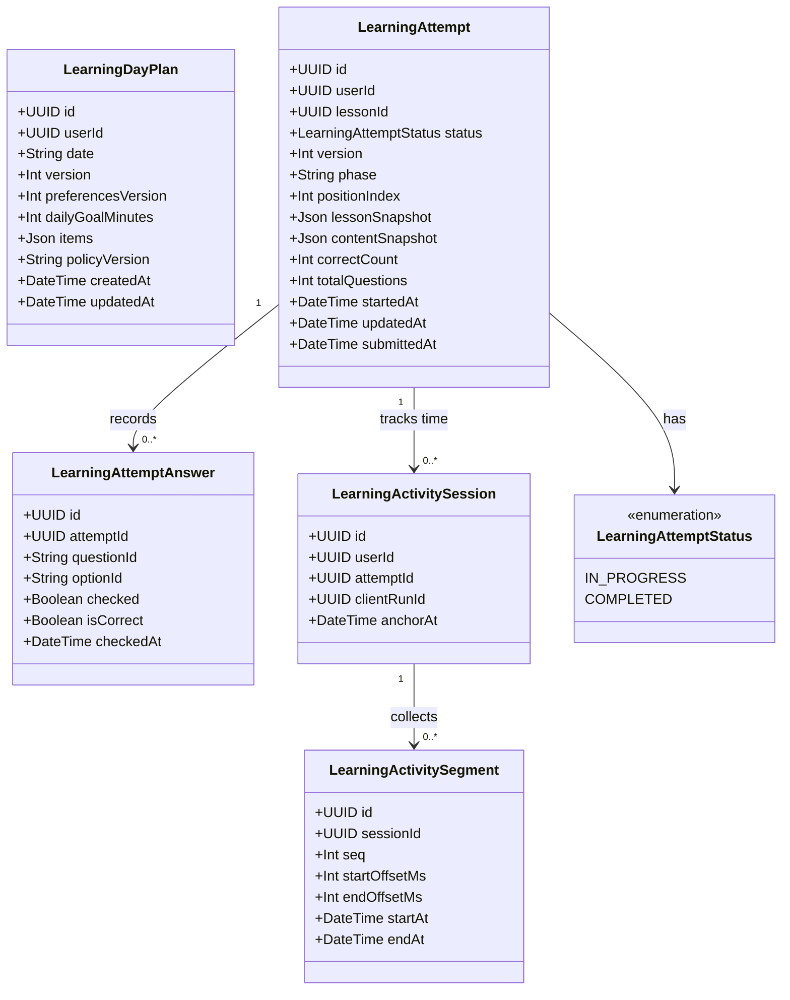
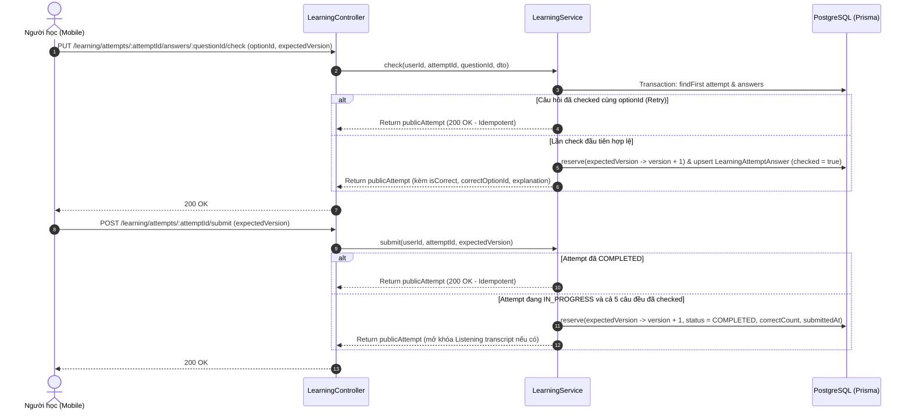

# Domain Specification: 04. Learning Path & Adaptive Sequencing

## Mission

Tài liệu Domain Specification định nghĩa ngôn ngữ thống nhất (Ubiquitous Language), các Aggregate Root, Entity, thuật toán lập kế hoạch học tập hàng ngày (`chooseDailyItems` policy `baseline-v1`), quản lý vòng đời lượt học bài (`LearningAttempt`), đo thời gian học thực tế (`LearningActivitySession` & `LearningActivitySegment`) và mô hình điều phối bài học thích ứng bằng Reinforcement Learning (`ToyLearnerEnv`, Kushner–Dupuis Value Iteration, `DQNAgent`) trong hệ sinh thái LingoRoad.

---

# 1. Domain Overview (Tổng quan phân hệ)

Phân hệ Learning Path & Adaptive Sequencing đóng vai trò là "người hoa tiêu" cá nhân hóa cho mỗi người học. Dựa trên kết quả bài kiểm tra đầu vào (`PlacementSession.skillResults`), thiết lập mục tiêu hằng ngày (`dailyGoalMinutes`, `preferredKinds`), và lịch sử lượt học (`LearningAttempt`), phân hệ này tự động tổng hợp kế hoạch học tập trong ngày (`LearningDayPlan`) và theo dõi sát sao tiến độ thực hiện của người học.

- **Vấn đề giải quyết**: Người học thường bị quá tải trước nhiều bài học nếu không có lộ trình ưu tiên rõ ràng, hoặc bị mất trạng thái đang học dở khi chuyển đổi thiết bị/mất mạng. Phân hệ này cung cấp kế hoạch học tập hằng ngày xác định (deterministic), đồng bộ phiên làm bài theo cơ chế khóa lạc quan (`expectedVersion`), và đo lường chính xác thời gian hoạt động theo chuẩn múi giờ Việt Nam (`Asia/Ho_Chi_Minh`).
- **Mục tiêu cốt lõi (Core Objectives)**:
  - Tự động sinh và cập nhật kế hoạch học tập hằng ngày (`LearningDayPlan`) với chính sách `baseline-v1` (`chooseDailyItems`): ưu tiên giữ bài đã hoàn thành trong ngày (`COMPLETED_TODAY`) → bài đang học dở (`RESUME`) → bài mới (`NEW`, ưu tiên `preferredKinds` và kỹ năng Reading/Listening có tỷ lệ điểm Placement thấp hơn) → bài cần ôn lại có điểm < 80% (`REVIEW`) → bài mới còn lại (`NEW`) → bài xoay vòng lâu chưa học (`ROTATION`).
  - Quản lý toàn diện vòng đời lượt học (`LearningAttempt` & `LearningAttemptAnswer`) với kiểm soát đồng thời qua `version` (`expectedVersion`), khóa đáp án vĩnh viễn theo từng câu hỏi (`check`), và nộp bài an toàn, idempotent (`submit`).
  - Ghi nhận thời gian học thực tế bằng `LearningActivitySession` và `LearningActivitySegment`, hợp nhất các khoảng thời gian chồng lấn giữa nhiều thiết bị bằng hàm `range_agg(tstzrange(...))` của PostgreSQL.
  - Nghiên cứu và đối sánh thuật toán sắp xếp lộ trình tối ưu bằng Reinforcement Learning (`apps/ml/lingoroad_ml/rl`: môi trường `ToyLearnerEnv`, mốc tối ưu chính xác Value Iteration nội suy đa tuyến Kushner–Dupuis `dp.py`, và mạng `DQNAgent` `dqn.py`).
- **Stack Công nghệ & Tích hợp (Technology Stack & Integrations)**:
  - **Framework**: NestJS (TypeScript) với `LearningModule` (`learning.controller.ts`, `learning.service.ts`) và `PlanningModule` (`planning.controller.ts`, `planning.service.ts`).
  - **Database & ORM**: PostgreSQL qua Prisma ORM (`learning_lessons`, `learning_attempts`, `learning_attempt_answers`, `learning_day_plans`, `learning_activity_sessions`, `learning_activity_segments`).
  - **Reinforcement Learning Engine**: Python (`NumPy`, `PyTorch`) tại `apps/ml/lingoroad_ml/rl/{env.py,dp.py,dqn.py}`.

---

# 2. Sub-systems & Feature Breakdown (Các phân hệ con & Phân rã tính năng)

```
                       ┌──────────────────────────────────────────────┐
                       │     Learning Path & Adaptive Sequencing      │
                       └──────────────────────┬───────────────────────┘
                                              │
         ┌────────────────────────────────────┼────────────────────────────────────┐
         │                                    │                                    │
         ▼                                    ▼                                    ▼
┌────────────────────────┐        ┌────────────────────────┐        ┌────────────────────────┐
│ Adaptive & RL Sequencer│        │ Daily Plan & Activity  │        │ LearningAttempt Engine │
├────────────────────────┤        ├────────────────────────┤        ├────────────────────────┤
│ • Placement Weakness   │        │ • chooseDailyItems v1  │        │ • Single Active Attempt│
│ • Preferred Kinds Sort │        │ • Preferences & Replan │        │ • Optimistic Version   │
│ • ToyLearnerEnv & DP   │        │ • VN Timezone Day Key  │        │ • Answer Check & Lock  │
│ • DQN Agent Policy     │        │ • tstzrange Union Time │        │ • Idempotent Submit    │
└────────────────────────┘        └────────────────────────┘        └────────────────────────┘
```

---

# 3. Ubiquitous Language (Ngôn ngữ Thống nhất)

| Thuật ngữ (English) | Thuật ngữ Tiếng Việt | Định nghĩa & Phạm vi sử dụng |
| :--- | :--- | :--- |
| **LearningDayPlan** | Kế hoạch Học tập Ngày | Bản ghi kế hoạch học tập của người dùng ứng với một ngày lịch theo múi giờ `Asia/Ho_Chi_Minh` (`YYYY-MM-DD`), chứa danh sách `PlanItem[]`, `dailyGoalMinutes`, `preferencesVersion` và `policyVersion` (`baseline-v1`). |
| **Plan Reason Code** | Mã Lý do Đề xuất | Lý do bài học xuất hiện trong kế hoạch ngày: `COMPLETED_TODAY` (đã hoàn thành hôm nay), `RESUME` (tiếp tục bài đang học), `NEW` (bài mới), `REVIEW` (ôn lại bài có kết quả gần nhất < 80%), `ROTATION` (luyện lại bài lâu chưa học). |
| **LearningAttempt (Aggregate Root)** | Lượt Học Bài | Một phiên học bài cụ thể (`IN_PROGRESS` hoặc `COMPLETED`), lưu snapshot bài học (`lessonSnapshot`, `contentSnapshot`), vị trí hiện tại (`phase`: `STUDY` hoặc `QUIZ`, `positionIndex`), và số phiên bản đồng bộ `version`. |
| **LearningAttemptAnswer** | Câu Trả lời Lượt học | Bản ghi lựa chọn (`optionId`) của một câu hỏi trong `LearningAttempt`. Khi `checked = true`, câu trả lời bị khóa vĩnh viễn và ghi nhận `isCorrect`, `checkedAt`. |
| **LearningActivitySession & Segment** | Phiên & Đoạn Hoạt động | Cơ chế đo thời gian tương tác thực tế của người học theo `clientRunId` và các đoạn dịch chuyển thời gian (`startOffsetMs`, `endOffsetMs` ≤ 15.000 ms mỗi đoạn). |
| **ToyLearnerEnv / DpPolicy / DQNAgent** | Mô hình RL Lộ trình | Bộ mô phỏng 5 kỹ năng chuỗi có điều kiện tiên quyết (≥ 0.50) và suy giảm trí nhớ (0.005/bước), giải bằng Quy hoạch động nội suy đa tuyến Kushner–Dupuis (`dp.py`) và mạng Deep Q-Network (`dqn.py`). |

---

# 4. Architecture Design & Core Decisions (Thiết kế Kiến trúc & Quyết định cốt lõi)

### 4.1. Quyết định 1: Chính sách Sinh Kế hoạch Ngày `chooseDailyItems` (`baseline-v1`)
- **Giải pháp**: Hàm `chooseDailyItems()` trong `apps/backend/src/modules/planning/planning.service.ts` xây dựng danh sách bài học trong ngày theo thứ tự ưu tiên tất định (deterministic):
  1. **`COMPLETED_TODAY`**: Giữ nguyên các bài đã hoàn thành trong ngày hôm nay (kể cả từ snapshot kế hoạch cũ của cùng ngày).
  2. **`RESUME`**: Đưa các bài đang có lượt học `IN_PROGRESS` vào kế hoạch để người học học tiếp.
  3. **Sắp xếp ưu tiên (`ordered`)**: Ưu tiên các bài thuộc `preferredKinds` của người dùng trước; đối với `READING` và `LISTENING`, kỹ năng nào có tỷ lệ điểm Placement (`correctCount ÷ totalItems` trong `PlacementSession.skillResults`) thấp hơn sẽ được xếp trước để bù đắp điểm yếu; sau đó xét theo `sortOrder ASC` và `code ASC`.
  4. **`NEW` (Bài mới đầu tiên)**: Chọn tối đa 1 bài mới chưa từng hoàn thành (`fresh`) để đảm bảo tiến độ mở bài mới.
  5. **`REVIEW` (Ôn tập bài dưới chuẩn)**: Chọn bài đã hoàn thành trước đây nhưng có tỷ lệ đúng ở lần hoàn thành gần nhất < 0.80 (80%), ưu tiên bài có điểm thấp hơn và hoàn thành lâu hơn.
  6. **`NEW` (Các bài mới tiếp theo)**: Lấp đầy quỹ thời gian `dailyGoalMinutes` còn lại bằng các bài `fresh` tiếp theo.
  7. **`ROTATION` (Xoay vòng khi hết bài mới)**: Nếu người học đã hoàn thành mọi bài trong danh mục (`fresh.length === 0`), hệ thống chọn các bài hoàn thành cách đây lâu nhất để luyện lại.
  8. **Fallback tối thiểu 1 bài**: Nếu quỹ thời gian `dailyGoalMinutes` nhỏ hơn thời lượng ước tính của bài đầu tiên khiến danh sách rỗng, hệ thống bắt buộc (`force = true`) thêm 1 bài ưu tiên nhất vào kế hoạch.

### 4.2. Quyết định 2: Kiểm soát Đồng thời bằng `expectedVersion` & Idempotent Retry
- **Giải pháp**: Mọi thao tác thay đổi trạng thái `LearningAttempt` (`PATCH /learning/attempts/:attemptId/progress`, `PUT /learning/attempts/:attemptId/answers/:questionId/check`, `POST /learning/attempts/:attemptId/submit`) đều sử dụng cơ chế khóa lạc quan (Optimistic Concurrency Control) thông qua `expectedVersion`:
  - Hàm `reserve()` cập nhật nguyên tử với điều kiện `WHERE id = :id AND status = 'IN_PROGRESS' AND version = :expectedVersion` và tăng `version` thêm 1. Nếu không khớp, hệ thống trả lỗi `409 Conflict` (`LEARNING_STATE_CONFLICT`).
  - **Idempotent Answer Check**: Nếu câu hỏi đã được khóa (`checked = true`) và request gửi lại đúng `optionId` đó (do mất kết nối khi nhận phản hồi hoặc 2 request song song), server trả về ngay `publicAttempt` hiện tại (`200 OK`) mà không báo lỗi xung đột.
  - **Idempotent Attempt Submit**: Nếu lượt học đã ở trạng thái `COMPLETED`, mọi lệnh gọi `POST /learning/attempts/:attemptId/submit` tiếp theo đều trả về ngay kết quả `publicAttempt` đã hoàn thành (`200 OK`).

### 4.3. Quyết định 3: Đo Thời gian Học bằng Hợp nhất Khoảng Thời gian (`tstzrange`)
- **Giải pháp**: Thay vì suy đoán thời gian học từ hiệu số `submittedAt - startedAt` (dễ sai lệch khi người học treo máy hoặc mở nhiều thiết bị), hệ thống thu thập các đoạn tương tác thực tế (`LearningActivitySegment`) gắn với `LearningActivitySession` (`anchorAt`).
- Khi tính tổng số giây học (`PlanningService.activeSeconds()`), PostgreSQL thực hiện hợp nhất (union) mọi khoảng thời gian bằng `range_agg(tstzrange(...))`, tự động loại bỏ phần chồng lấn giữa các tab/thiết bị và giới hạn điểm kết thúc không vượt quá `attempt.submittedAt`.

### 4.4. Quyết định 4: Nghiên cứu Điều phối Thích ứng bằng Reinforcement Learning (`apps/ml/lingoroad_ml/rl`)
- **Môi trường `ToyLearnerEnv` (`env.py`)**: Mô hình hóa 5 kỹ năng chuỗi (`0 → 1 → 2 → 3 → 4`), trong đó kỹ năng `i` yêu cầu kỹ năng `i - 1` đạt độ thành thạo ≥ 0.50. Luyện tập kỹ năng đã mở khóa giúp tăng `0.15 × (1 - mastery)`, kỹ năng còn khóa chỉ tăng `0.01`; mỗi bước toàn bộ kỹ năng suy giảm `0.005` (forgetting). Phần thưởng bằng độ tăng mastery trung bình cộng thêm `+1.0` khi cả 5 kỹ năng đều đạt ≥ 0.80 (tối đa 60 bước/episode).
- **Quy hoạch động Nội suy Kushner–Dupuis (`dp.py`)**: Xây dựng lưới rời rạc `k = 11` mức cho mỗi kỹ năng (`11^5 = 161.051` trạng thái) và xấp xỉ trạng thái kế tiếp bằng nội suy đa tuyến (multilinear interpolation) trên `2^n` đỉnh lân cận để bảo toàn chính xác kỳ vọng chuyển trạng thái, tạo mốc chuẩn tối ưu (`DpPolicy`).
- **Mạng Deep Q-Network (`dqn.py`)**: Triển khai `DQNAgent` với mạng MLP 3 tầng (`state_dim → 64 → 64 → n_actions`, hàm kích hoạt ReLU), Replay Buffer (`10.000` mẫu), hàm mất mát Huber (`smooth_l1_loss`), hệ số chiết khấu `gamma = 0.98`, và đồng bộ mạng mục tiêu (`target network`) mỗi 200 bước huấn luyện.

---

# 5. Domain Model & Entities (Mô hình Miền & Thực thể)

## 5.1 Class Diagram (Mermaid)



## 5.2 Prisma Schema (Implemented in `apps/backend/prisma/schema.prisma`)

```prisma
enum LearningAttemptStatus {
  IN_PROGRESS
  COMPLETED
}

model LearningAttempt {
  id               String                    @id @default(uuid()) @db.Uuid
  userId           String                    @map("user_id") @db.Uuid
  lessonId         String                    @map("lesson_id") @db.Uuid
  status           LearningAttemptStatus     @default(IN_PROGRESS)
  version          Int                       @default(0)
  phase            String                    @default("STUDY") @db.VarChar(10)
  positionIndex    Int                       @default(0) @map("position_index")
  lessonSnapshot   Json                      @map("lesson_snapshot") @db.JsonB
  contentSnapshot  Json                      @map("content_snapshot") @db.JsonB
  correctCount     Int?                      @map("correct_count")
  totalQuestions   Int                       @map("total_questions")
  startedAt        DateTime                  @default(now()) @map("started_at")
  updatedAt        DateTime                  @updatedAt @map("updated_at")
  submittedAt      DateTime?                 @map("submitted_at")
  user             User                      @relation(fields: [userId], references: [id], onDelete: Cascade)
  lesson           LearningLesson            @relation(fields: [lessonId], references: [id], onDelete: Restrict)
  answers          LearningAttemptAnswer[]
  activitySessions LearningActivitySession[]

  @@index([userId, status, updatedAt])
  @@index([userId, lessonId])
  @@map("learning_attempts")
}

model LearningAttemptAnswer {
  id         String          @id @default(uuid()) @db.Uuid
  attemptId  String          @map("attempt_id") @db.Uuid
  questionId String          @map("question_id") @db.VarChar(100)
  optionId   String?         @map("option_id") @db.VarChar(100)
  checked    Boolean         @default(false)
  isCorrect  Boolean?        @map("is_correct")
  checkedAt  DateTime?       @map("checked_at")
  attempt    LearningAttempt @relation(fields: [attemptId], references: [id], onDelete: Cascade)

  @@unique([attemptId, questionId])
  @@map("learning_attempt_answers")
}

model LearningDayPlan {
  id                 String   @id @default(uuid()) @db.Uuid
  userId             String   @map("user_id") @db.Uuid
  date               String   @db.VarChar(10)
  version            Int      @default(0)
  preferencesVersion Int      @map("preferences_version")
  dailyGoalMinutes   Int      @map("daily_goal_minutes")
  items              Json     @db.JsonB
  policyVersion      String   @default("baseline-v1") @map("policy_version")
  createdAt          DateTime @default(now()) @map("created_at")
  updatedAt          DateTime @updatedAt @map("updated_at")
  user               User     @relation(fields: [userId], references: [id], onDelete: Cascade)

  @@unique([userId, date])
  @@map("learning_day_plans")
}

model LearningActivitySession {
  id          String                    @id @default(uuid()) @db.Uuid
  userId      String                    @map("user_id") @db.Uuid
  attemptId   String                    @map("attempt_id") @db.Uuid
  clientRunId String                    @map("client_run_id") @db.Uuid
  anchorAt    DateTime                  @default(now()) @map("anchor_at")
  user        User                      @relation(fields: [userId], references: [id], onDelete: Cascade)
  attempt     LearningAttempt           @relation(fields: [attemptId], references: [id], onDelete: Cascade)
  segments    LearningActivitySegment[]

  @@unique([userId, attemptId, clientRunId])
  @@index([userId, anchorAt])
  @@map("learning_activity_sessions")
}

model LearningActivitySegment {
  id            String                  @id @default(uuid()) @db.Uuid
  sessionId     String                  @map("session_id") @db.Uuid
  seq           Int
  startOffsetMs Int                     @map("start_offset_ms")
  endOffsetMs   Int                     @map("end_offset_ms")
  startAt       DateTime?               @map("start_at")
  endAt         DateTime?               @map("end_at")
  session       LearningActivitySession @relation(fields: [sessionId], references: [id], onDelete: Cascade)

  @@unique([sessionId, seq])
  @@index([startAt, endAt])
  @@map("learning_activity_segments")
}
```

---

# 6. Core Workflows (Quy trình Vận hành Cốt lõi)

## 6.1 Quy trình Kiểm tra Câu trả lời & Nộp Bài học Idempotent



---

# 7. Business Rules (Quy tắc Nghiệp vụ)

1. **Một Lượt học Đang diễn ra Duy nhất cho mỗi Bài học (Single Active Attempt Invariant)**:
   - Khi gọi `POST /learning/lessons/:lessonId/attempts`, hệ thống khóa hàng người dùng (`SELECT id FROM users WHERE id = :userId FOR UPDATE`) và kiểm tra xem đã có `LearningAttempt` nào ở trạng thái `IN_PROGRESS` cho `lessonId` đó chưa. Nếu có, trả về ngay lượt học đang diễn ra thay vì tạo bản ghi trùng lặp.
2. **Quy tắc Tính Điểm & Ngưỡng Ôn tập (`scoreRatio` & Review Threshold)**:
   - Tỷ lệ điểm bài học: **scoreRatio = correctCount ÷ totalQuestions** (với `totalQuestions = 5`).
   - Ngưỡng cần ôn tập (`REVIEW` trong `chooseDailyItems`): Các bài học có lần hoàn thành gần nhất đạt `scoreRatio < 0.80` (dưới 4/5 câu đúng) sẽ được đưa vào danh sách ưu tiên ôn tập trong kế hoạch ngày tiếp theo.
3. **Bắt buộc Kiểm tra Đủ 5 Câu trước khi Nộp bài**:
   - Người học phải thực hiện khóa đáp án (`checked = true`) cho toàn bộ 5 câu hỏi trong bài học trước khi gọi `POST /learning/attempts/:attemptId/submit`. Nếu còn câu hỏi chưa kiểm tra, server từ chối với mã lỗi `400 Bad Request` (`LEARNING_INVALID_INPUT`).
4. **Ràng buộc Đo Thời gian Hoạt động (`LearningActivitySegment`)**:
   - Mỗi đoạn hoạt động phải thỏa mãn `0 ≤ startOffsetMs < endOffsetMs ≤ 86.400.000` (24 giờ) và độ dài mỗi đoạn `endOffsetMs - startOffsetMs ≤ 15.000` ms (15 giây). Các đoạn gửi sau 7 ngày kể từ `anchorAt` sẽ bị từ chối với lỗi `410 Gone` (`LEARNING_ACTIVITY_UPLOAD_EXPIRED`).

---

# 8. API Specifications (Đặc tả API Đã Triển khai)

## 8.1 Quản lý Thiết lập & Kế hoạch Học tập Hôm nay (`PlanningController`)
- **`GET /learning/preferences`**: Lấy thiết lập `dailyGoalMinutes`, `preferredKinds`, `version`.
- **`PATCH /learning/preferences`**: Cập nhật `dailyGoalMinutes` (5..120), `preferredKinds`, `expectedVersion`; tự động tính lại `LearningDayPlan` của ngày hôm nay nếu kế hoạch đã tồn tại.
- **`POST /learning/plan/today`** (`200 OK`) & **`GET /learning/plan/today`**: Khởi tạo/đồng bộ hoặc đọc kế hoạch học tập hôm nay theo múi giờ `Asia/Ho_Chi_Minh`.
  ```json
  {
    "success": true,
    "data": {
      "plan": {
        "id": "a1b2c3d4-1111-2222-3333-444455556666",
        "date": "2026-11-12",
        "timeZone": "Asia/Ho_Chi_Minh",
        "version": 0,
        "dailyGoalMinutes": 10,
        "estimatedMinutes": 10,
        "completedCount": 0,
        "totalCount": 2,
        "continueLessonId": "b2c3d4e5-1111-2222-3333-444455556666",
        "continueAttemptId": null,
        "items": [
          {
            "id": "c3d4e5f6-1111-2222-3333-444455556666",
            "lessonId": "b2c3d4e5-1111-2222-3333-444455556666",
            "title": "Hiện tại đơn cho thói quen hằng ngày",
            "kind": "GRAMMAR",
            "estimatedMinutes": 5,
            "reasonCode": "NEW",
            "reason": "Bài mới",
            "completed": false,
            "activeAttemptId": null,
            "completedAttemptId": null
          }
        ]
      }
    }
  }
  ```

## 8.2 Vòng đời Lượt học Bài (`LearningController`)
- **`POST /learning/lessons/:lessonId/attempts`**: Bắt đầu hoặc tiếp tục lượt học `IN_PROGRESS` cho bài học.
- **`GET /learning/attempts/:attemptId`**: Lấy trạng thái chi tiết của lượt học (`publicAttempt`).
- **`PATCH /learning/attempts/:attemptId/progress`**: Lưu tiến độ bước học/câu hỏi (`phase`: `STUDY` | `QUIZ`, `index`, `questionId`, `optionId`, `expectedVersion`).
- **`PUT /learning/attempts/:attemptId/answers/:questionId/check`**: Khóa đáp án câu hỏi (`optionId`, `expectedVersion`) và nhận ngay `isCorrect`, `correctOptionId`, `explanation`.
- **`POST /learning/attempts/:attemptId/submit`** (`200 OK`): Hoàn tất lượt học (`expectedVersion`), trả về `result: { correctCount, totalQuestions, scoreRatio }` và mở khóa `transcript` (nếu là bài Nghe).
- **`GET /learning/history?cursor=&limit=`**: Lấy lịch sử các lượt học phân trang theo cursor.
- **`GET /learning/summary`**: Lấy tóm tắt tổng số bài học, số bài đã hoàn thành, tổng giây học và gợi ý `continueLessonId` / `continueAttemptId`.

## 8.3 Ghi nhận Phiên Thời gian Học (`PlanningController`)
- **`POST /learning/attempts/:attemptId/activity-sessions`** (`200 OK`): Mở phiên đo thời gian với `clientRunId` (UUID).
- **`POST /learning/activity-sessions/:sessionId/segments`** (`200 OK`): Gửi lô các đoạn hoạt động `segments: [{ seq, startOffsetMs, endOffsetMs }]` (tối đa 50 đoạn/lần).

---

# 9. Product Recommendations & Future Improvements

1. **Online RL Policy Serving Integration**: Kết nối chính sách `DpPolicy` / `DQNAgent` từ `apps/ml/lingoroad_ml/rl` với vector xác suất thành thạo từ `POST /kt/predict` để nâng cấp `policyVersion` của `LearningDayPlan` từ `baseline-v1` sang `rl-saint-v2`.
2. **Cross-Device Offline Attempt Queue**: Mở rộng cơ chế `ActivityOutbox` hiện có sang hàng đợi đồng bộ bước làm bài ngoại tuyến hoàn chỉnh.

# End
