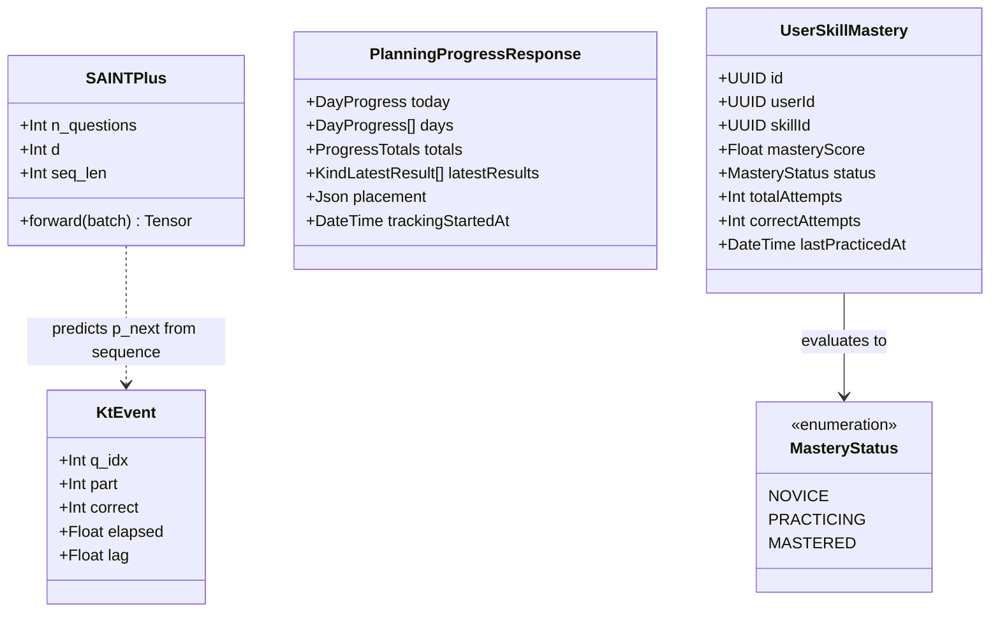
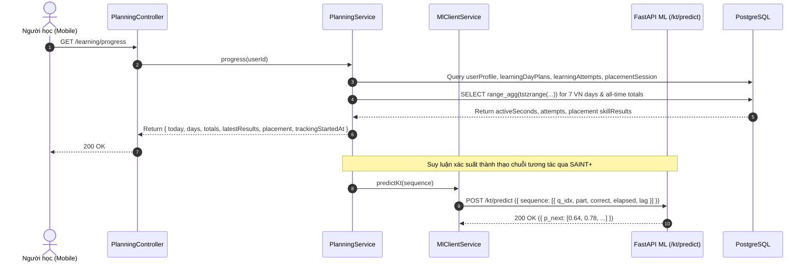

# Domain Specification: 05. Knowledge Tracing & Mastery

## Mission

Tài liệu Domain Specification định nghĩa ngôn ngữ thống nhất (Ubiquitous Language), các mô hình Deep Knowledge Tracing (`SAINTPlus`, `DKTLstm`, `DKVMN`) triển khai tại Python ML Service (`apps/ml/lingoroad_ml/kt`), mô hình toán học tham chiếu Bayesian Knowledge Tracing (BKT), cùng hệ thống tổng hợp tiến độ và phân tích kết quả học tập (`GET /learning/progress`, `GET /learning/summary`) trong hệ sinh thái LingoRoad.

---

# 1. Domain Overview (Tổng quan phân hệ)

Phân hệ Knowledge Tracing & Mastery chịu trách nhiệm mô hình hóa chuỗi tương tác trả lời câu hỏi của người học để dự đoán xác suất trả lời đúng ở bước tiếp theo (`POST /kt/predict`), đồng thời cung cấp bức tranh toàn diện về tiến độ học tập 7 ngày gần nhất, kết quả mới nhất theo từng kỹ năng (`LearningKind`) và kết quả phân loại đầu vào (`PlacementSession.skillResults`).

- **Vấn đề giải quyết**: Điểm số của một bài tập đơn lẻ không phản ánh đầy đủ quá trình tích lũy kiến thức theo thời gian, độ trễ giữa các lần ôn tập (`lag`), thời gian suy nghĩ (`elapsed`) hay sự tương tác chéo giữa các kỹ năng. Phân hệ này kết hợp Deep Knowledge Tracing (Transformer SAINT+, LSTM DKT, Memory-Augmented DKVMN) với hệ thống thống kê tiến độ thực tế theo ngày để theo dõi năng lực người học.
- **Mục tiêu cốt lõi (Core Objectives)**:
  - Huấn luyện và phục vụ suy luận thời gian thực mô hình **SAINT+** (`POST /kt/predict`) cùng các mô hình đối sánh **DKT** (`DKTLstm`) và **DKVMN** trên chuỗi sự kiện làm bài (`q_idx`, `part`, `correct`, `elapsed`, `lag`).
  - Tích hợp client suy luận `MlClientService.predictKt()` trong NestJS Backend để truy vấn vector xác suất thành thạo từ dịch vụ ML.
  - Duy trì mô hình tham chiếu Bayesian Knowledge Tracing (BKT - `UserSkillMastery`) để phân ngưỡng trạng thái thành thạo (`NOVICE` < 0.40, `PRACTICING` 0.40 – 0.69, `MASTERED` ≥ 0.70).
  - Cung cấp API thống kê tiến độ học tập (`GET /learning/progress`, `GET /learning/summary`) cho Mobile App (`DailyProgressCard`, `HomeDashboard`) với dữ liệu 7 ngày theo múi giờ `Asia/Ho_Chi_Minh`, thời gian hoạt động hợp nhất (`range_agg(tstzrange(...))`), điểm mới nhất theo `LearningKind` và kết quả Placement theo kỹ năng.
- **Stack Công nghệ & Tích hợp (Technology Stack & Integrations)**:
  - **Python ML Service (`apps/ml`)**: PyTorch + FastAPI (`lingoroad_ml/kt/{saint_plus.py,dkt.py,dkvmn.py,data.py,train.py}` và `lingoroad_ml/serving/kt_routes.py`).
  - **Backend NestJS (`apps/backend`)**: `MlClientService.predictKt()` (`src/modules/ml-client/ml-client.service.ts`) và `PlanningService` (`src/modules/planning/planning.service.ts`).
  - **Database & ORM**: PostgreSQL qua Prisma ORM (`learning_attempts`, `learning_day_plans`, `learning_activity_sessions`, `learning_activity_segments`, `placement_sessions`).

---

# 2. Sub-systems & Feature Breakdown (Các phân hệ con & Phân rã tính năng)

```
                       ┌──────────────────────────────────────────────┐
                       │         Knowledge Tracing & Mastery          │
                       └──────────────────────┬───────────────────────┘
                                              │
         ┌────────────────────────────────────┼────────────────────────────────────┐
         │                                    │                                    │
         ▼                                    ▼                                    ▼
┌────────────────────────┐        ┌────────────────────────┐        ┌────────────────────────┐
│ Deep KT Models (ML)    │        │ Bayesian KT Reference  │        │ Progress & Analytics   │
├────────────────────────┤        ├────────────────────────┤        ├────────────────────────┤
│ • SAINTPlus Transformer│        │ • Bayesian Posterior   │        │ • 7-Day VN TZ Breakdown│
│ • DKTLstm & DKVMN      │        │ • Transition Modeling  │        │ • Active Seconds Union │
│ • EdNet/Riiid Dataset  │        │ • Guess / Slip Params  │        │ • Latest Kind Results  │
│ • POST /kt/predict API │        │ • Mastery Thresholds   │        │ • Placement Skill Radar│
└────────────────────────┘        └────────────────────────┘        └────────────────────────┘
```

---

# 3. Ubiquitous Language (Ngôn ngữ Thống nhất)

| Thuật ngữ (English) | Thuật ngữ Tiếng Việt | Định nghĩa & Phạm vi sử dụng |
| :--- | :--- | :--- |
| **SAINT+ (`SAINTPlus`)** | Mô hình Transformer KT | Kiến trúc Encoder-Decoder Transformer tách biệt chuỗi bài tập (Exercise Encoder) và chuỗi phản hồi kèm đặc trưng thời gian `elapsed`, `lag` (Response Decoder) tại `lingoroad_ml/kt/saint_plus.py`. |
| **DKT (`DKTLstm`)** | Deep Knowledge Tracing | Mô hình mạng hồi quy LSTM (`lingoroad_ml/kt/dkt.py`) mã hóa tương tác `q_idx + correct × n_questions` để dự đoán xác suất trả lời đúng câu hỏi kế tiếp. |
| **DKVMN (`DKVMN`)** | Dynamic Key-Value Memory Network | Mô hình bộ nhớ ma trận Khóa tĩnh (`key_m`) – Giá trị động (`val_m` cập nhật qua cổng Erase & Add) tại `lingoroad_ml/kt/dkvmn.py`. |
| **KT Event (`KtEvent`)** | Sự kiện Tương tác KT | Một bước trong chuỗi lịch sử làm bài gồm: `q_idx` (mã câu hỏi), `part` (phần thi/nhóm kỹ năng 1..7), `correct` (0 hoặc 1), `elapsed` (thời gian làm câu hỏi đã chuẩn hóa), `lag` (thời gian trôi qua từ câu trước đã chuẩn hóa). |
| **Bayesian Knowledge Tracing (BKT)** | Mô hình Tri thức Bayes | Mô hình Markov ẩn tham chiếu dùng 4 tham số `P(L0)`, `P(T)`, `P(G)`, `P(S)` để ước lượng xác suất thành thạo kỹ năng đơn lẻ (0.0 → 1.0). |
| **Progress Overview (`GET /learning/progress`)** | Tổng quan Tiến độ Học tập | Báo cáo tổng hợp gồm tiến độ 7 ngày gần nhất (`days`), thống kê hôm nay (`today`), tổng tích lũy (`totals`), kết quả gần nhất theo 4 `LearningKind` (`latestResults`) và kết quả Placement (`placement`). |

---

# 4. Architecture Design & Core Decisions (Thiết kế Kiến trúc & Quyết định cốt lõi)

### 4.1. Quyết định 1: Kiến trúc Deep Knowledge Tracing đa mô hình với SAINT+ làm Trọng tâm Phục vụ
- **Dữ liệu & Tiền xử lý (`lingoroad_ml/kt/data.py`)**:
  - Hỗ trợ đọc dữ liệu tương tác chuẩn EdNet / Riiid (`user_id`, `content_id`, `part`, `answered_correctly`, `prior_question_elapsed_time`, `timestamp`) hoặc sinh dữ liệu mô phỏng IRT (`synthetic_interactions`).
  - Chuẩn hóa đặc trưng thời gian bằng biến đổi logarit: `elapsed = log1p(clip(elapsed_ms, 0, 300.000) ÷ 1000)` và `lag = log1p(clip(lag_ms, 0, 86.400.000) ÷ 1000)`.
  - Đóng gói thành cửa sổ chuỗi độ dài cố định `seq_len = 100` thông qua `KTSequenceDataset` và chia tập huấn luyện/kiểm định theo người dùng (`user_split`).
- **Ba kiến trúc mạng nơ-ron (`lingoroad_ml/kt/`)**:
  1. **`SAINTPlus` (`saint_plus.py`)**: Encoder nhúng `q_emb(q) + part_emb(part) + pos_emb`; Decoder dịch phải 1 bước (right-shifted causal input) kết hợp `r_emb(correct) + time_proj([elapsed, lag]) + pos_emb`; đi qua `nn.Transformer` với mặt nạ nhân quả (`generate_square_subsequent_mask`), sau đó ghép nối (`concat`) biểu diễn hiện tại với câu hỏi mục tiêu để dự đoán logit xác suất đúng cho từng vị trí trong chuỗi.
  2. **`DKTLstm` (`dkt.py`)**: Nhúng mã tương tác kết hợp `inter = q_sh + r_sh × (n_questions + 1)` qua mạng `nn.LSTM`, chiếu tuyến tính ra không gian toàn bộ câu hỏi và chọn (`gather`) logit của câu hỏi mục tiêu `batch["q"]`.
  3. **`DKVMN` (`dkvmn.py`)**: Tính trọng số chú ý `w = softmax(k @ key_m.T)` trên `n_concepts = 32` ô nhớ khái niệm, đọc vector tri thức `read = w @ val_m` để dự đoán xác suất đúng, sau đó cập nhật ma trận giá trị động `val_m` bằng vector xóa `erase` và vector thêm `add`.
- **Phục vụ Suy luận (`lingoroad_ml/serving/kt_routes.py` & `MlClientService`)**:
  - Endpoint `POST /kt/predict` nạp checkpoint `SAINTPlus` (`QG_KT_CHECKPOINT`, mặc định `checkpoints/saint_plus.pt`), cắt tối đa `_seq_len` sự kiện cuối cùng trong `sequence`, và trả về mảng xác suất dự đoán `{"p_next": [...]}`.
  - Tại NestJS Backend, `MlClientService.predictKt(sequence)` (`apps/backend/src/modules/ml-client/ml-client.service.ts`) gọi trực tiếp `POST /kt/predict` với cơ chế timeout và xử lý lỗi chuẩn hóa (`ML_UNAVAILABLE`, `ML_TIMEOUT`).

### 4.2. Quyết định 2: Mô hình Tham chiếu Bayesian Knowledge Tracing (BKT Formula - Plain Markdown)
Bên cạnh mô hình học sâu SAINT+, hệ thống định nghĩa công thức cập nhật xác suất Bayes (BKT) làm mô hình tham chiếu giải thích được cho từng kỹ năng đơn lẻ:
- **Khi người học trả lời ĐÚNG (`Observation = 1`)**:
  - **P(L_t | obs = 1) = [P(L_{t-1}) × (1 - P(S))] ÷ [P(L_{t-1}) × (1 - P(S)) + (1 - P(L_{t-1})) × P(G)]**
- **Khi người học trả lời SAI (`Observation = 0`)**:
  - **P(L_t | obs = 0) = [P(L_{t-1}) × P(S)] ÷ [P(L_{t-1}) × P(S) + (1 - P(L_{t-1})) × (1 - P(G))]**
- **Cập nhật xác suất sau bước chuyển tiếp học tập (Transition step)**:
  - **P(L_t) = P(L_t | obs) + (1 - P(L_t | obs)) × P(T)**
- **Tham số mặc định**:
  - `P(L0) = 0.10` (xác suất tiên nghiệm ban đầu; hoặc khởi tạo theo kết quả Placement: A1 = 0.20, A2 = 0.40, B1 = 0.60, B2 = 0.80).
  - `P(T) = 0.15` (tốc độ tiếp thu qua mỗi cơ hội học tập).
  - `P(G) = 0.20` (xác suất đoán đúng cho câu hỏi trắc nghiệm 4 lựa chọn).
  - `P(S) = 0.10` (xác suất sơ suất trả lời sai khi đã nắm kiến thức).

### 4.3. Quyết định 3: Tổng hợp Tiến độ & Thành thạo theo Kỹ năng (`PlanningService.progress()`)
- **Giải pháp**: Endpoint `GET /learning/progress` và `GET /learning/summary` trong `PlanningService` (`apps/backend/src/modules/planning/planning.service.ts`) tính toán trực tiếp các chỉ số năng lực và chuyên cần từ dữ liệu thực tế:
  - **Chuỗi 7 ngày (`days`) theo múi giờ `Asia/Ho_Chi_Minh`**: Với mỗi ngày trong 7 ngày gần nhất, tính `activeSeconds` (bằng hợp nhất `range_agg(tstzrange(...))`), đối chiếu với `dailyGoalMinutes` của ngày đó để xác định `goalMet` (`activeSeconds ≥ dailyGoalMinutes × 60`), đếm số bài học riêng biệt đã hoàn thành (`completedLessonCount`) và số lượt hoàn thành (`completedAttemptCount`).
  - **Kết quả mới nhất theo kỹ năng (`latestResults`)**: Với mỗi `LearningKind` (`GRAMMAR`, `VOCABULARY`, `READING`, `LISTENING`), trích xuất lượt hoàn thành gần nhất kèm `correctCount`, `totalQuestions`, `scoreRatio` (`correctCount ÷ totalQuestions`), `submittedAt` và `lessonTitle`.
  - **Hồ sơ năng lực đầu vào (`placement`)**: Đính kèm `skillResults` của phiên `PlacementSession` hoàn thành gần nhất để giao diện hiển thị đồng thời điểm đầu vào và tiến độ rèn luyện hiện tại.

---

# 5. Domain Model & Entities (Mô hình Miền & Thực thể)

## 5.1 Class Diagram (Mermaid)



## 5.2 Data Contracts & Reference Schema

### 5.2.1 Python ML KT Serving Contract (`apps/ml/lingoroad_ml/serving/kt_routes.py`)
```python
class KtEvent(BaseModel):
    q_idx: int
    part: int
    correct: int
    elapsed: float
    lag: float

class KtRequest(BaseModel):
    sequence: list[KtEvent]
```

### 5.2.2 Reference BKT Prisma Schema (Planned Relational Per-Skill Table)
```prisma
enum MasteryStatus {
  NOVICE
  PRACTICING
  MASTERED
}

model UserSkillMastery {
  id              String        @id @default(uuid()) @db.Uuid
  userId          String        @map("user_id") @db.Uuid
  skillId         String        @map("skill_id") @db.Uuid
  masteryScore    Float         @default(0.10) @map("mastery_score")
  status          MasteryStatus @default(NOVICE)
  totalAttempts   Int           @default(0) @map("total_attempts")
  correctAttempts Int           @default(0) @map("correct_attempts")
  lastPracticedAt DateTime?     @map("last_practiced_at")
  updatedAt       DateTime      @updatedAt @map("updated_at")

  @@unique([userId, skillId])
  @@index([userId, status])
  @@map("user_skill_masteries")
}
```

---

# 6. Core Workflows (Quy trình Vận hành Cốt lõi)

## 6.1 Quy trình Dự đoán Knowledge Tracing (`POST /kt/predict`) & Truy xuất Tiến độ (`GET /learning/progress`)



---

# 7. Business Rules (Quy tắc Nghiệp vụ)

1. **Phân cấp Trạng thái Độ thành thạo (Mastery Thresholds)**:
   - `NOVICE`: Mastery Score < 0.40.
   - `PRACTICING`: 0.40 ≤ Mastery Score < 0.70.
   - `MASTERED`: Mastery Score ≥ 0.70.
2. **Giới hạn Chuỗi Suy luận SAINT+ (`_seq_len` Truncation & Causality)**:
   - Khi gọi `POST /kt/predict`, nếu chuỗi lịch sử `sequence` rỗng thì trả về `{"p_next": []}`. Nếu chuỗi dài hơn `_seq_len` (mặc định 100), mô hình chỉ lấy `_seq_len` sự kiện gần nhất.
   - Tại vị trí thời gian `t`, mô hình SAINT+ chỉ được phép quan sát lịch sử phản hồi từ `0` đến `t - 1` (nhờ cơ chế dịch phải `r_sh`, `el_sh`, `lg_sh` và mặt nạ nhân quả tam giác trên), tuyệt đối không rò rỉ nhãn `correct[t]` của bước hiện tại.
3. **Quy tắc Đạt Mục tiêu Ngày (`goalMet` & `timeMeasured`)**:
   - Một ngày trong mảng `days` (7 ngày theo múi giờ `Asia/Ho_Chi_Minh`) được tính là đạt mục tiêu (`goalMet = true`) khi `dailyGoalMinutes != null` và `activeSeconds ≥ dailyGoalMinutes × 60`.
   - Cờ `timeMeasured` chỉ mang giá trị `true` cho những ngày tính từ ngày có phiên đo thời gian đầu tiên (`first.anchorAt`) của người dùng trở đi.

---

# 8. API Specifications (Đặc tả API Đã Triển khai)

## 8.1 Lấy tổng quan tiến độ và năng lực học tập (`GET /learning/progress`)
- **Endpoint**: `GET /learning/progress`
- **Headers**: `Authorization: Bearer <accessToken>`
- **Response**: `200 OK`
  ```json
  {
    "success": true,
    "data": {
      "today": {
        "date": "2026-11-12",
        "dailyGoalMinutes": 10,
        "activeSeconds": 640,
        "goalMet": true,
        "completedLessonCount": 2,
        "completedAttemptCount": 2,
        "hasActivity": true,
        "timeMeasured": true
      },
      "days": [
        {
          "date": "2026-11-06",
          "dailyGoalMinutes": 10,
          "activeSeconds": 300,
          "goalMet": false,
          "completedLessonCount": 1,
          "completedAttemptCount": 1,
          "hasActivity": true,
          "timeMeasured": true
        }
      ],
      "totals": {
        "totalLessons": 4,
        "completedLessonCount": 3,
        "completedAttemptCount": 4,
        "activeAttemptCount": 0,
        "activeSeconds": 1850
      },
      "latestResults": [
        {
          "kind": "GRAMMAR",
          "correctCount": 5,
          "totalQuestions": 5,
          "scoreRatio": 1.0,
          "submittedAt": "2026-11-12T08:30:00.000Z",
          "lessonTitle": "Hiện tại đơn cho thói quen hằng ngày"
        }
      ],
      "placement": {
        "reading": { "correctCount": 4, "totalItems": 5, "cefr": "B1" },
        "listening": { "correctCount": 3, "totalItems": 5, "cefr": "A2" }
      },
      "trackingStartedAt": "2026-11-06T02:15:00.000Z"
    }
  }
  ```

## 8.2 Dự đoán xác suất thành thạo chuỗi câu hỏi (`POST /kt/predict` - Python ML Service)
- **Endpoint**: `POST /kt/predict` (được gọi qua `MlClientService.predictKt()`)
- **Request Body**:
  ```json
  {
    "sequence": [
      { "q_idx": 12, "part": 5, "correct": 1, "elapsed": 2.89, "lag": 0.0 },
      { "q_idx": 15, "part": 5, "correct": 0, "elapsed": 3.40, "lag": 3.04 }
    ]
  }
  ```
- **Response**: `200 OK`
  ```json
  {
    "p_next": [0.7124, 0.5831]
  }
  ```

---

# 9. Product Recommendations & Future Improvements

1. **Persisted Per-Skill Mastery Table (`UserSkillMastery`)**: Lưu trữ lâu dài kết quả suy luận từ `SAINTPlus` và công thức BKT vào bảng `user_skill_masteries` để theo dõi lịch sử biến thiên điểm thành thạo của từng `skillCode` chi tiết.
2. **Mastery Forgetting Curve Decay**: Kết hợp đặc trưng `lag` của SAINT+ với lịch ôn tập từ vựng để tự động cảnh báo các kỹ năng có nguy cơ suy giảm độ thành thạo sau 30–90 ngày không luyện tập.

# End
