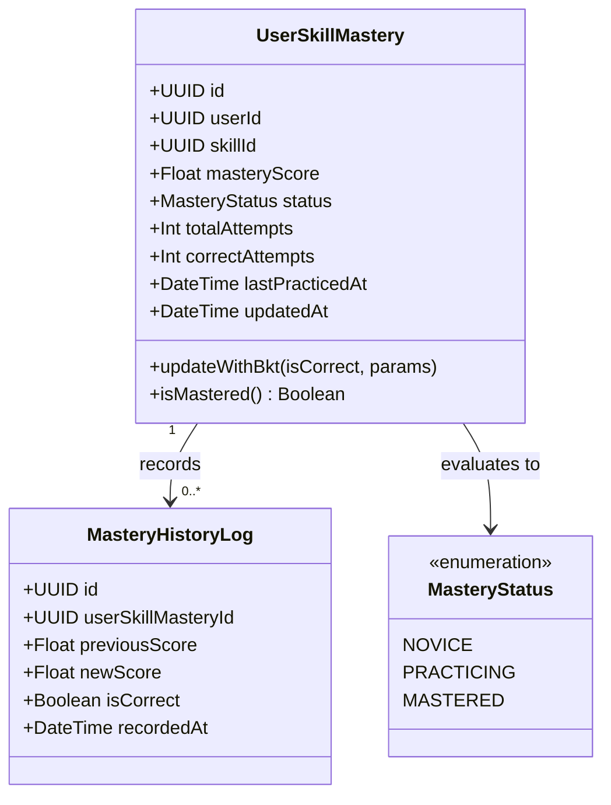
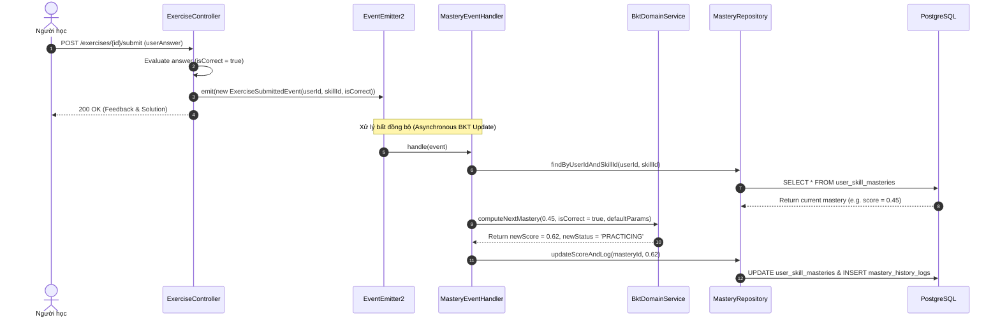

# Domain Specification: 05. Knowledge Tracing & Mastery

## Mission

Tài liệu Domain Specification định nghĩa ngôn ngữ thống nhất (Ubiquitous Language), các Aggregate Root, Entity, mô hình toán học theo dõi độ thành thạo tri thức (Bayesian Knowledge Tracing - BKT) và cơ chế cập nhật trạng thái năng lực kỹ năng trong hệ sinh thái LingoRoad trên nền tảng **NestJS**.

---

# 1. Domain Overview (Tổng quan phân hệ)

Phân hệ Knowledge Tracing & Mastery chịu trách nhiệm mô hình hóa và ước lượng liên tục xác suất làm chủ (Mastery Probability) của người học đối với từng kỹ năng ngôn ngữ trong Knowledge Graph theo thời gian thực.

- **Vấn đề giải quyết**: Điểm số bài học đơn thuần không phản ánh được khả năng một người học thực sự hiểu bài hay chỉ là "đoán mò" (Guess) hoặc bị "trượt tay" (Slip). Phân hệ này sử dụng thuật toán BKT chuẩn học thuật để theo dõi trạng thái ẩn về độ hiểu biết của người học.
- **Mục tiêu cốt lõi (Core Objectives)**:
  - Cập nhật xác suất thành thạo $P(L)$ của từng kỹ năng ngay sau mỗi câu trả lời của người học.
  - Phân loại trạng thái kỹ năng thành các cấp độ: `NOVICE` (< 0.40), `PRACTICING` (0.40 – 0.69), và `MASTERED` (≥ 0.70).
  - Cung cấp dữ liệu thời gian thực cho phân hệ Learning Path để quyết định mở khóa bài học kế tiếp.
  - Cung cấp chỉ số năng lực trực quan cho biểu đồ Radar trên màn hình Profile & Dashboard.
- **Stack Công nghệ & Tích hợp (Technology Stack & Integrations)**:
  - **Framework**: NestJS (TypeScript) với Clean Architecture / DDD.
  - **Database & ORM**: PostgreSQL qua Prisma ORM.
  - **In-Memory Cache**: Redis (lưu trữ vector Mastery của người dùng để truy vấn tốc độ cao).
  - **Computation Engine**: Pure TypeScript Domain Service triển khai công thức Bayesian Knowledge Tracing (BKT) / EMA Mastery phục vụ tính toán tức thời; kết nối mô hình Transformer SAINT+ tại Python ML Service (`POST /kt/predict`) qua `MlClientService`.
  - **Event Listener**: `@nestjs/event-emitter` lắng nghe `ExerciseSubmittedEvent` và `PlacementCompletedEvent`.

---

# 2. Sub-systems & Feature Breakdown (Các phân hệ con & Phân rã tính năng)

```
                       ┌──────────────────────────────────────────────┐
                       │         Knowledge Tracing & Mastery          │
                       └──────────────────────┬───────────────────────┘
                                              │
         ┌────────────────────────────────────┼────────────────────────────────────┐
         │                                    │                                    │
         ▼                                    ▼                                    ▼
┌────────────────────────┐        ┌────────────────────────┐        ┌────────────────────────┐
│ BKT Computation Engine │        │ Mastery State Manager  │        │ Analytics & Insights   │
├────────────────────────┤        ├────────────────────────┤        ├────────────────────────┤
│ • Bayesian Posterior   │        │ • Skill Mastery Store  │        │ • Overall CEFR Mastery │
│   Update               │        │ • Mastery Level Gates  │        │ • Category Radar Vector│
│ • Transition Modeling  │        │ • Batch Seed on Test   │        │ • Weakness Detection   │
│ • Guess / Slip Params  │        │ • Decay Adjustments    │        │ • Progress Trend Log   │
└────────────────────────┘        └────────────────────────┘        └────────────────────────┘
```

---

# 3. Ubiquitous Language (Ngôn ngữ Thống nhất)

| Thuật ngữ (English) | Thuật ngữ Tiếng Việt | Định nghĩa & Phạm vi sử dụng |
| :--- | :--- | :--- |
| **Skill Mastery (Aggregate Root)** | Độ Thành thạo Kỹ năng | Bản ghi trạng thái thể hiện mức độ làm chủ một nút kỹ năng cụ thể của người học ($0.0 \rightarrow 1.0$). |
| **Bayesian Knowledge Tracing (BKT)** | Mô hình Tri thức Bayes | Thuật toán xác suất ẩn Markov dùng để tính toán xác suất một người học đã nắm vững kiến thức dựa trên chuỗi quan sát đúng/sai. |
| **Prior Probability $P(L_0)$** | Xác suất Tiên nghiệm | Xác suất ban đầu người học đã biết kỹ năng trước khi thực hiện bài tập. |
| **Transition Probability $P(T)$** | Xác suất Tiếp thu | Xác suất người học chuyển từ trạng thái chưa biết sang đã biết sau một cơ hội học tập. |
| **Guess Parameter $P(G)$** | Hệ số Đoán mò | Xác suất người học trả lời đúng một câu hỏi dù chưa nắm vững kỹ năng. |
| **Slip Parameter $P(S)$** | Hệ số Trượt tay / Sơ suất | Xác suất người học trả lời sai một câu hỏi dù đã nắm vững kỹ năng. |
| **Mastery Gate (0.70)** | Ngưỡng Thành thạo | Điểm xác suất tối thiểu ($\ge 0.70$) để xem một kỹ năng là đã thuần thục và mở khóa các bài nâng cao. |

---

# 4. Architecture Design & Core Decisions (Thiết kế Kiến trúc & Quyết định cốt lõi)

### 4.1. Quyết định 1: Công thức Cập nhật BKT Chuẩn mực (Bayesian Update Formula)
- **Mô hình toán học**:
  - Khi người học trả lời **ĐÚNG** ($\text{Observation} = 1$):
    $$P(L_{t|\text{obs}=1}) = \frac{P(L_{t-1}) \times (1 - P(S))}{P(L_{t-1}) \times (1 - P(S)) + (1 - P(L_{t-1})) \times P(G)}$$
  - Khi người học trả lời **SAI** ($\text{Observation} = 0$):
    $$P(L_{t|\text{obs}=0}) = \frac{P(L_{t-1}) \times P(S)}{P(L_{t-1}) \times P(S) + (1 - P(L_{t-1})) \times (1 - P(G))}$$
  - Cập nhật xác suất sau quá trình học tập (Transition step):
    $$P(L_t) = P(L_{t|\text{obs}}) + (1 - P(L_{t|\text{obs}})) \times P(T)$$
- **Tham số mặc định của hệ thống**:
  - $P(L_0) = 0.10$ (hoặc lấy từ kết quả Placement test: A1 = 0.20, A2 = 0.40, B1 = 0.60, B2 = 0.80).
  - $P(T) = 0.15$ (tốc độ tiếp thu trung bình qua bài học).
  - $P(G) = 0.20$ (trắc nghiệm 4 lựa chọn có xác suất đoán đúng 20–25%).
  - $P(S) = 0.10$ (xác suất sơ suất 10%).

### 4.2. Quyết định 2: Cập nhật bất đồng bộ qua Domain Event (Event-Driven)
- **Giải pháp**: Việc tính toán BKT diễn ra khi người học nộp từng câu hỏi (`ExerciseSubmittedEvent`). Quá trình này được xử lý bởi `MasteryEventHandler` độc lập để không làm tăng độ trễ (latency) của API nộp bài.

---

# 5. Domain Model & Entities (Mô hình Miền & Thực thể)

## 5.1 Class Diagram (Mermaid)



## 5.2 Prisma Schema Draft (NestJS Infrastructure)

```prisma
enum MasteryStatus {
  NOVICE
  PRACTICING
  MASTERED
}

model UserSkillMastery {
  id              String        @id @default(uuid()) @db.Uuid
  userId          String        @map("user_id") @db.Uuid
  skillId         String        @map("skill_id") @db.Uuid
  masteryScore    Float         @default(0.10) @map("mastery_score")
  status          MasteryStatus @default(NOVICE)
  totalAttempts   Int           @default(0) @map("total_attempts")
  correctAttempts Int           @default(0) @map("correct_attempts")
  lastPracticedAt DateTime?     @map("last_practiced_at")
  updatedAt       DateTime      @updatedAt @map("updated_at")

  historyLogs     MasteryHistoryLog[]

  user            User          @relation(fields: [userId], references: [id], onDelete: Cascade)
  skill           Skill         @relation(fields: [skillId], references: [id], onDelete: Cascade)

  @@unique([userId, skillId])
  @@index([userId, status])
  @@map("user_skill_masteries")
}

model MasteryHistoryLog {
  id                 String           @id @default(uuid()) @db.Uuid
  userSkillMasteryId String           @map("user_skill_mastery_id") @db.Uuid
  previousScore      Float            @map("previous_score")
  newScore           Float            @map("new_score")
  isCorrect          Boolean          @map("is_correct")
  recordedAt         DateTime         @default(now()) @map("recorded_at")

  userSkillMastery   UserSkillMastery @relation(fields: [userSkillMasteryId], references: [id], onDelete: Cascade)

  @@map("mastery_history_logs")
}
```

---

# 6. Core Workflows (Quy trình Vận hành Cốt lõi)

## 6.1 Quy trình Cập nhật Mastery theo BKT khi Nộp Câu Trả lời



---

# 7. Business Rules (Quy tắc Nghiệp vụ)

1. **Phân cấp Trạng thái Độ thành thạo (Mastery Thresholds)**:
   - `NOVICE`: Mastery Score $< 0.40$.
   - `PRACTICING`: $0.40 \le \text{Mastery Score} < 0.70$.
   - `MASTERED`: $\text{Mastery Score} \ge 0.70$.
2. **Khởi tạo Năng lực từ Placement Test (Seeding Rule)**:
   - Khi hoàn thành Placement Test, toàn bộ các kỹ năng thuộc cấp độ đạt được hoặc thấp hơn sẽ được khởi tạo điểm tiên nghiệm ($P(L_0) = 0.75$), giúp người học không phải học lại các kiến thức căn bản đã biết.
3. **Giới hạn Điểm số (Score Bounds)**:
   - Giá trị `masteryScore` luôn nằm trong khoảng $[0.01, 0.99]$ để tránh giá trị suy biến 0 hoặc 1 gây lỗi tính toán xác suất Bayes trong các lần cập nhật tiếp theo.

---

# 8. Draft API Requirements (Dự thảo Yêu cầu API)

## 8.1 Lấy tổng quan độ thành thạo của người học (Get Mastery Overview)
- **Endpoint**: `GET /mastery`
- **Headers**: `Authorization: Bearer <accessToken>`
- **Response**: `200 OK`
  ```json
  {
    "success": true,
    "data": {
      "overallMasteryPercentage": 68.5,
      "totalMasteredSkills": 24,
      "totalPracticingSkills": 8,
      "totalNoviceSkills": 3,
      "categoryBreakdown": {
        "GRAMMAR": 0.72,
        "VOCABULARY": 0.65,
        "READING": 0.70,
        "LISTENING": 0.60
      }
    }
  }
  ```

## 8.2 Lấy chi tiết độ thành thạo theo từng kỹ năng
- **Endpoint**: `GET /mastery/skills`
- **Headers**: `Authorization: Bearer <accessToken>`
- **Response**: `200 OK`
  ```json
  {
    "success": true,
    "data": [
      {
        "skillId": "a1b2c3d4-0001-0000-0000-000000000001",
        "skillName": "Present Simple Tense",
        "category": "GRAMMAR",
        "masteryScore": 0.88,
        "status": "MASTERED",
        "lastPracticedAt": "2026-10-05T14:20:00.000Z"
      }
    ]
  }
  ```

---

# 9. Product Recommendations & Future Improvements

1. **Deep Knowledge Tracing (DKT) với LSTM / Transformers**: Khi lượng dữ liệu tương tác người dùng đủ lớn ($> 100,000$ tương tác), thử nghiệm triển khai mô hình DKT để nắm bắt tương quan phức tạp giữa các kỹ năng không cùng nhánh.
2. **Mastery Forgetting Curve Decay**: Tích hợp cơ chế suy giảm năng lực tự nhiên (Memory Decay) nếu một kỹ năng không được người học rèn luyện hoặc ôn tập trong hơn 90 ngày.

# End
