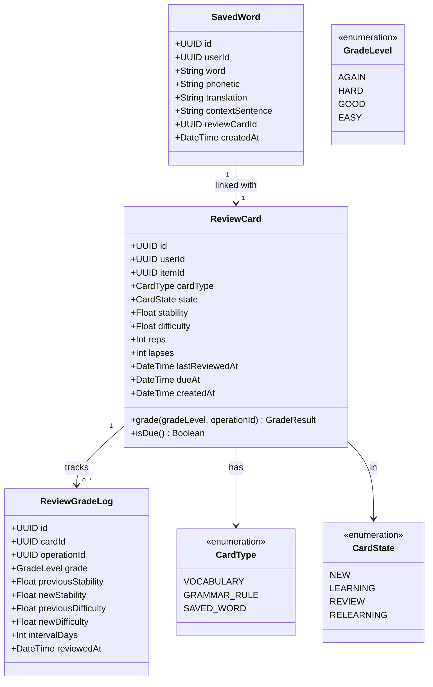
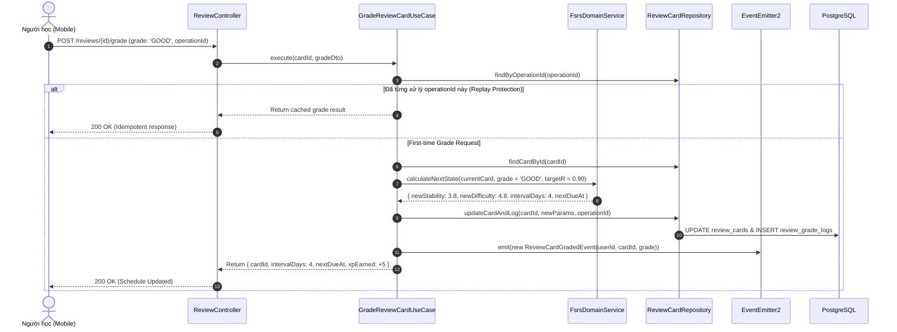

# Domain Specification: 06. Spaced Repetition & Retention (FSRS)

## Mission

Tài liệu Domain Specification định nghĩa ngôn ngữ thống nhất (Ubiquitous Language), các Aggregate Root, Entity, mô hình toán học lặp lại ngắt quãng thế hệ mới (Free Spaced Repetition Scheduler - FSRS) và cơ chế quản lý thẻ từ vựng/ngữ pháp cần ôn tập (Review Cards & Saved Words) trong hệ sinh thái LingoRoad trên nền tảng **NestJS**.

---

# 1. Domain Overview (Tổng quan phân hệ)

Phân hệ Spaced Repetition & Retention (FSRS) chịu trách nhiệm chống lại đường cong quên lãng (Ebbinghaus Forgetting Curve) của não bộ bằng cách tính toán thời điểm vàng tối ưu để nhắc người học ôn lại kiến thức ngay trước khi họ sắp quên.

- **Vấn đề giải quyết**: Học từ vựng hoặc ngữ pháp mà không ôn tập đúng thời điểm sẽ dẫn đến tỷ lệ rơi rụng kiến thức lên đến 80% sau 30 ngày. Các thuật toán cũ như SM-2 (SuperMemo 2) cứng nhắc và kém chính xác; LingoRoad áp dụng thuật toán FSRS hiện đại dựa trên mô hình ba thành phần trí nhớ (Three-Component Model of Memory).
- **Mục tiêu cốt lõi (Core Objectives)**:
  - Tự động tạo thẻ ôn tập (`ReviewCard`) khi người học hoàn thành từ vựng/mẫu câu trong bài học hoặc chủ động lưu từ vựng (`SavedWord`).
  - Triển khai thuật toán FSRS-4.5 tính toán liên tục hai chỉ số cốt lõi: Độ bền trí nhớ (Stability - $S$) và Độ khó của mục (Difficulty - $D$).
  - Cung cấp hàng đợi các thẻ đến hạn (`Due Reviews`) cho kế hoạch học tập mỗi ngày (`/path/today`).
  - Hỗ trợ 4 mức đánh giá phản hồi: `AGAIN` (1), `HARD` (2), `GOOD` (3), `EASY` (4) với cơ chế Idempotency chống gửi lặp request.
- **Stack Công nghệ & Tích hợp (Technology Stack & Integrations)**:
  - **Framework**: NestJS (TypeScript) với Clean Architecture / DDD.
  - **Database & ORM**: PostgreSQL qua Prisma ORM (lập chỉ mục `[userId, dueAt]` để truy vấn cực nhanh).
  - **In-Memory Cache**: Redis (caching danh sách `due_cards_count` cho mobile badge).
  - **Algorithm Engine**: Pure TypeScript FSRS Math Engine độc lập ở tầng Domain Layer.

---

# 2. Sub-systems & Feature Breakdown (Các phân hệ con & Phân rã tính năng)

```
                       ┌──────────────────────────────────────────────┐
                       │     Spaced Repetition & Retention (FSRS)     │
                       └──────────────────────┬───────────────────────┘
                                              │
         ┌────────────────────────────────────┼────────────────────────────────────┐
         │                                    │                                    │
         ▼                                    ▼                                    ▼
┌────────────────────────┐        ┌────────────────────────┐        ┌────────────────────────┐
│ FSRS Calculation Engine│        │ Review Queue Manager   │        │ Saved Word Notebook    │
├────────────────────────┤        ├────────────────────────┤        ├────────────────────────┤
│ • Stability (S) Update │        │ • Due Card Extraction  │        │ • Personal Vocabulary  │
│ • Difficulty (D) Update│        │ • Card State Machine   │        │ • In-context Clip Save │
│ • Retrievability Curve │        │   (New/Learning/Review)│        │ • Dictionary Lookup    │
│ • Target Retention P=90%│       │ • Idempotent Grading   │        │ • Custom Flashcard Auto│
└────────────────────────┘        └────────────────────────┘        └────────────────────────┘
```

---

# 3. Ubiquitous Language (Ngôn ngữ Thống nhất)

| Thuật ngữ (English) | Thuật ngữ Tiếng Việt | Định nghĩa & Phạm vi sử dụng |
| :--- | :--- | :--- |
| **Review Card (Aggregate Root)** | Thẻ Ôn tập | Đơn vị kiến thức cần ôn tập (từ vựng, cụm từ hoặc mẫu câu) gắn với thông số trí nhớ FSRS của một người học. |
| **Stability ($S$)** | Độ bền Trí nhớ | Thời gian (tính bằng ngày) để khả năng nhớ lại kiến thức (Retrievability) suy giảm từ 100% xuống còn 90%. |
| **Difficulty ($D$)** | Độ khó Mục từ | Thang đo độ phức tạp vốn có của từ vựng đối với người học, nằm trong khoảng $[1.0, 10.0]$. |
| **Retrievability ($R$)** | Khả năng Nhớ lại | Xác suất ($0.0 \rightarrow 1.0$) người học có thể nhớ lại mục từ tại thời điểm hiện tại $t$. |
| **Target Retention ($R_{\text{target}}$)** | Tỷ lệ Nhớ Mục tiêu | Mức giữ lại kiến thức mong muốn (mặc định của LingoRoad là $0.90$ tức 90%). |
| **Review Grade** | Mức Đánh giá Ôn tập | Phản hồi của người học khi xem flashcard: `AGAIN` (quên hoàn toàn), `HARD` (nhớ khó khăn), `GOOD` (nhớ chuẩn), `EASY` (nhớ rất rõ). |
| **Due Date (`dueAt`)** | Hạn Ôn tập | Mốc thời gian chính xác thẻ bài cần được đưa ra ôn lại để bảo toàn tỷ lệ nhớ $90\%$. |

---

# 4. Architecture Design & Core Decisions (Thiết kế Kiến trúc & Quyết định cốt lõi)

### 4.1. Quyết định 1: Triển khai Mô hình Toán học FSRS
- **Công thức tính Retrievability theo thời gian**:
  $$R(t, S) = \left(1 + \text{factor} \times \frac{t}{S}\right)^{-w}$$
- **Cập nhật Stability sau lượt ôn tập thành công ($R \ge \text{Pass}$)**:
  $$S' = S \times \left(1 + e^{w_8} \times (11 - D) \times S^{-w_9} \times (e^{w_{10} \times (1 - R)} - 1)\right)$$
- **Cập nhật Stability sau lượt ôn tập thất bại (`AGAIN`)**:
  $$S' = w_{11} \times D^{-w_{12}} \times \left((S + 1)^{w_{13}} - 1\right) \times e^{w_{14} \times (1 - R)}$$
- **Tính toán Khoảng cách Ngày tới lượt ôn tiếp theo (Interval $I$)**:
  $$I = \frac{S}{\text{factor}} \times \left(R_{\text{target}}^{-1/w} - 1\right)$$

### 4.2. Quyết định 2: Idempotent Grade Submission
- **Giải pháp**: Mỗi thao tác chấm điểm flashcard gửi kèm `operationId`. Server lưu lịch sử `ReviewGradeLog`. Nếu request bị gửi lại do rớt mạng, server trả về interval đã tính trước đó mà không đẩy `dueAt` đi xa hơn hay tính thêm XP ôn tập.

---

# 5. Domain Model & Entities (Mô hình Miền & Thực thể)

## 5.1 Class Diagram (Mermaid)



## 5.2 Prisma Schema Draft (NestJS Infrastructure)

```prisma
enum CardType {
  VOCABULARY
  GRAMMAR_RULE
  SAVED_WORD
}

enum CardState {
  NEW
  LEARNING
  REVIEW
  RELEARNING
}

enum GradeLevel {
  AGAIN
  HARD
  GOOD
  EASY
}

model ReviewCard {
  id             String    @id @default(uuid()) @db.Uuid
  userId         String    @map("user_id") @db.Uuid
  itemId         String?   @map("item_id") @db.Uuid
  cardType       CardType  @default(VOCABULARY) @map("card_type")
  state          CardState @default(NEW)
  stability      Float     @default(0.4)
  difficulty     Float     @default(5.0)
  reps           Int       @default(0)
  lapses         Int       @default(0)
  lastReviewedAt DateTime? @map("last_reviewed_at")
  dueAt          DateTime  @default(now()) @map("due_at")
  createdAt      DateTime  @default(now()) @map("created_at")

  gradeLogs      ReviewGradeLog[]
  savedWord      SavedWord?

  user           User      @relation(fields: [userId], references: [id], onDelete: Cascade)
  item           Item?     @relation(fields: [itemId], references: [id], onDelete: SetNull)

  @@index([userId, dueAt, state])
  @@map("review_cards")
}

model SavedWord {
  id              String      @id @default(uuid()) @db.Uuid
  userId          String      @map("user_id") @db.Uuid
  word            String      @db.VarChar(100)
  phonetic        String?     @db.VarChar(100)
  translation     String      @db.Text
  contextSentence String?     @map("context_sentence") @db.Text
  reviewCardId    String?     @unique @map("review_card_id") @db.Uuid
  createdAt       DateTime    @default(now()) @map("created_at")

  user            User        @relation(fields: [userId], references: [id], onDelete: Cascade)
  reviewCard      ReviewCard? @relation(fields: [reviewCardId], references: [id], onDelete: SetNull)

  @@index([userId, word])
  @@map("saved_words")
}

model ReviewGradeLog {
  id                 String     @id @default(uuid()) @db.Uuid
  cardId             String     @map("card_id") @db.Uuid
  operationId        String     @unique @map("operation_id") @db.VarChar(100)
  grade              GradeLevel
  previousStability  Float      @map("previous_stability")
  newStability       Float      @map("new_stability")
  previousDifficulty Float      @map("previous_difficulty")
  newDifficulty      Float      @map("new_difficulty")
  intervalDays       Int        @map("interval_days")
  reviewedAt         DateTime   @default(now()) @map("reviewed_at")

  card               ReviewCard @relation(fields: [cardId], references: [id], onDelete: Cascade)

  @@map("review_grade_logs")
}
```

---

# 6. Core Workflows (Quy trình Vận hành Cốt lõi)

## 6.1 Quy trình Chấm điểm Thẻ Ôn tập (FSRS Grade Flow)



---

# 7. Business Rules (Quy tắc Nghiệp vụ)

1. **Giới hạn Thang đo FSRS (Parameter Boundaries)**:
   - Độ khó $D$ được kẹp chặt trong khoảng $[1.0, 10.0]$: $1.0$ là cực dễ, $10.0$ là cực khó.
   - Độ bền $S$ tối thiểu là $0.1$ ngày (khoảng 2.4 giờ).
2. **Quy tắc Phân loại Hạn ôn tập (Due Filtering)**:
   - Thẻ được coi là đến hạn (`Due`) khi: $\text{dueAt} \le \text{CurrentUtcTimestamp}$.
3. **Quy tắc Tạo Flashcard Tự động từ Saved Word**:
   - Khi người học lưu một từ vựng mới (`POST /saved-words`), hệ thống tự động sinh một bản ghi `ReviewCard` ở trạng thái `NEW` và đưa vào hàng đợi ôn tập của ngày hôm sau.

---

# 8. Draft API Requirements (Dự thảo Yêu cầu API)

## 8.1 Lấy danh sách thẻ đến hạn ôn tập (Get Due Reviews)
- **Endpoint**: `GET /reviews/due?limit=20`
- **Headers**: `Authorization: Bearer <accessToken>`
- **Response**: `200 OK`
  ```json
  {
    "success": true,
    "data": {
      "totalDue": 8,
      "cards": [
        {
          "id": "e4f5a6b7-1111-2222-3333-444455556666",
          "cardType": "VOCABULARY",
          "prompt": "Persistent",
          "phonetic": "/pərˈsɪs.tənt/",
          "hint": "Continuing firmly in a course of action despite difficulty.",
          "state": "REVIEW",
          "reps": 3
        }
      ]
    }
  }
  ```

## 8.2 Chấm điểm lượt ôn tập (Grade Review Card)
- **Endpoint**: `POST /reviews/{cardId}/grade`
- **Headers**: `Authorization: Bearer <accessToken>`
- **Request Body**:
  ```json
  {
    "grade": "GOOD",
    "operationId": "c8d1e2f3-4444-5555-6666-777788889999"
  }
  ```
- **Response**: `200 OK`
  ```json
  {
    "success": true,
    "data": {
      "cardId": "e4f5a6b7-1111-2222-3333-444455556666",
      "grade": "GOOD",
      "intervalDays": 4,
      "nextDueAt": "2026-10-10T09:15:00.000Z",
      "xpEarned": 5
    }
  }
  ```

## 8.3 Lưu từ vựng vào sổ tay cá nhân (Save Word)
- **Endpoint**: `POST /saved-words`
- **Headers**: `Authorization: Bearer <accessToken>`
- **Request Body**:
  ```json
  {
    "word": "Diligent",
    "phonetic": "/ˈdɪl.ə.dʒənt/",
    "translation": "Chăm chỉ, cần cù",
    "contextSentence": "She is a diligent student who always completes her assignments on time."
  }
  ```
- **Response**: `201 Created`

---

# 9. Product Recommendations & Future Improvements

1. **Custom FSRS Parameter Optimizer**: Xây dựng thuật toán Machine Learning tối ưu hóa 17 trọng số FSRS ($w_0 \rightarrow w_{16}$) riêng cho từng cá nhân dựa trên lịch sử $\ge 1,000$ lượt review thực tế.
2. **Audio Flashcards**: Tích hợp nút phát âm giọng đọc bản xứ (Native Speaker TTS) trực tiếp trên từng flashcard ôn tập.

# End
