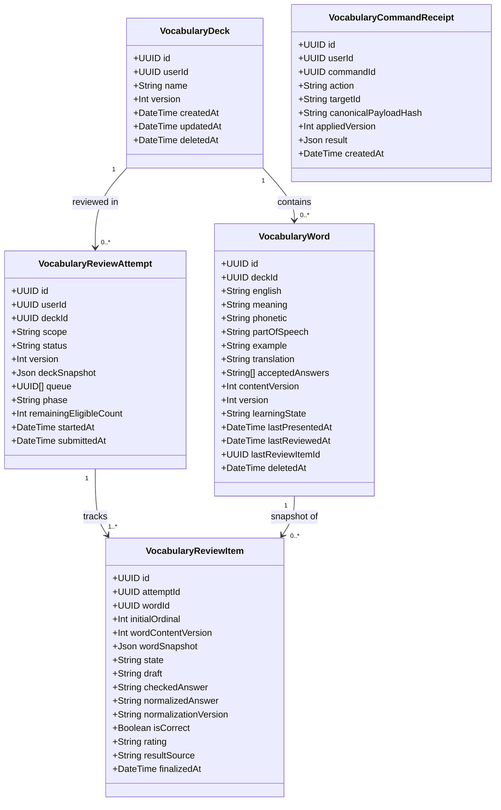
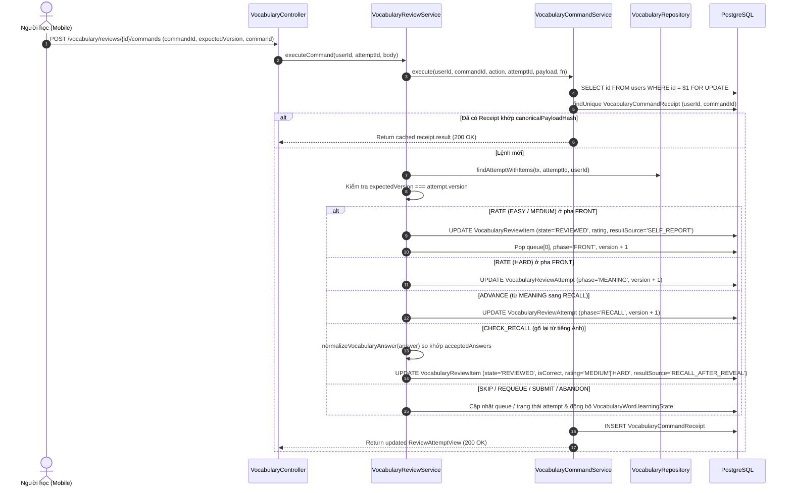

# Domain Specification: 06. Spaced Repetition, Vocabulary Decks & Flashcard Review Engine

## Mission

Tài liệu Domain Specification định nghĩa ngôn ngữ thống nhất (Ubiquitous Language), các Aggregate Root, Entity, mô hình lặp lại ngắt quãng FSRS cùng kiến trúc quản lý bộ thẻ từ vựng cá nhân (`VocabularyDeck`, `VocabularyWord`), phiên ôn tập Flashcard hai pha (`VocabularyReviewAttempt`, `VocabularyReviewItem`) và cơ chế thực thi lệnh bất biến (`VocabularyCommandReceipt`) trong hệ sinh thái LingoRoad trên nền tảng **NestJS** và **Flutter**.

---

# 1. Domain Overview (Tổng quan phân hệ)

Phân hệ Spaced Repetition & Vocabulary Review Engine chịu trách nhiệm chống lại đường cong quên lãng (Ebbinghaus Forgetting Curve) bằng cách kết hợp quản lý bộ từ vựng cá nhân theo chủ đề (`VocabularyDeck`), trạng thái ghi nhớ hai mức (`NEEDS_REVIEW` / `REMEMBERED`), phiên ôn tập đa pha (`FRONT` → `MEANING` → `RECALL`) trên ứng dụng đã đăng nhập và bộ lập lịch ôn tập ngắt quãng (`SrsReviewPage` / `WordLibrary`) cho chế độ khách (Guest Mode).

- **Vấn đề giải quyết**: Học từ vựng mà không ôn tập chủ động (Active Recall) và không theo dõi trạng thái ghi nhớ dẫn đến tỷ lệ rơi rụng kiến thức lên tới 80% sau 30 ngày. Đồng thời, việc ôn tập trên thiết bị di động trong điều kiện mạng chập chờn dễ gây xung đột trạng thái hoặc gửi trùng lệnh chấm điểm.
- **Mục tiêu cốt lõi (Core Objectives)**:
  - Quản lý bộ từ vựng cá nhân (`VocabularyDeck`) và mục từ (`VocabularyWord`) với đầy đủ ngữ nghĩa, phiên âm IPA, từ loại, câu ví dụ, bản dịch và danh sách đáp án chấp nhận (`acceptedAnswers`).
  - Triển khai luồng ôn tập Flashcard (`VocabularyReviewAttempt`) hỗ trợ phạm vi ôn tập linh hoạt (`NEEDS_REVIEW` hoặc `ALL`), kết hợp tự đánh giá (`SELF_REPORT`: `EASY`, `MEDIUM`, `HARD`) và kiểm tra gõ lại từ sau khi xem nghĩa (`RECALL_AFTER_REVEAL`).
  - Bảo toàn tính toàn vẹn dữ liệu tuyệt đối qua cơ chế khóa hành trình theo người dùng (`SELECT id FROM users WHERE id = $1 FOR UPDATE`), mức cô lập giao dịch `RepeatableRead` cho truy vấn đọc và biên lai chống trùng lệnh `VocabularyCommandReceipt` băm SHA-256 (`canonicalPayloadHash`).
  - Hỗ trợ chế độ Guest Offline (`WordLibrary` & `SrsReviewPage`) lưu trữ cục bộ và tính toán chu kỳ ôn tập ngắt quãng theo mức đánh giá.
- **Stack Công nghệ & Tích hợp (Technology Stack & Integrations)**:
  - **Backend Framework**: NestJS (TypeScript) với `VocabularyModule` (`VocabularyController`, `VocabularyService`, `VocabularyReviewService`, `VocabularyCommandService`, `VocabularyRepository`).
  - **Database & ORM**: PostgreSQL qua Prisma ORM (`VocabularyDeck`, `VocabularyWord`, `VocabularyReviewAttempt`, `VocabularyReviewItem`, `VocabularyCommandReceipt`).
  - **Mobile Client**: Flutter (`VocabularyController`, `VocabularyReviewController`, `VocabularyPendingStore`, `SrsReviewPage`, `WordLibrary`).

---

# 2. Sub-systems & Feature Breakdown (Các phân hệ con & Phân rã tính năng)

```
                        ┌──────────────────────────────────────────────┐
                        │   Vocabulary & Spaced Repetition Domain      │
                        └──────────────────────┬───────────────────────┘
                                               │
          ┌────────────────────────────────────┼────────────────────────────────────┐
          │                                    │                                    │
          ▼                                    ▼                                    ▼
┌────────────────────────┐        ┌────────────────────────┐        ┌────────────────────────┐
│ Deck & Word Management │        │ Flashcard Review Queue │        │ Command & Sync Engine  │
├────────────────────────┤        ├────────────────────────┤        ├────────────────────────┤
│ • VocabularyDeck CRUD  │        │ • Scope: NEEDS_REVIEW  │        │ • Per-User FOR UPDATE  │
│ • VocabularyWord CRUD  │        │   or ALL               │        │ • SHA-256 Payload Hash │
│ • Soft Delete & Version│        │ • Phases: FRONT,       │        │ • VocabularyPendingStore│
│ • Answer Normalization │        │   MEANING, RECALL      │        │ • Guest SrsReviewPage  │
└────────────────────────┘        └────────────────────────┘        └────────────────────────┘
```

---

# 3. Ubiquitous Language (Ngôn ngữ Thống nhất)

| Thuật ngữ (English) | Thuật ngữ Tiếng Việt | Định nghĩa & Phạm vi sử dụng |
| :--- | :--- | :--- |
| **Vocabulary Deck (Aggregate Root)** | Bộ Thẻ Từ vựng | Tập hợp các từ vựng được người học phân nhóm theo chủ đề, hỗ trợ xóa mềm (`deletedAt`) và kiểm soát phiên bản (`version`). |
| **Vocabulary Word** | Mục Từ vựng | Đơn vị từ vựng thuộc một `VocabularyDeck`, lưu trữ từ tiếng Anh (`english`), nghĩa (`meaning`), phiên âm (`phonetic`), từ loại (`partOfSpeech`), câu ví dụ (`example`), bản dịch (`translation`), các đáp án chấp nhận (`acceptedAnswers`) và trạng thái học (`learningState`). |
| **Learning State** | Trạng thái Ghi nhớ | Trạng thái hiện tại của từ vựng: `NEEDS_REVIEW` (cần ôn tập lại) hoặc `REMEMBERED` (đã thuộc). |
| **Vocabulary Review Attempt** | Phiên Ôn tập Từ vựng | Một lượt ôn tập bộ từ vựng với bản chụp bất biến (`deckSnapshot`), hàng đợi (`queue` chứa các `wordId` còn lại) và pha hiển thị hiện tại (`phase`: `FRONT` → `MEANING` → `RECALL`). |
| **Vocabulary Review Item** | Mục Ôn tập trong Phiên | Trạng thái kết quả của từng từ trong một phiên ôn tập: `PENDING`, `REVIEWED`, hoặc `SKIPPED`, kèm mức đánh giá (`EASY`, `MEDIUM`, `HARD`) và nguồn kết quả (`SELF_REPORT` hoặc `RECALL_AFTER_REVEAL`). |
| **Command Receipt** | Biên lai Thực thi Lệnh | Bản ghi idempotency (`VocabularyCommandReceipt`) lưu `commandId`, `canonicalPayloadHash` (SHA-256) và `result` nhằm chống thực thi lặp các thao tác ghi. |
| **Stability (S) & Difficulty (D)** | Độ bền & Độ khó Trí nhớ | Các tham số mô hình hóa đường cong quên lãng FSRS (Stability S ≥ 0.1 ngày, Difficulty D trong đoạn [1.0, 10.0], Target Retention R_target = 0.90). |

---

# 4. Architecture Design & Core Decisions (Thiết kế Kiến trúc & Quyết định cốt lõi)

### 4.1. Quyết định 1: Mô hình Toán học FSRS & Chuyển đổi Trạng thái Ghi nhớ Thực tế
- **Mô hình lý thuyết FSRS-4.5 (không dùng LaTeX)**:
  - **Khả năng nhớ lại theo thời gian (Retrievability)**:
    `R(t, S) = (1 + factor × (t ÷ S))^(-w)`
  - **Cập nhật Stability sau lượt ôn tập nhớ thành công**:
    `S' = S × (1 + exp(w_8) × (11 - D) × S^(-w_9) × (exp(w_10 × (1 - R)) - 1))`
  - **Cập nhật Stability sau lượt quên**:
    `S' = w_11 × D^(-w_12) × ((S + 1)^w_13 - 1) × exp(w_14 × (1 - R))`
  - **Khoảng cách ngày tới lượt ôn tiếp theo (Interval I)**:
    `I = (S ÷ factor) × (R_target^(-1 ÷ w) - 1)`
- **Mô hình trạng thái thực thi trong `VocabularyModule`**:
  - Mỗi `VocabularyWord` duy trì trạng thái `learningState` (`NEEDS_REVIEW` | `REMEMBERED`), `lastPresentedAt`, `lastReviewedAt` và `lastReviewItemId`.
  - Khi người học đánh giá `EASY` hoặc `MEDIUM` ở pha `FRONT` (`SELF_REPORT`), từ vựng được ghi nhận hoàn thành (`REVIEWED`) và khi `SUBMIT` phiên ôn tập, các từ đạt `EASY` / `MEDIUM` chuyển sang `learningState = 'REMEMBERED'`, trong khi từ đánh giá `HARD` hoặc trả lời sai ở pha `RECALL` (`RECALL_AFTER_REVEAL`) được đặt `learningState = 'NEEDS_REVIEW'` để ưu tiên xuất hiện trong các phiên ôn tập kế tiếp.

### 4.2. Quyết định 2: Kiểm soát Đồng thời & Idempotency Cấp Người dùng (`VocabularyCommandService`)
- **Khóa tuần tự theo User**: Mọi thao tác thay đổi dữ liệu (tạo/sửa/xóa deck, thêm/sửa/xóa từ, bắt đầu phiên ôn tập, thực thi lệnh ôn tập) đều đi qua `VocabularyCommandService.execute()`, mở transaction PostgreSQL và thực thi `SELECT id FROM users WHERE id = $1 FOR UPDATE` để tuần tự hóa toàn bộ lệnh của cùng một người dùng.
- **Canonical Payload Hashing (SHA-256)**: Payload của lệnh được chuẩn hóa thứ tự khóa đệ quy và băm SHA-256 thành `canonicalPayloadHash`. Nếu `commandId` đã tồn tại trong `vocabulary_command_receipts`:
  - Khớp cả `action`, `targetId` và `canonicalPayloadHash`: Trả về ngay `receipt.result` đã lưu (Idempotent Replay).
  - Khác payload hoặc target: Ném lỗi `409 Conflict` (`VOCAB_COMMAND_CONFLICT`).
- **Đọc nhất quán (`RepeatableRead`)**: Các truy vấn đọc tổng hợp (`getSummary`, `listDecks`, `listWords`, `getReview`, `getHistory`) chạy trong transaction `Prisma.TransactionIsolationLevel.RepeatableRead` để tránh hiện tượng đọc lệch giữa danh sách và bộ đếm.

---

# 5. Domain Model & Entities (Mô hình Miền & Thực thể)

## 5.1 Class Diagram (Mermaid)



## 5.2 Prisma Schema (NestJS Infrastructure)

```prisma
model VocabularyDeck {
  id String @id @default(uuid()) @db.Uuid
  userId String @map("user_id") @db.Uuid
  name String @db.VarChar(60)
  version Int @default(0)
  createdAt DateTime @default(now()) @map("created_at")
  updatedAt DateTime @updatedAt @map("updated_at")
  deletedAt DateTime? @map("deleted_at")
  user User @relation(fields: [userId], references: [id], onDelete: Cascade)
  words VocabularyWord[]
  reviews VocabularyReviewAttempt[]
  @@index([userId, deletedAt, createdAt, id])
  @@map("vocabulary_decks")
}

model VocabularyWord {
  id String @id @default(uuid()) @db.Uuid
  deckId String @map("deck_id") @db.Uuid
  english String @db.VarChar(100)
  meaning String @db.VarChar(500)
  phonetic String @default("") @db.VarChar(100)
  partOfSpeech String @default("") @map("part_of_speech") @db.VarChar(50)
  example String @default("") @db.VarChar(1000)
  translation String @default("") @db.VarChar(1000)
  acceptedAnswers String[] @map("accepted_answers")
  contentVersion Int @default(1) @map("content_version")
  version Int @default(0)
  learningState String @default("NEEDS_REVIEW") @map("learning_state") @db.VarChar(20)
  lastPresentedAt DateTime? @map("last_presented_at")
  lastReviewedAt DateTime? @map("last_reviewed_at")
  lastReviewItemId String? @map("last_review_item_id") @db.Uuid
  createdAt DateTime @default(now()) @map("created_at")
  updatedAt DateTime @updatedAt @map("updated_at")
  deletedAt DateTime? @map("deleted_at")
  deck VocabularyDeck @relation(fields: [deckId], references: [id], onDelete: Cascade)
  reviewItems VocabularyReviewItem[]
  @@index([deckId, deletedAt, createdAt, id])
  @@map("vocabulary_words")
}

model VocabularyReviewAttempt {
  id String @id @default(uuid()) @db.Uuid
  userId String @map("user_id") @db.Uuid
  deckId String @map("deck_id") @db.Uuid
  scope String @db.VarChar(20)
  status String @default("IN_PROGRESS") @db.VarChar(20)
  version Int @default(0)
  deckSnapshot Json @map("deck_snapshot") @db.JsonB
  queue String[] @db.Uuid
  phase String @default("FRONT") @db.VarChar(20)
  remainingEligibleCount Int @default(0) @map("remaining_eligible_count")
  startedAt DateTime @default(now()) @map("started_at")
  updatedAt DateTime @updatedAt @map("updated_at")
  submittedAt DateTime? @map("submitted_at")
  user User @relation(fields: [userId], references: [id], onDelete: Cascade)
  deck VocabularyDeck @relation(fields: [deckId], references: [id], onDelete: Restrict)
  items VocabularyReviewItem[]
  @@index([userId, startedAt, id])
  @@map("vocabulary_review_attempts")
}

model VocabularyReviewItem {
  id String @id @default(uuid()) @db.Uuid
  attemptId String @map("attempt_id") @db.Uuid
  wordId String @map("word_id") @db.Uuid
  initialOrdinal Int @map("initial_ordinal")
  wordContentVersion Int @map("word_content_version")
  wordSnapshot Json @map("word_snapshot") @db.JsonB
  state String @default("PENDING") @db.VarChar(20)
  draft String @default("") @db.VarChar(1000)
  checkedAnswer String? @map("checked_answer") @db.VarChar(1000)
  normalizedAnswer String? @map("normalized_answer") @db.VarChar(1000)
  normalizationVersion String? @map("normalization_version") @db.VarChar(10)
  isCorrect Boolean? @map("is_correct")
  checkedAt DateTime? @map("checked_at")
  rating String? @db.VarChar(10)
  resultSource String? @map("result_source") @db.VarChar(30)
  finalizedAt DateTime? @map("finalized_at")
  attempt VocabularyReviewAttempt @relation(fields: [attemptId], references: [id], onDelete: Cascade)
  word VocabularyWord @relation(fields: [wordId], references: [id], onDelete: Restrict)
  @@unique([attemptId, wordId])
  @@map("vocabulary_review_items")
}

model VocabularyCommandReceipt {
  id String @id @default(uuid()) @db.Uuid
  userId String @map("user_id") @db.Uuid
  commandId String @map("command_id") @db.Uuid
  action String @db.VarChar(40)
  targetId String @map("target_id")
  canonicalPayloadHash String @map("canonical_payload_hash") @db.VarChar(64)
  appliedVersion Int? @map("applied_version")
  result Json @db.JsonB
  createdAt DateTime @default(now()) @map("created_at")
  user User @relation(fields: [userId], references: [id], onDelete: Cascade)
  @@unique([userId, commandId])
  @@map("vocabulary_command_receipts")
}
```

---

# 6. Core Workflows (Quy trình Vận hành Cốt lõi)

## 6.1 Quy trình Ôn tập Flashcard & Thực thi Lệnh (`POST /vocabulary/reviews/:id/commands`)



---

# 7. Business Rules (Quy tắc Nghiệp vụ)

1. **Giới hạn & Chuẩn hóa Dữ liệu Từ vựng**:
   - Mỗi người dùng có tối đa `50` bộ từ (`MAX_DECKS_PER_USER = 50`), mỗi bộ tối đa `500` từ (`MAX_WORDS_PER_DECK = 500`), mỗi phiên ôn tập lấy tối đa `20` từ (`REVIEW_SESSION_SIZE = 20`).
   - Đáp án kiểm tra nhớ từ (`acceptedAnswers`) được chuẩn hóa qua `normalizeVocabularyAnswer` (`normalizationVersion = 'v1'`): chuẩn hóa Unicode NFKC, chuyển dấu nháy cong thành `'`, hạ chữ thường (lowercase), gom khoảng trắng thừa.
2. **Quy tắc Pha Ôn tập Flashcard (`FRONT` → `MEANING` → `RECALL`)**:
   - Tại pha `FRONT`: Người học có thể tự đánh giá `EASY` hoặc `MEDIUM` (hoàn tất thẻ ngay với `resultSource = 'SELF_REPORT'`), hoặc chọn `HARD` để lật thẻ sang pha `MEANING`.
   - Tại pha `MEANING`: Người học xem nghĩa, phiên âm, ví dụ rồi gửi lệnh `ADVANCE` để chuyển sang pha `RECALL`.
   - Tại pha `RECALL`: Người học gõ lại từ tiếng Anh (`CHECK_RECALL`). Nếu khớp `acceptedAnswers`, thẻ đạt `isCorrect = true, rating = 'MEDIUM'`; nếu sai, đạt `isCorrect = false, rating = 'HARD'`, sau đó gửi `ADVANCE` để qua thẻ tiếp theo.
   - Vuốt trái (`SKIP`) đánh dấu thẻ `SKIPPED` và bỏ qua; vuốt phải (`REQUEUE`) chỉ hợp lệ ở pha `FRONT` khi hàng đợi có từ 2 thẻ trở lên, đẩy thẻ hiện tại xuống cuối hàng đợi.
3. **Đồng bộ Trạng thái Ghi nhớ khi `SUBMIT`**:
   - Khi nộp phiên ôn tập (`SUBMIT`), hệ thống chỉ cập nhật `VocabularyWord.learningState` cho các từ chưa bị xóa mềm và không có phiên ôn tập nào mới hơn đã cập nhật từ đó:
     - `rating === 'EASY' || rating === 'MEDIUM'` → `learningState = 'REMEMBERED'`.
     - `rating === 'HARD'` → `learningState = 'NEEDS_REVIEW'`.

---

# 8. Implemented API Endpoints (Danh mục API Thực tế)

| Method & Endpoint | Mô tả Chức năng |
| :--- | :--- |
| `GET /vocabulary/summary` | Lấy thống kê tổng số từ, số từ cần ôn (`dueWords`), số từ đã nhớ (`rememberedWords`), phiên đang dở (`activeReview`) và danh sách bộ thẻ. |
| `GET /vocabulary/decks` | Phân trang danh sách bộ thẻ (`cursor`, `limit`). |
| `POST /vocabulary/decks` | Tạo bộ thẻ từ vựng mới (kèm `commandId`). |
| `PATCH /vocabulary/decks/:id` | Đổi tên bộ thẻ (kiểm tra `expectedVersion` và `commandId`). |
| `DELETE /vocabulary/decks/:id` | Xóa mềm bộ thẻ và các từ bên trong (chặn xóa nếu đang có phiên ôn tập `IN_PROGRESS`). |
| `GET /vocabulary/decks/:id/words` | Lấy danh sách từ vựng trong bộ thẻ (lọc theo `state: ALL | NEEDS_REVIEW | REMEMBERED`, tìm kiếm `q`, phân trang `cursor`). |
| `POST /vocabulary/decks/:id/words` | Thêm từ vựng mới vào bộ thẻ (`english`, `meaning`, `phonetic`, `partOfSpeech`, `example`, `translation`, `acceptedAnswers`). |
| `PATCH /vocabulary/words/:id` | Cập nhật nội dung từ vựng (tăng `contentVersion` nếu đổi từ tiếng Anh hoặc `acceptedAnswers`). |
| `DELETE /vocabulary/words/:id` | Xóa mềm từ vựng khỏi bộ thẻ. |
| `POST /vocabulary/decks/:id/reviews` | Khởi tạo hoặc tiếp tục phiên ôn tập (`scope: NEEDS_REVIEW | ALL`) cho bộ thẻ. |
| `GET /vocabulary/reviews/:id` | Lấy chi tiết trạng thái phiên ôn tập hiện tại. |
| `POST /vocabulary/reviews/:id/commands` | Thực thi lệnh trong phiên ôn tập (`SAVE_PROGRESS`, `CHECK_RECALL`, `RATE`, `ADVANCE`, `SKIP`, `REQUEUE`, `SUBMIT`, `ABANDON`). |
| `GET /vocabulary/history` | Xem lịch sử các phiên ôn tập đã hoàn thành (`COMPLETED`) hoặc bỏ dở (`ABANDONED`). |

# End
