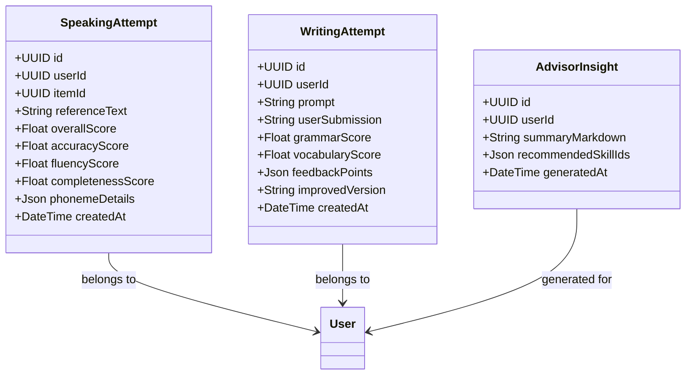
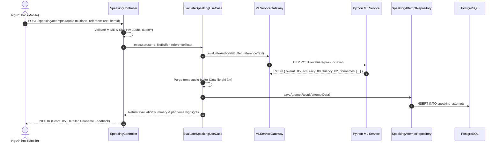

# Domain Specification: 07. AI Practice & Intelligent Tutoring

## Mission

Tài liệu Domain Specification định nghĩa ngôn ngữ thống nhất (Ubiquitous Language), các Aggregate Root, Entity, quy trình chấm điểm phát âm & nói (Speaking Evaluation), chấm bài viết (Writing Evaluation) và Trợ lý học tập thông minh (AI Learning Advisor) trong hệ sinh thái LingoRoad trên nền tảng **NestJS**.

---

# 1. Domain Overview (Tổng quan phân hệ)

Phân hệ AI Practice & Intelligent Tutoring cung cấp môi trường luyện tập giao tiếp chủ động và phản hồi tức thời cho người học. Tận dụng các mô hình học máy (Speech-to-Text, Phoneme-level Pronunciation Scoring) và mô hình ngôn ngữ lớn (LLM), phân hệ này cá nhân hóa lời giải thích lỗi sai và đưa ra lời khuyên học tập chuyên sâu.

- **Vấn đề giải quyết**: Học ngoại ngữ thường thiếu cơ hội luyện nói và nhận phản hồi chi tiết về phát âm/ngữ pháp nếu không có giáo viên trực tiếp 1-1. Phân hệ này cung cấp trợ lý ảo chấm điểm và giải thích 24/7.
- **Mục tiêu cốt lõi (Core Objectives)**:
  - Đánh giá phát âm câu nói của người học: Chấm điểm độ chuẩn xác âm vị (Phoneme Accuracy), độ lưu loát (Fluency) và độ hoàn chỉnh (Completeness).
  - Đánh giá bài viết ngắn (Writing Evaluation): Phát hiện lỗi ngữ pháp, dùng từ và gợi ý cách diễn đạt tự nhiên hơn.
  - Cung cấp Trợ lý AI (Learning Advisor): Phân tích điểm yếu trong Knowledge Graph và đưa ra chiến lược học tập phù hợp.
  - Cơ chế Graceful Degradation: Mặc định bảo vệ hệ thống khi AI Service quá tải, đảm bảo các tính năng làm bài tập cốt lõi vẫn vận hành bình thường.
- **Stack Công nghệ & Tích hợp (Technology Stack & Integrations)**:
  - **Framework**: NestJS (TypeScript) với Clean Architecture / DDD.
  - **External ML & AI Services**: FastAPI Python ML Service (`:8001`) tích hợp Faster-Whisper (ASR Speaking Scoring), Vector RAG, và Google Gemini Flash API (`/speech/score`, `/llm/advisor`, `/llm/exercises`, `/llm/awe`).
  - **ML Client**: `MlClientService` (`@nestjs/axios`) với xác thực `x-internal-token`, Circuit Breaker và Timeout 15s-30s.
  - **Storage & Temp Stream**: S3 / Local Temp Storage (với cơ chế tự động xóa file ghi âm sau khi chấm điểm để bảo vệ quyền riêng tư).
  - **Validation**: `@nestjs/platform-express` Multer với MIME signature validation (audio/wav, audio/m4a, audio/mp3, audio/webm).

---

# 2. Sub-systems & Feature Breakdown (Các phân hệ con & Phân rã tính năng)

```
                       ┌──────────────────────────────────────────────┐
                       │     AI Practice & Intelligent Tutoring       │
                       └──────────────────────┬───────────────────────┘
                                              │
         ┌────────────────────────────────────┼────────────────────────────────────┐
         │                                    │                                    │
         ▼                                    ▼                                    ▼
┌────────────────────────┐        ┌────────────────────────┐        ┌────────────────────────┐
│ Speaking Evaluator     │        │ Writing Evaluator      │        │ AI Learning Advisor    │
├────────────────────────┤        ├────────────────────────┤        ├────────────────────────┤
│ • Audio Upload & MIME  │        │ • Text Grammar Parsing │        │ • Weakness Synthesis   │
│ • Phoneme Scoring (GOP)│        │ • Lexical Diversity    │        │ • Personalized Action  │
│ • Fluency & Pitch Rate │        │ • CEFR Text Alignment  │          Recommendations        │
│ • Ephemeral Audio Purge│        │ • Detailed Corrections │        │ • Contextual Insights  │
└────────────────────────┘        └────────────────────────┘        └────────────────────────┘
```

---

# 3. Ubiquitous Language (Ngôn ngữ Thống nhất)

| Thuật ngữ (English) | Thuật ngữ Tiếng Việt | Định nghĩa & Phạm vi sử dụng |
| :--- | :--- | :--- |
| **Speaking Attempt (Aggregate Root)** | Lượt Luyện Nói | Phiên ghi âm và đánh giá phát âm cho một câu mẫu cụ thể của người học. |
| **Goodness of Pronunciation (GOP)**| Điểm Chuẩn Phát Âm | Thuật toán so khớp âm vị nhận dạng với âm vị chuẩn của người bản xứ ($0 \rightarrow 100$). |
| **Fluency Score** | Điểm Lưu Loát | Chỉ số đo lường tốc độ nói, khoảng lặng ngập ngừng và nhịp điệu phát âm. |
| **Ephemeral Audio Policy** | Chính sách Âm thanh Tạm thời| Quy định bảo mật: Tệp âm thanh ghi âm chỉ lưu tạm trong bộ nhớ để chấm điểm và BẮT BUỘC bị xóa ngay sau khi hoàn thành. |
| **AI Learning Advisor** | Trợ lý Lộ trình AI | Tính năng phân tích biểu đồ năng lực Mastery và lịch sử sai sót để tạo bản tóm tắt lời khuyên thông minh. |
| **Fail-Closed Fallback** | Cơ chế Phòng vệ Dự phòng | Hành vi an toàn: Nếu AI Service phản hồi chậm hoặc lỗi, hệ thống trả về thông báo rõ ràng mà không làm gián đoạn luồng làm bài tập thường. |

---

# 4. Architecture Design & Core Decisions (Thiết kế Kiến trúc & Quyết định cốt lõi)

### 4.1. Quyết định 1: Chính sách Bảo mật Dữ liệu Âm thanh (Zero-Retention Audio)
- **Giải pháp**: Nhằm tuân thủ các quy định bảo mật quyền riêng tư cá nhân (GDPR & COPPA):
  1. File âm thanh ghi âm từ ứng dụng Mobile gửi lên (`POST /speaking/attempts`) được kiểm tra dung lượng ($\le 10\text{ MiB}$) và thời lượng ($\le 120\text{ giây}$).
  2. File được xử lý trực tiếp qua ML Service và kết quả dạng text JSON (Phoneme breakdown, score) được lưu vào DB.
  3. File âm thanh gốc lập tức bị xóa vĩnh viễn khỏi server/storage sau khi chấm điểm.

### 4.2. Quyết định 2: Tách biệt Microservice ML và NestJS Backend
- **Giải pháp**: Tác vụ chấm điểm giọng nói (Voice AI) sử dụng nhiều tài nguyên GPU/CPU chuyên biệt nên được tách thành dịch vụ Python FastAPI riêng. NestJS Backend đóng vai trò Gateway điều phối, xác thực phiên người dùng và quản lý dữ liệu nghiệp vụ.

---

# 5. Domain Model & Entities (Mô hình Miền & Thực thể)

## 5.1 Class Diagram (Mermaid)



## 5.2 Prisma Schema Draft (NestJS Infrastructure)

```prisma
model SpeakingAttempt {
  id                String   @id @default(uuid()) @db.Uuid
  userId            String   @map("user_id") @db.Uuid
  itemId            String?  @map("item_id") @db.Uuid
  referenceText     String   @map("reference_text") @db.Text
  overallScore      Float    @map("overall_score")
  accuracyScore     Float    @map("accuracy_score")
  fluencyScore      Float    @map("fluency_score")
  completenessScore Float    @map("completeness_score")
  phonemeDetails    Json     @map("phoneme_details") @db.JsonB
  createdAt         DateTime @default(now()) @map("created_at")

  user              User     @relation(fields: [userId], references: [id], onDelete: Cascade)
  item              Item?    @relation(fields: [itemId], references: [id], onDelete: SetNull)

  @@index([userId, createdAt])
  @@map("speaking_attempts")
}

model WritingAttempt {
  id              String   @id @default(uuid()) @db.Uuid
  userId          String   @map("user_id") @db.Uuid
  prompt          String   @db.Text
  userSubmission  String   @map("user_submission") @db.Text
  grammarScore    Float    @map("grammar_score")
  vocabularyScore Float    @map("vocabulary_score")
  feedbackPoints  Json     @map("feedback_points") @db.JsonB
  improvedVersion String?  @map("improved_version") @db.Text
  createdAt       DateTime @default(now()) @map("created_at")

  user            User     @relation(fields: [userId], references: [id], onDelete: Cascade)

  @@index([userId, createdAt])
  @@map("writing_attempts")
}
```

---

# 6. Core Workflows (Quy trình Vận hành Cốt lõi)

## 6.1 Quy trình Chấm điểm Phát âm Luyện nói (Speaking Evaluation)



---

# 7. Business Rules (Quy tắc Nghiệp vụ)

1. **Ràng buộc Định dạng Tệp Âm thanh (Audio Constraints)**:
   - Chấp nhận các định dạng âm thanh: `.wav`, `.m4a`, `.mp3`.
   - Dung lượng tối đa: $10\text{ MiB}$; Thời lượng tối đa: $120\text{ giây}$.
2. **Quy định Xóa Dữ liệu Âm thanh Tức thì (Purge Invariant)**:
   - Hệ thống không được lưu trữ tệp âm thanh gốc của người học quá 60 giây sau khi quá trình chấm điểm kết thúc.
3. **Thang điểm Đánh giá AI**:
   - Mọi điểm số phát âm và bài viết đều được chuẩn hóa về thang điểm $[0, 100]$.

---

# 8. Draft API Requirements (Dự thảo Yêu cầu API)

## 8.1 Nộp bài nói để AI chấm điểm (Evaluate Speaking)
- **Endpoint**: `POST /speaking/attempts`
- **Headers**: `Authorization: Bearer <accessToken>`, `Content-Type: multipart/form-data`
- **Form Data**:
  - `audio`: File Binary (.wav / .m4a)
  - `referenceText`: "I would like a cup of coffee, please."
  - `itemId`: "c3d4e5f6-1111-2222-3333-444455556666"
- **Response**: `200 OK`
  ```json
  {
    "success": true,
    "data": {
      "overallScore": 86.5,
      "accuracyScore": 90.0,
      "fluencyScore": 82.0,
      "completenessScore": 100.0,
      "phonemeFeedback": [
        {
          "word": "coffee",
          "accuracyScore": 95.0,
          "errorType": "None"
        }
      ]
    }
  }
  ```

## 8.2 Lấy lời khuyên học tập từ AI Advisor
- **Endpoint**: `POST /path/advisor`
- **Headers**: `Authorization: Bearer <accessToken>`
- **Response**: `200 OK`
  ```json
  {
    "success": true,
    "data": {
      "adviceMarkdown": "Bạn đang làm rất tốt ở phần Từ vựng A2, nhưng thường gặp lỗi ở **Thì Hiện tại Hoàn thành**. Hãy dành 10 phút hôm nay để làm bài tập củng cố nhé!",
      "suggestedLessonId": "b2c3d4e5-1111-2222-3333-444455556666"
    }
  }
  ```

---

# 9. Product Recommendations & Future Improvements

1. **Interactive AI Roleplay Dialogue**: Tích hợp luồng đàm thoại nhiều lượt (Multi-turn conversational bot) theo các chủ đề thực tế (Ordering Food, Job Interview).
2. **Real-time Streaming TTS/STT**: Sử dụng WebSocket để nhận diện và phản hồi giọng nói theo thời gian thực (Realtime Voice Streaming).

# End
