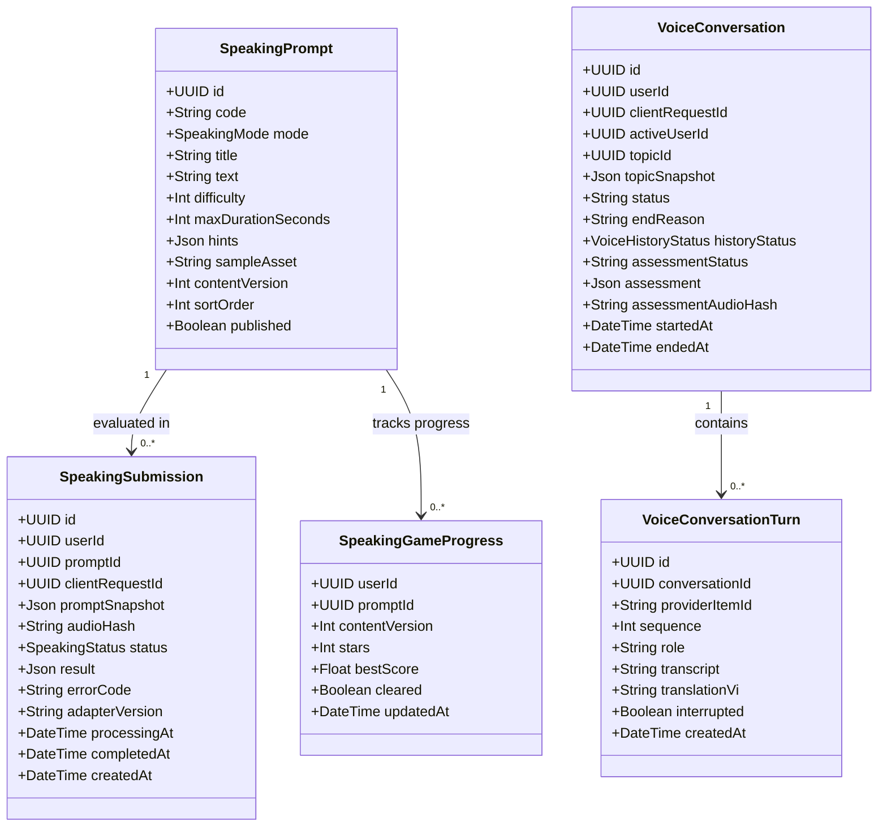
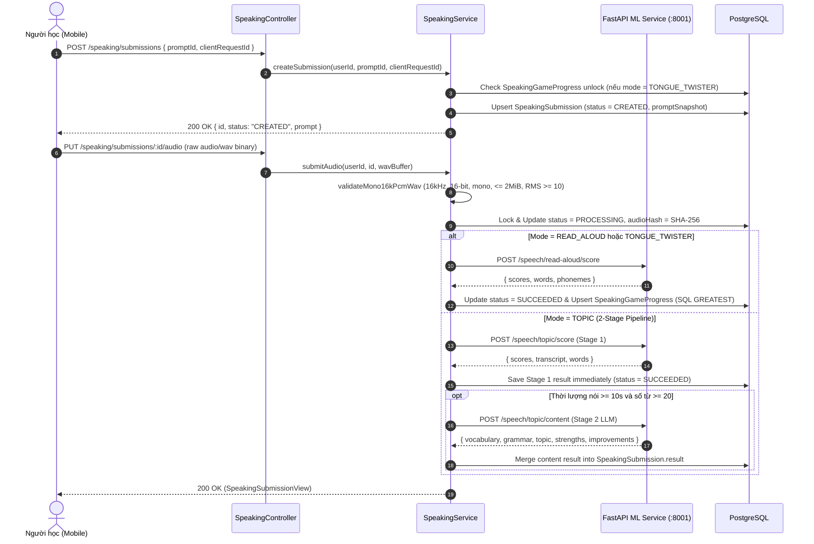

# Domain Specification: 07. AI Practice, Speaking Evaluator & Intelligent Tutoring

## Mission

Tài liệu Domain Specification định nghĩa ngôn ngữ thống nhất (Ubiquitous Language), các Aggregate Root, Entity, quy trình chấm điểm phát âm & luyện nói 3 chế độ (`READ_ALOUD`, `TOPIC`, `TONGUE_TWISTER`), hội thoại trực tiếp thời gian thực với AI (`VoiceConversation`, `VoiceConversationTurn`), đánh giá bài viết định tính theo bậc CEFR & danh sách kiểm tra ngữ pháp (`EvaluateCefrWritingUseCase`) và Trợ lý học tập thông minh tích hợp Vector RAG (`advisor.py`, `exercises.py`) trong hệ sinh thái LingoRoad trên nền tảng **NestJS**, **FastAPI ML** và **Flutter**.

---

# 1. Domain Overview (Tổng quan phân hệ)

Phân hệ AI Practice & Intelligent Tutoring cung cấp môi trường luyện tập giao tiếp chủ động (Nói & Viết) và phản hồi tức thời cho người học. Tận dụng Azure Cognitive Services Speech SDK (Pronunciation Assessment & Azure Voice Live Realtime API), Faster-Whisper, Vector RAG (`corpus_index.npz`) và các mô hình ngôn ngữ lớn đa nhà cung cấp (Azure OpenAI / OpenAI / Gemini), phân hệ này cá nhân hóa đánh giá phát âm đến từng âm vị, đối thoại giọng nói hai chiều và chấm bài viết an toàn trước tấn công Prompt Injection.

- **Vấn đề giải quyết**: Người học ngoại ngữ thiếu môi trường thực hành nói đa dạng (đọc chuẩn âm, nói tự do theo chủ đề, trò chơi xoắn lưỡi, hội thoại trực tiếp 1-1) và thiếu phản hồi chi tiết về ngữ pháp/từ vựng khi luyện viết.
- **Mục tiêu cốt lõi (Core Objectives)**:
  - **Speaking Evaluator (3 chế độ & Game)**:
    - `READ_ALOUD`: Đọc thành tiếng câu/đoạn văn (9 đề bài), chấm điểm `Accuracy`, `Fluency`, `Prosody`, `Completeness` và công thức trọng số `lingoroad-weighted-v1`: `round((40 × Acc + 25 × Flu + 25 × Pros + 10 × Comp) ÷ 100)`.
    - `TOPIC`: Nói tự do theo chủ đề (6 đề bài, tối đa 60s) qua pipeline 2 giai đoạn: Giai đoạn 1 chấm phát âm liên tục (`POST /speech/topic/score`, `overall = round((40 × Acc + 25 × Flu + 25 × Pros) ÷ 90)`) lưu ngay vào DB; Giai đoạn 2 chấm nội dung bằng LLM (`POST /speech/topic/content`: `vocabulary`, `grammar`, `topic` 0–100 kèm nhận xét tiếng Việt `strengths` và `improvements`, có hỗ trợ chấm lại qua `POST /speaking/submissions/:id/content`).
    - `TONGUE_TWISTER`: Trò chơi phát âm câu xoắn lưỡi (12 màn chơi mở khóa tuần tự), tính sao (`60/80/90` cho 1/2/3 sao), điều kiện qua màn (`stars ≥ 1` và `completeness ≥ 80`) và cập nhật kỷ lục nguyên tử bằng SQL `GREATEST`.
  - **AI Voice Live Conversation**: Hội thoại tiếng Anh thời gian thực (tối đa 180s/cuộc gọi, tối đa 10 cuộc gọi/ngày UTC) qua WebSocket relay `/speaking/conversations/connect` và WebRTC kết nối trực tiếp tới Azure Voice Live (`wss://<resource>/voice-live/realtime/calls`), hỗ trợ 3 chủ đề A1–A2 có gói chuẩn bị từ vựng/cụm từ, dịch từng lượt thoại sang tiếng Việt và chấm điểm tổng kết sau cuộc gọi.
  - **Qualitative CEFR Writing Evaluator**: Đánh giá bài viết tự luận (`GET /api/v1/assessment/writing/items`, `POST /api/v1/assessment/writing/evaluate`) với kiểm tra tối thiểu 20 từ, 3 lớp phòng thủ chống Prompt Injection (tra cứu `itemId` từ DB, bộ lọc 10 mẫu Regex độc hại, và vách ngăn ngẫu nhiên `BOUNDARY_<hex>`), trả về nhận xét định tính `levelEvaluation`, `grammarChecklist`, `improvementSteps`, `feedback` và `overallCommentVi`.
  - **AI Learning Advisor & Exercise Generator**: Tư vấn lộ trình học tập tích hợp RAG (`POST /llm/advisor` truy vấn kho tri thức `data/corpus_index.npz`) và tự động sinh câu hỏi trắc nghiệm từ vựng/ngữ pháp kết hợp WordNet distractors (`POST /llm/exercises`).

---

# 2. Sub-systems & Feature Breakdown (Các phân hệ con & Phân rã tính năng)

```
                        ┌──────────────────────────────────────────────┐
                        │     AI Practice & Intelligent Tutoring       │
                        └──────────────────────┬───────────────────────┘
                                               │
     ┌─────────────────────────┬───────────────┴───────────┬─────────────────────────┐
     ▼                         ▼                           ▼                         ▼
┌─────────────────────┐ ┌─────────────────────┐ ┌─────────────────────┐ ┌─────────────────────┐
│ Speaking 3-Mode &   │ │ AI Voice Live       │ │ CEFR Writing &      │ │ RAG Advisor &       │
│ Game Evaluator      │ │ Conversation        │ │ Grammar Evaluator   │ │ Exercise Generator  │
├─────────────────────┤ ├─────────────────────┤ ├─────────────────────┤ ├─────────────────────┤
│ • READ_ALOUD (9)    │ │ • WebRTC + WS Relay │ │ • Stateless /llm/awe│ │ • Vector RAG Search │
│ • TOPIC 2-Stage (6) │ │ • 3 A1-A2 Prep Packs│ │ • Qualitative CEFR  │ │   (corpus_index.npz)│
│ • TONGUE_TWISTER(12)│ │ • Turn Translation  │ │ • Grammar Checklist │ │ • WordNet Distractor│
│ • 16kHz Mono PCM WAV│ │ • Post-Call Scoring │ │ • 3-Tier Anti-Inject│ │ • Multi-LLM Client  │
└─────────────────────┘ └─────────────────────┘ └─────────────────────┘ └─────────────────────┘
```

---

# 3. Ubiquitous Language (Ngôn ngữ Thống nhất)

| Thuật ngữ (English) | Thuật ngữ Tiếng Việt | Định nghĩa & Phạm vi sử dụng |
| :--- | :--- | :--- |
| **SpeakingPrompt** | Đề bài Luyện Nói | Mẫu câu hoặc chủ đề luyện nói thuộc 1 trong 3 chế độ (`READ_ALOUD`, `TOPIC`, `TONGUE_TWISTER`), lưu phiên bản `contentVersion`, độ khó, thời lượng tối đa (`maxDurationSeconds`) và tệp âm thanh mẫu (`sampleAsset`). |
| **SpeakingSubmission** | Bài nộp Luyện Nói | Bản ghi phiên nộp bài nói của người học, quản lý trạng thái vòng đời (`CREATED` → `PROCESSING` → `SUCCEEDED` / `FAILED` / `UNKNOWN`), chống gửi lặp qua `(userId, clientRequestId)` và băm âm thanh `audioHash` (SHA-256). |
| **SpeakingGameProgress** | Tiến độ Trò chơi Phát âm | Kỷ lục điểm cao nhất (`bestScore`), số sao (`stars`: 0–3) và trạng thái qua màn (`cleared`) của người học trên từng màn `TONGUE_TWISTER`. |
| **VoiceConversation** | Cuộc Hội thoại AI Trực tiếp | Phiên đàm thoại giọng nói thời gian thực với trợ lý AI theo chủ đề, kiểm soát độc quyền cuộc gọi đang mở bằng khóa duy nhất `activeUserId`. |
| **VoiceConversationTurn** | Lượt Thoại Hội thoại | Từng câu nói của người học (`user`) hoặc AI (`assistant`) trong cuộc hội thoại, hỗ trợ lưu bản dịch tiếng Việt (`translationVi`) và trạng thái ngắt lời (`interrupted`). |
| **Qualitative CEFR Writing** | Đánh giá Viết Định tính | Cơ chế đánh giá bài viết không chấm điểm số cứng mà phân tích sự phù hợp với bậc CEFR mục tiêu (`levelEvaluation`) và kiểm tra mức độ áp dụng các cấu trúc ngữ pháp bắt buộc (`grammarChecklist`). |

---

# 4. Architecture Design & Core Decisions (Thiết kế Kiến trúc & Quyết định cốt lõi)

### 4.1. Quyết định 1: Xác thực Định dạng Âm thanh Nghiêm ngặt & Zero-Retention (`validateMono16kPcmWav`)
- Mọi tệp âm thanh gửi lên `PUT /speaking/submissions/:id/audio` được kiểm tra header RIFF/WAVE trực tiếp trên bộ nhớ đệm:
  - Bắt buộc chuẩn **16 kHz, 16-bit, Mono PCM WAV**, dung lượng tối đa **2 MiB** (`2,097,152` bytes), thời lượng từ **1.5s** đến `maxDurationSeconds + 1s`.
  - Kiểm tra năng lượng tín hiệu âm thanh (RMS ≥ 10) để chặn sớm các bản ghi im lặng hoàn toàn (`SPEAKING_NO_SPEECH`) trước khi gọi Azure Speech SDK.
  - Chỉ lưu mã băm SHA-256 (`audioHash`) và kết quả JSON vào DB; buffer âm thanh gốc bị giải phóng ngay sau khi xử lý.

### 4.2. Quyết định 2: Pipeline 2 Giai đoạn cho Chế độ Nói theo Chủ đề (`TOPIC`)
- **Stage 1 (Pronunciation & Transcript)**: Gọi `POST /speech/topic/score` (`topic.py`) sử dụng Azure Continuous Recognition để thu bản phiên âm (`transcript`), tính điểm phát âm theo trọng số thời lượng từng từ (`overall = round((40 × Acc + 25 × Flu + 25 × Pros) ÷ 90)`) và lưu ngay vào `SpeakingSubmission` với trạng thái `SUCCEEDED`.
- **Stage 2 (LLM Content Evaluation)**: Nếu thời lượng nói thực tế ≥ 10 giây và bản phiên âm có ≥ 20 từ, hệ thống gọi tiếp `POST /speech/topic/content` (`content.py`) để đánh giá `vocabulary`, `grammar`, `topic` (0–100) kèm điểm mạnh (`strengths`) và gợi ý sửa câu cụ thể (`improvements`). Nếu Stage 2 lỗi hoặc timeout, bài nộp vẫn giữ nguyên điểm phát âm Stage 1 (`contentEvaluator.status = 'FAILED'`) và cho phép người học bấm chấm lại riêng phần nội dung qua `POST /speaking/submissions/:id/content` mà không cần ghi âm lại.

### 4.3. Quyết định 3: Kết nối Lai WebSocket + WebRTC cho AI Voice Live Conversation
- Backend NestJS đóng vai trò cổng điều phối bảo mật (`VoiceConversationRelayService`): cấp vé một lần `connectTicket` (hết hạn sau 30 giây), xác thực qua WebSocket `/speaking/conversations/connect`, mở phiên tới Azure Voice Live (`wss://<resource>/voice-live/realtime/calls`) bằng API Key nội bộ của server, và chỉ chuyển tiếp SDP Offer/Answer để ứng dụng Mobile thiết lập luồng âm thanh WebRTC độ trễ cực thấp mà không bao giờ để lộ khóa Azure ra client.

### 4.4. Quyết định 4: Phòng thủ 3 Lớp Chống Prompt Injection cho Chấm Bài Viết CEFR
1. **Tier 1 (Trusted DB Lookup)**: `EvaluateCefrWritingUseCase` chỉ nhận `itemId` từ client và tự truy vấn `prompt`, `cefrLevel`, `rubricCriteria` từ bảng `assessment_items` trong PostgreSQL, tuyệt đối không tin tưởng đề bài hay rubric do client gửi lên.
2. **Tier 2 (Regex Injection Filter)**: `awe.py` quét bài viết qua 10 mẫu biểu thức chính quy (`_INJECTION_PATTERNS`) để chặn các lệnh chiếm quyền điều khiển như `"ignore previous instructions"`, `"system prompt"`, `"jailbreak"`, `"override score"`.
3. **Tier 3 (Random Hex Boundary Delimiter)**: Bài viết của người học được bọc trong cặp thẻ phân cách ngẫu nhiên `BOUNDARY_<16-hex>` kèm chỉ thị buộc LLM chỉ xử lý nội dung bên trong như dữ liệu văn bản thuần túy.

---

# 5. Domain Model & Entities (Mô hình Miền & Thực thể)

## 5.1 Class Diagram (Mermaid)



## 5.2 Prisma Schema (NestJS Infrastructure)

```prisma
enum SpeakingStatus {
  CREATED
  PROCESSING
  SUCCEEDED
  FAILED
  UNKNOWN
}

enum SpeakingMode {
  READ_ALOUD
  TOPIC
  TONGUE_TWISTER
}

enum VoiceHistoryStatus {
  PENDING
  SAVED
  DISCARDED
}

model SpeakingPrompt {
  mode SpeakingMode @default(READ_ALOUD)
  title String @default("")
  difficulty Int @default(1)
  maxDurationSeconds Int @default(30) @map("max_duration_seconds")
  hints Json @default("[]")
  sampleAsset String? @map("sample_asset")
  id String @id @default(uuid()) @db.Uuid
  code String @unique @db.VarChar(100)
  text String @db.Text
  contentVersion Int @default(1) @map("content_version")
  sortOrder Int @map("sort_order")
  published Boolean @default(true)
  @@index([mode, sortOrder])
  submissions SpeakingSubmission[]
  @@map("speaking_prompts")
}

model SpeakingSubmission {
  id String @id @default(uuid()) @db.Uuid
  userId String @map("user_id") @db.Uuid
  promptId String @map("prompt_id") @db.Uuid
  clientRequestId String @map("client_request_id") @db.Uuid
  promptSnapshot Json @map("prompt_snapshot") @db.JsonB
  audioHash String? @map("audio_hash") @db.VarChar(64)
  status SpeakingStatus @default(CREATED)
  result Json? @db.JsonB
  errorCode String? @map("error_code") @db.VarChar(100)
  adapterVersion String? @map("adapter_version") @db.VarChar(100)
  processingAt DateTime? @map("processing_at")
  completedAt DateTime? @map("completed_at")
  createdAt DateTime @default(now()) @map("created_at")
  user User @relation(fields: [userId], references: [id], onDelete: Cascade)
  prompt SpeakingPrompt @relation(fields: [promptId], references: [id], onDelete: Restrict)
  @@unique([userId, clientRequestId])
  @@index([userId, createdAt, id])
  @@index([status, processingAt])
  @@map("speaking_submissions")
}

model SpeakingGameProgress {
  userId String @map("user_id") @db.Uuid
  promptId String @map("prompt_id") @db.Uuid
  contentVersion Int @map("content_version")
  stars Int @default(0)
  bestScore Float @default(0) @map("best_score")
  cleared Boolean @default(false)
  updatedAt DateTime @updatedAt @map("updated_at")
  @@id([userId, promptId, contentVersion])
  @@map("speaking_game_progress")
}

model VoiceConversation {
  id String @id @default(uuid()) @db.Uuid
  userId String @map("user_id") @db.Uuid
  clientRequestId String @map("client_request_id") @db.Uuid
  activeUserId String? @unique @map("active_user_id") @db.Uuid
  topicId String @map("topic_id") @db.Uuid
  topicSnapshot Json @map("topic_snapshot") @db.JsonB
  status String @default("CREATED") @db.VarChar(30)
  endReason String? @map("end_reason") @db.VarChar(50)
  createdAt DateTime @default(now()) @map("created_at")
  startedAt DateTime? @map("started_at")
  endedAt DateTime? @map("ended_at")
  historyStatus VoiceHistoryStatus @default(SAVED) @map("history_status")
  assessmentStatus String @default("UNASSESSED") @map("assessment_status") @db.VarChar(30)
  assessment Json? @db.JsonB
  assessmentAudioHash String? @map("assessment_audio_hash") @db.VarChar(64)
  assessmentStartedAt DateTime? @map("assessment_started_at")
  user User @relation(fields: [userId], references: [id], onDelete: Cascade)
  turns VoiceConversationTurn[]
  @@unique([userId, clientRequestId])
  @@index([userId, createdAt, id])
  @@index([historyStatus, endedAt])
  @@map("voice_conversations")
}

model VoiceConversationTurn {
  id String @id @default(uuid()) @db.Uuid
  conversationId String @map("conversation_id") @db.Uuid
  providerItemId String @map("provider_item_id") @db.VarChar(200)
  sequence Int
  role String @db.VarChar(20)
  transcript String @db.Text
  translationVi String? @map("translation_vi") @db.Text
  interrupted Boolean @default(false)
  createdAt DateTime @default(now()) @map("created_at")
  conversation VoiceConversation @relation(fields: [conversationId], references: [id], onDelete: Cascade)
  @@unique([conversationId, providerItemId])
  @@index([conversationId, sequence])
  @@map("voice_conversation_turns")
}
```

---

# 6. Core Workflows (Quy trình Vận hành Cốt lõi)

## 6.1 Quy trình Nộp & Chấm điểm Phát âm 2 Bước (`SpeakingSubmission`)



---

# 7. Business Rules (Quy tắc Nghiệp vụ)

1. **Ràng buộc Định dạng Âm thanh Chuẩn (`validateMono16kPcmWav`)**:
   - Chỉ chấp nhận định dạng WAV PCM 1 kênh (Mono), tần số lấy mẫu `16,000 Hz`, độ sâu `16-bit`, kích thước tối đa `2 MiB`, mức năng lượng tín hiệu `RMS ≥ 10`.
   - Thời lượng ghi âm tối thiểu `1.5 giây`, tối đa: `30s` cho `READ_ALOUD`, `60s` cho `TOPIC`, `20s` cho `TONGUE_TWISTER`.
2. **Quy tắc Trò chơi Phát âm (`TONGUE_TWISTER`)**:
   - Ngưỡng sao: Điểm tổng `≥ 90` đạt 3 sao, `≥ 80` đạt 2 sao, `≥ 60` đạt 1 sao, `< 60` đạt 0 sao.
   - Điều kiện qua màn (`cleared`): Đạt ít nhất 1 sao (`stars ≥ 1`) VÀ độ hoàn chỉnh câu `completeness ≥ 80`.
   - Mở khóa tuần tự (`requireUnlocked`): Màn có `sortOrder > 1` chỉ mở khóa khi màn liền trước (`sortOrder - 1`) đã đạt `cleared = true`.
3. **Quy tắc Giới hạn AI Voice Live Conversation**:
   - Tối đa `10` cuộc gọi mỗi ngày UTC trên mỗi tài khoản (`MAX_CALLS_PER_UTC_DAY = 10`).
   - Thời lượng tối đa mỗi cuộc gọi là `180 giây` (`CALL_MAX_SECONDS = 180`), vé kết nối `connectTicket` chỉ dùng 1 lần trong vòng `30 giây`.
   - Lịch sử hội thoại ở trạng thái `PENDING` quá `24 giờ` sẽ tự động chuyển sang `DISCARDED` và xóa toàn bộ các lượt thoại (`turns`).

---

# 8. Implemented API Summary (Danh mục API Thực tế)

- **Speaking Evaluator (`/speaking`)**:
  - `GET /speaking/prompts?mode=READ_ALOUD|TOPIC|TONGUE_TWISTER`
  - `GET /speaking/game/progress`
  - `POST /speaking/submissions`
  - `PUT /speaking/submissions/:id/audio`
  - `POST /speaking/submissions/:id/content`
  - `GET /speaking/submissions/:id`
  - `GET /speaking/history`
- **AI Voice Live Conversation (`/speaking/conversations`)**:
  - `GET /speaking/conversations/topics` & `GET /speaking/conversations/topics/:id`
  - `POST /speaking/conversations` & `WS /speaking/conversations/connect?ticket=...`
  - `GET /speaking/conversations` & `GET /speaking/conversations/:id`
  - `POST /speaking/conversations/:id/end`
  - `PUT /speaking/conversations/:id/history`
  - `PUT /speaking/conversations/:id/assessment/audio` & `POST /speaking/conversations/:id/assessment`
  - `POST /speaking/conversations/:id/turns/:itemId/translation`
- **Writing Evaluator & AI Advisor**:
  - `GET /api/v1/assessment/writing/items` & `POST /api/v1/assessment/writing/evaluate`
  - FastAPI ML: `POST /speech/read-aloud/score`, `POST /speech/topic/score`, `POST /speech/topic/content`, `POST /speech/conversation/score`, `POST /speech/conversation/content`, `POST /speech/conversation/translate`, `POST /llm/awe`, `POST /ml/awe/evaluate-cefr`, `POST /llm/advisor`, `POST /llm/exercises`.

# End
