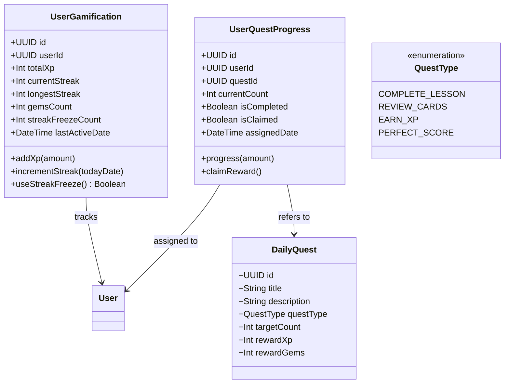
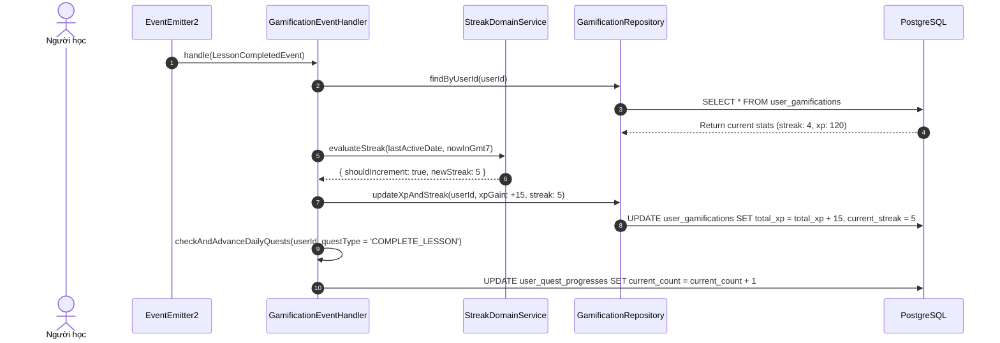

# Domain Specification: 08. Gamification & Learner Engagement

## Mission

Tài liệu Domain Specification định nghĩa ngôn ngữ thống nhất (Ubiquitous Language), các Aggregate Root, Entity, cơ chế duy trì chuỗi học tập (Streak System), điểm kinh nghiệm (XP), hệ thống năng lượng (Hearts/Energy), nhiệm vụ hàng ngày (Daily Quests) và dữ liệu tổng quan bảng điều khiển (Dashboard Aggregates) trong hệ sinh thái LingoRoad trên nền tảng **NestJS**.

---

# 1. Domain Overview (Tổng quan phân hệ)

Phân hệ Gamification & Learner Engagement chịu trách nhiệm biến quá trình học ngoại ngữ vốn đòi hỏi sự kiên trì thành một hành trình thú vị, tạo động lực nội tại (Intrinsic Motivation) và thúc đẩy người học duy trì thói quen học tập đều đặn mỗi ngày.

- **Vấn đề giải quyết**: Tỷ lệ bỏ cuộc (Drop-off rate) trong việc tự học ngoại ngữ rất cao. Việc bổ sung các yếu tố trò chơi hóa (Gamification) giúp người học có cảm giác thành tựu rõ rệt qua từng ngày học.
- **Mục tiêu cốt lõi (Core Objectives)**:
  - Quản lý chuỗi ngày học liên tục (Streak Counter) với múi giờ chuẩn của người học (`Asia/Ho_Chi_Minh` / GMT+7).
  - Tích lũy điểm kinh nghiệm (XP) từ các hoạt động học tập, làm bài kiểm tra và ôn tập thẻ từ.
  - Quản lý hệ thống Nhiệm vụ hàng ngày (Daily Quests) tự động làm mới vào 00:00 mỗi ngày.
  - Cung cấp dữ liệu tổng hợp hiệu năng học tập (`GET /dashboard`) để hiển thị biểu đồ tiến độ trên ứng dụng Mobile.
- **Stack Công nghệ & Tích hợp (Technology Stack & Integrations)**:
  - **Framework**: NestJS (TypeScript) với Clean Architecture / DDD.
  - **Database & ORM**: PostgreSQL qua Prisma ORM.
  - **Cache Store**: Redis (lưu leaderboard và trạng thái streak tạm thời).
  - **Event Listener**: `@nestjs/event-emitter` lắng nghe `LessonCompletedEvent`, `ReviewCardGradedEvent`, `PlacementCompletedEvent`.

---

# 2. Sub-systems & Feature Breakdown (Các phân hệ con & Phân rã tính năng)

```
                       ┌──────────────────────────────────────────────┐
                       │     Gamification & Learner Engagement        │
                       └──────────────────────┬───────────────────────┘
                                              │
         ┌────────────────────────────────────┼────────────────────────────────────┐
         │                                    │                                    │
         ▼                                    ▼                                    ▼
┌────────────────────────┐        ┌────────────────────────┐        ┌────────────────────────┐
│ Streak & Reward Engine │        │ Quest & Achievement    │        │ Dashboard Aggregator   │
├────────────────────────┤        ├────────────────────────┤        ├────────────────────────┤
│ • Daily Activity Check │        │ • Daily Quest Cycle    │        │ • Weekly Study Chart   │
│ • Streak Increment     │        │ • Progress Tracking    │        │ • Level & Tier Vector  │
│ • Streak Freeze / Save │        │ • Milestone Badges     │        │ • Summary Aggregation  │
│ • XP & Gems Ledger     │        │ • Claim Reward Handler │        │ • Realtime Notification│
└────────────────────────┘        └────────────────────────┘        └────────────────────────┘
```

---

# 3. Ubiquitous Language (Ngôn ngữ Thống nhất)

| Thuật ngữ (English) | Thuật ngữ Tiếng Việt | Định nghĩa & Phạm vi sử dụng |
| :--- | :--- | :--- |
| **Learner Gamification (Aggregate Root)** | Hồ sơ Trò chơi hóa | Thực thể ghi nhận số XP, chuỗi Streak, số Gems và cấp độ hiện tại của một người học. |
| **Streak** | Chuỗi Ngày Học | Số ngày liên tiếp người học hoàn thành ít nhất 1 bài học hoặc 1 phiên ôn tập. |
| **Streak Freeze** | Khiên Bảo vệ Chuỗi | Vật phẩm giúp bảo toàn chuỗi streak nếu người học bỏ lỡ 1 ngày không học. |
| **XP (Experience Points)** | Điểm Kinh nghiệm | Điểm số tích lũy phản ánh khối lượng rèn luyện của người học trong hệ thống. |
| **Gems** | Đá Quý / Tiền Tệ Game | Đơn vị tiền tệ ảo nhận được khi hoàn thành chuỗi streak hoặc nhiệm vụ, dùng để mua vật phẩm hỗ trợ. |
| **Daily Quest** | Nhiệm vụ Ngày | Thử thách nhỏ làm mới mỗi ngày (ví dụ: *Hoàn thành 2 bài học*, *Đạt điểm tuyệt đối 1 lần*). |

---

# 4. Architecture Design & Core Decisions (Thiết kế Kiến trúc & Quyết định cốt lõi)

### 4.1. Quyết định 1: Xử lý Chuỗi Ngày Học theo Múi giờ Địa phương (Timezone-Aware Streak)
- **Giải pháp**: Cơ sở dữ liệu lưu mốc thời gian hoàn thành ở dạng UTC chuẩn. Khi tính toán duy trì hay đứt chuỗi Streak, server chuyển đổi mốc thời gian về múi giờ người học (mặc định `Asia/Ho_Chi_Minh` / GMT+7):
  - Nếu lần học cuối diễn ra trong ngày hôm nay: Không tăng streak thêm.
  - Nếu lần học cuối diễn ra vào ngày hôm qua: Tăng `streakCount` thêm +1.
  - Nếu lần học cuối cách 2 ngày trở lên: Kiểm tra `streakFreezeCount` (nếu có thì trừ 1 khiên và giữ streak; nếu không có thì reset `streakCount = 1`).

### 4.2. Quyết định 2: Tự động Cập nhật Tiến độ Nhiệm vụ qua Event Listener
- **Giải pháp**: Phân hệ Gamification hoàn toàn tách biệt với phân hệ Lesson/Review. Mỗi khi có `LessonCompletedEvent`, `GamificationEventHandler` sẽ tự động:
  1. Cộng XP cho người học.
  2. Kiểm tra và cập nhật Streak.
  3. Cập nhật tiến độ của các `UserDailyQuest` tương ứng.

---

# 5. Domain Model & Entities (Mô hình Miền & Thực thể)

## 5.1 Class Diagram (Mermaid)



## 5.2 Prisma Schema Draft (NestJS Infrastructure)

```prisma
enum QuestType {
  COMPLETE_LESSON
  REVIEW_CARDS
  EARN_XP
  PERFECT_SCORE
}

model UserGamification {
  id                String    @id @default(uuid()) @db.Uuid
  userId            String    @unique @map("user_id") @db.Uuid
  totalXp           Int       @default(0) @map("total_xp")
  currentStreak     Int       @default(0) @map("current_streak")
  longestStreak     Int       @default(0) @map("longest_streak")
  gemsCount         Int       @default(0) @map("gems_count")
  streakFreezeCount Int       @default(0) @map("streak_freeze_count")
  lastActiveDate    DateTime? @map("last_active_date")
  updatedAt         DateTime  @updatedAt @map("updated_at")

  user              User      @relation(fields: [userId], references: [id], onDelete: Cascade)

  @@map("user_gamifications")
}

model DailyQuest {
  id          String    @id @default(uuid()) @db.Uuid
  title       String    @db.VarChar(150)
  description String    @db.Text
  questType   QuestType @map("quest_type")
  targetCount Int       @default(1) @map("target_count")
  rewardXp    Int       @default(10) @map("reward_xp")
  rewardGems  Int       @default(5) @map("reward_gems")

  userQuests  UserQuestProgress[]

  @@map("daily_quests")
}

model UserQuestProgress {
  id           String     @id @default(uuid()) @db.Uuid
  userId       String     @map("user_id") @db.Uuid
  questId      String     @map("quest_id") @db.Uuid
  currentCount Int        @default(0) @map("current_count")
  isCompleted  Boolean    @default(false) @map("is_completed")
  isClaimed    Boolean    @default(false) @map("is_claimed")
  assignedDate DateTime   @map("assigned_date")

  user         User       @relation(fields: [userId], references: [id], onDelete: Cascade)
  quest        DailyQuest @relation(fields: [questId], references: [id], onDelete: Cascade)

  @@unique([userId, questId, assignedDate])
  @@index([userId, assignedDate])
  @@map("user_quest_progresses")
}
```

---

# 6. Core Workflows (Quy trình Vận hành Cốt lõi)

## 6.1 Quy trình Cập nhật Streak & Hoàn thành Nhiệm vụ Ngày



---

# 7. Business Rules (Quy tắc Nghiệp vụ)

1. **Quy tắc Duy trì Streak**:
   - Để được tính hoàn thành ngày học, người học phải hoàn thành tối thiểu 1 bài học (`score >= 80%`) hoặc hoàn thành tối thiểu 5 thẻ ôn tập `ReviewCard`.
2. **Quy tắc Múi giờ Tính Ngày**:
   - Một ngày học được tính từ 00:00:00 đến 23:59:59 theo giờ Việt Nam (`Asia/Ho_Chi_Minh` / GMT+7).
3. **Quy tắc Nhận Thưởng Nhiệm vụ (Claim Invariant)**:
   - Phần thưởng từ nhiệm vụ chỉ được cộng vào tài khoản khi người học chủ động nhấn nút "Nhận thưởng" (`POST /quests/{id}/claim`) và trường `is_claimed` được đánh dấu `true`.

---

# 8. Draft API Requirements (Dự thảo Yêu cầu API)

## 8.1 Lấy thông tin Gamification của người học (Get Gamification Me)
- **Endpoint**: `GET /gamification/me`
- **Headers**: `Authorization: Bearer <accessToken>`
- **Response**: `200 OK`
  ```json
  {
    "success": true,
    "data": {
      "totalXp": 450,
      "currentStreak": 5,
      "longestStreak": 12,
      "gemsCount": 85,
      "streakFreezeCount": 1,
      "hasCompletedToday": true
    }
  }
  ```

## 8.2 Lấy danh sách nhiệm vụ hôm nay (Get Today Quests)
- **Endpoint**: `GET /quests`
- **Headers**: `Authorization: Bearer <accessToken>`
- **Response**: `200 OK`
  ```json
  {
    "success": true,
    "data": [
      {
        "id": "q1-uuid",
        "title": "Học bài mới",
        "description": "Hoàn thành 1 bài học bất kỳ trong lộ trình",
        "currentCount": 1,
        "targetCount": 1,
        "isCompleted": true,
        "isClaimed": false,
        "rewardXp": 15,
        "rewardGems": 5
      }
    ]
  }
  ```

## 8.3 Nhận thưởng nhiệm vụ (Claim Quest Reward)
- **Endpoint**: `POST /quests/{questProgressId}/claim`
- **Headers**: `Authorization: Bearer <accessToken>`
- **Response**: `200 OK`

---

# 9. Product Recommendations & Future Improvements

1. **Weekly Leaderboard (Bảng xếp hạng tuần)**: Xây dựng bảng xếp hạng theo hạng đồng, bạc, vàng (League Tiers) cập nhật xếp hạng chủ nhật hàng tuần để kích thích thi đua học tập.
2. **Streak Recovery Challenge**: Cho phép người học làm một bài kiểm tra thử thách khó để khôi phục chuỗi streak bị đứt nếu không có Streak Freeze.

# End
