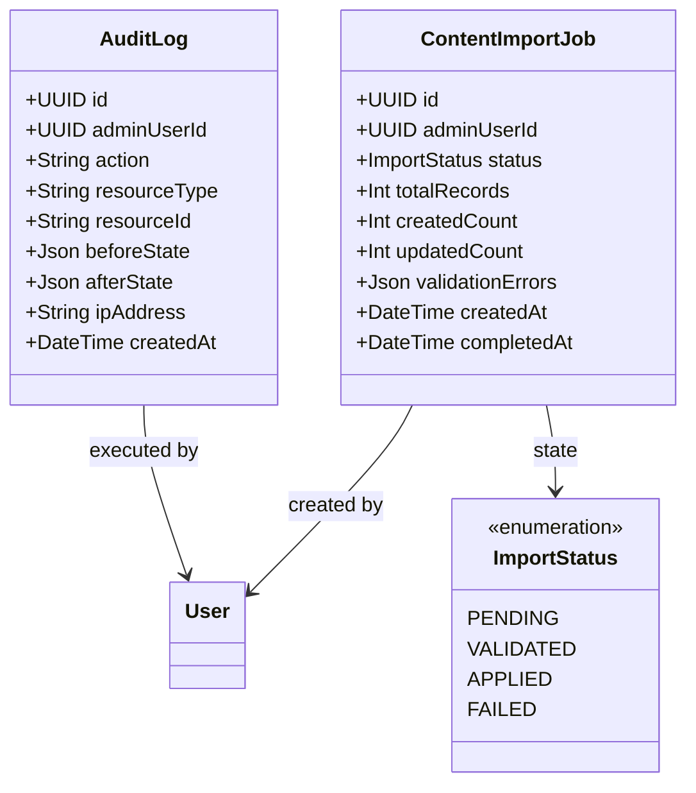
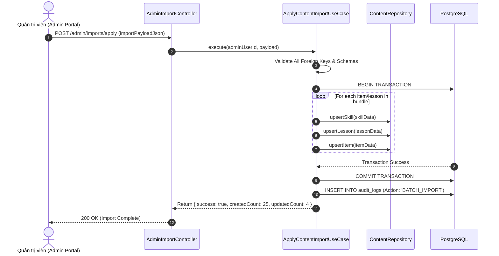

# Domain Specification: 09. Content Administration & Analytics

## Mission

Tài liệu Domain Specification định nghĩa ngôn ngữ thống nhất (Ubiquitous Language), các Aggregate Root, Entity, quy trình nhập liệu hàng loạt (Batch Content Import Pipeline), cơ chế ghi vết kiểm toán (Audit Logging) và các chỉ số phân tích hệ thống (System Analytics) trong hệ sinh thái LingoRoad trên nền tảng **NestJS**.

---

# 1. Domain Overview (Tổng quan phân hệ)

Phân hệ Content Administration & Analytics là trung tâm điều hành nội dung và giám sát hệ thống dành cho đội ngũ Quản trị viên (Admin & Content Creators). Phân hệ này cung cấp bộ công cụ quản lý toàn bộ vòng đời chương trình học, nhập xuất dữ liệu hàng loạt an toàn và theo dõi chất lượng học tập của người dùng.

- **Vấn đề giải quyết**: Việc nhập liệu thủ công từng bài học hoặc câu hỏi rất tốn thời gian và dễ xảy ra sai sót dữ liệu. Phân hệ cung cấp quy trình nhập liệu 3 bước (`Validate → Preview → Apply`) có kiểm tra tính toàn vẹn (Integrity Check) và đảm bảo khả năng hoàn tác.
- **Mục tiêu cốt lõi (Core Objectives)**:
  - Cung cấp giao diện quản trị (Admin CMS) cho phép CRUD Kỹ năng, Bài học và Ngân hàng câu hỏi.
  - Triển khai quy trình nhập liệu theo lô an toàn (Idempotent & Transactional Batch Import).
  - Ghi vết mọi thao tác chỉnh sửa nội dung thông qua hệ thống Nhật ký Kiểm toán (Audit Logs).
  - Thống kê phân tích hiệu quả giảng dạy (Tỷ lệ hoàn thành bài, tỷ lệ trả lời sai theo từng câu hỏi).
- **Stack Công nghệ & Tích hợp (Technology Stack & Integrations)**:
  - **Framework**: NestJS (TypeScript) với Clean Architecture / DDD.
  - **Database & ORM**: PostgreSQL qua Prisma ORM (sử dụng Interactive Transactions `$transaction`).
  - **Admin Web Client**: React / Next.js Admin Portal.
  - **Audit Interceptor**: NestJS Interceptors / Middleware tự động ghi log thao tác nhạy cảm.

---

# 2. Sub-systems & Feature Breakdown (Các phân hệ con & Phân rã tính năng)

```
                       ┌──────────────────────────────────────────────┐
                       │     Content Administration & Analytics       │
                       └──────────────────────┬───────────────────────┘
                                              │
         ┌────────────────────────────────────┼────────────────────────────────────┐
         │                                    │                                    │
         ▼                                    ▼                                    ▼
┌────────────────────────┐        ┌────────────────────────┐        ┌────────────────────────┐
│ Content Management     │        │ Batch Import Pipeline  │        │ Audit & System Metrics │
├────────────────────────┤        ├────────────────────────┤        ├────────────────────────┤
│ • Skill Node Editor    │        │ • JSON/CSV Schema Check│        │ • Action Audit Logs    │
│ • Lesson Composer      │        │ • Dry-run Preview Diff │        │ • DAU / MAU Analytics  │
│ • Item Bank Creator    │        │ • Atomic Apply (Tx)    │        │ • Item Difficulty Index│
│ • Prerequisite Mapper  │        │ • Rollback on Failure  │        │ • Drop-off Funnel      │
└────────────────────────┘        └────────────────────────┘        └────────────────────────┘
```

---

# 3. Ubiquitous Language (Ngôn ngữ Thống nhất)

| Thuật ngữ (English) | Thuật ngữ Tiếng Việt | Định nghĩa & Phạm vi sử dụng |
| :--- | :--- | :--- |
| **Content Batch Import** | Nhập Liệu Hàng Loạt | Quy trình đưa một gói nội dung (nhiều kỹ năng, bài học, câu hỏi) vào hệ thống thông qua một tệp dữ liệu duy nhất. |
| **Import Pipeline Stage** | Giai đoạn Nhập Liệu | Ba bước kiểm soát chất lượng: `VALIDATE` (kiểm tra cú pháp), `PREVIEW` (xem trước thay đổi), `APPLY` (ghi đè vào DB). |
| **Audit Log (Aggregate Root)** | Nhật ký Kiểm toán | Bản ghi lưu vết hành động của Admin: ai thao tác, vào lúc nào, thay đổi dữ liệu gì (Before/After JSON diff). |
| **Item Discrimination Index** | Chỉ số Phân biệt Câu hỏi| Thống kê đánh giá câu hỏi: câu hỏi có quá dễ (100% đúng) hoặc có lỗi đề bài (100% sai) hay không. |

---

# 4. Architecture Design & Core Decisions (Thiết kế Kiến trúc & Quyết định cốt lõi)

### 4.1. Quyết định 1: Quy trình Nhập liệu 3 Bước Giao dịch (Transactional 3-Step Import)
- **Quy trình chuẩn**:
  1. `POST /admin/imports/validate`: Kiểm tra tính hợp lệ cú pháp JSON, kiểm tra liên kết khóa ngoại (`skill_code` có tồn tại không, `options` có chứa `correct_option` không).
  2. `POST /admin/imports/preview`: Phân tích và trả về bản tóm tắt số lượng bản ghi sẽ được tạo mới (`created`), cập nhật (`updated`), hoặc giữ nguyên (`unchanged`).
  3. `POST /admin/imports/apply`: Thực thi toàn bộ thao tác trong một `Prisma Interactive Transaction`. Nếu có bất kỳ lỗi nào xảy ra ở bất kỳ dòng nào, toàn bộ giao dịch sẽ tự động Rollback, không để lại dữ liệu rác dở dang.

### 4.2. Quyết định 2: Bảo mật Phân quyền Tuyệt đối ở Server
- **Giải pháp**: Mọi endpoint bắt đầu bằng `/admin/*` đều được bảo vệ bởi `JwtAuthGuard` và `RolesGuard` với metadata `@Roles(UserRole.ADMIN)`. Server từ chối ngay lập tức mọi request không có quyền với mã lỗi `403 Forbidden`.

---

# 5. Domain Model & Entities (Mô hình Miền & Thực thể)

## 5.1 Class Diagram (Mermaid)



## 5.2 Prisma Schema Draft (NestJS Infrastructure)

```prisma
enum ImportStatus {
  PENDING
  VALIDATED
  APPLIED
  FAILED
}

model AuditLog {
  id           String   @id @default(uuid()) @db.Uuid
  adminUserId  String   @map("admin_user_id") @db.Uuid
  action       String   @db.VarChar(100)
  resourceType String   @map("resource_type") @db.VarChar(100)
  resourceId   String?  @map("resource_id") @db.VarChar(100)
  beforeState  Json?    @map("before_state") @db.JsonB
  afterState   Json?    @map("after_state") @db.JsonB
  ipAddress    String?  @map("ip_address") @db.VarChar(45)
  createdAt    DateTime @default(now()) @map("created_at")

  adminUser    User     @relation(fields: [adminUserId], references: [id], onDelete: Restrict)

  @@index([adminUserId, resourceType, createdAt])
  @@map("audit_logs")
}

model ContentImportJob {
  id               String       @id @default(uuid()) @db.Uuid
  adminUserId      String       @map("admin_user_id") @db.Uuid
  status           ImportStatus @default(PENDING)
  totalRecords     Int          @default(0) @map("total_records")
  createdCount     Int          @default(0) @map("created_count")
  updatedCount     Int          @default(0) @map("updated_count")
  validationErrors Json?        @map("validation_errors") @db.JsonB
  createdAt        DateTime     @default(now()) @map("created_at")
  completedAt      DateTime?    @map("completed_at")

  adminUser        User         @relation(fields: [adminUserId], references: [id], onDelete: Restrict)

  @@map("content_import_jobs")
}
```

---

# 6. Core Workflows (Quy trình Vận hành Cốt lõi)

## 6.1 Quy trình Nhập liệu Nội dung theo Lô (Batch Import Pipeline)



---

# 7. Business Rules (Quy tắc Nghiệp vụ)

1. **Bắt buộc Giao dịch Nguyên tử (Atomic Import Rule)**:
   - Nếu trong một tệp nhập liệu có 100 câu hỏi mà câu hỏi thứ 99 bị lỗi dữ liệu, toàn bộ 98 câu hỏi trước đó KHÔNG ĐƯỢC phép ghi vào cơ sở dữ liệu.
2. **Quy định Ghi vết Kiểm toán (Audit Invariant)**:
   - Mọi thao tác Thêm, Sửa, Xóa (`POST`, `PUT`, `PATCH`, `DELETE`) trên các tài nguyên nội dung trong `/admin/*` BẮT BUỘC phải ghi nhận một bản ghi `AuditLog`.

---

# 8. Draft API Requirements (Dự thảo Yêu cầu API)

## 8.1 Thẩm định gói nội dung (Validate Import)
- **Endpoint**: `POST /admin/imports/validate`
- **Headers**: `Authorization: Bearer <adminAccessToken>`
- **Request Body**:
  ```json
  {
    "bundleVersion": "1.0",
    "skills": [
      {
        "code": "GRAM-B1-01",
        "name": "Past Continuous vs Past Simple",
        "cefrLevel": "B1"
      }
    ]
  }
  ```
- **Response**: `200 OK`
  ```json
  {
    "success": true,
    "data": {
      "isValid": true,
      "errors": []
    }
  }
  ```

## 8.2 Lấy báo cáo phân tích hệ thống (Get System Analytics)
- **Endpoint**: `GET /admin/analytics/overview`
- **Headers**: `Authorization: Bearer <adminAccessToken>`
- **Response**: `200 OK`
  ```json
  {
    "success": true,
    "data": {
      "totalLearners": 1250,
      "dailyActiveUsers": 412,
      "totalCompletedLessons": 8940,
      "averagePassRate": 84.2
    }
  }
  ```

---

# 9. Product Recommendations & Future Improvements

1. **A/B Testing Content Variations**: Hỗ trợ gắn 2 phiên bản câu hỏi khác nhau cho cùng một vị trí bài học để đo lường phiên bản nào giúp người học hiểu nhanh hơn.
2. **Automated Error Flagging**: Khi tỷ lệ trả lời sai của một câu hỏi vượt quá $80\%$, hệ thống tự động gắn cờ cảnh báo (Flag for Review) gửi tới dashboard của Admin.

# End
