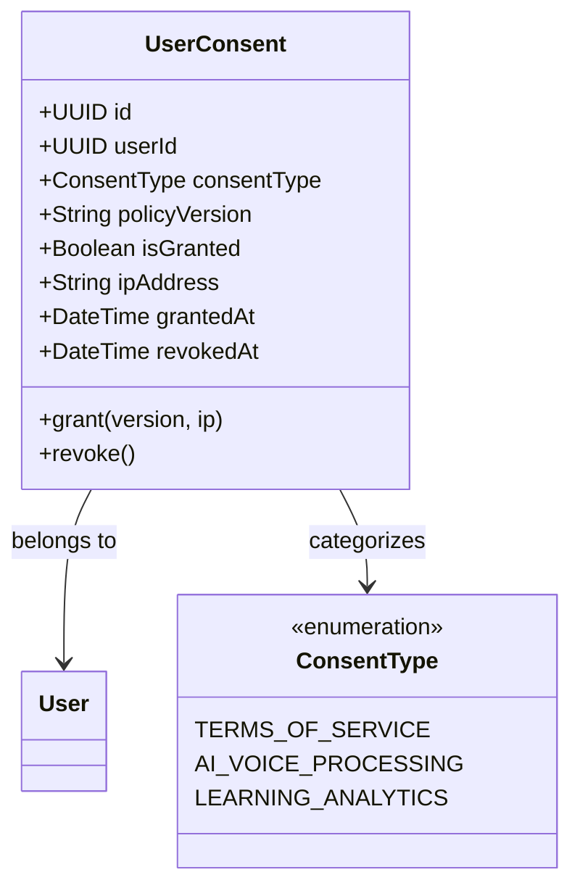
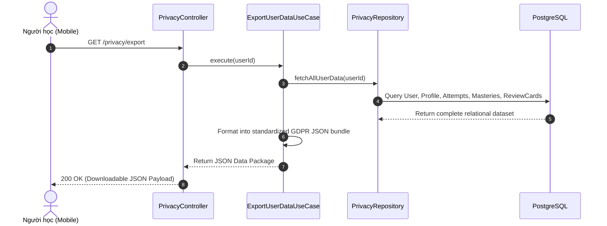

# Domain Specification: 10. Privacy, Consent & Data Governance

## Mission

Tài liệu Domain Specification định nghĩa ngôn ngữ thống nhất (Ubiquitous Language), các Aggregate Root, Entity, quy trình thu thập và quản lý đồng thuận dữ liệu (Consent Management), chính sách lưu trữ và hủy dữ liệu (Data Retention & Purge), xuất dữ liệu người dùng (GDPR Data Portability) và quy trình xóa tài khoản vĩnh viễn (Right to Erasure) trong hệ sinh thái LingoRoad trên nền tảng **NestJS**.

---

# 1. Domain Overview (Tổng quan phân hệ)

Phân hệ Privacy, Consent & Data Governance đảm bảo hệ thống LingoRoad tuân thủ nghiêm ngặt các quy định quốc tế và địa phương về quyền riêng tư và bảo vệ dữ liệu cá nhân (GDPR, COPPA, Nghị định 13/2023/NĐ-CP về bảo vệ dữ liệu cá nhân).

- **Vấn đề giải quyết**: Người học cung cấp nhiều thông tin nhạy cảm như giọng nói (biometric audio), tiến độ học tập và thông tin cá nhân. Hệ thống cần minh bạch hóa việc thu thập, cho phép người dùng kiểm soát sự đồng thuận và có quyền xuất hoặc xóa toàn bộ dữ liệu của mình.
- **Mục tiêu cốt lõi (Core Objectives)**:
  - Quản lý trạng thái đồng thuận rõ ràng của người học đối với từng mục đích xử lý dữ liệu (AI Voice Processing, Analytics, Notifications).
  - Cung cấp API xuất dữ liệu cá nhân trọn gói (`GET /privacy/export`) dưới định dạng JSON chuẩn.
  - Xử lý yêu cầu xóa tài khoản tức thì (`DELETE /auth/me`) với cơ chế xóa an toàn (Cascading Hard Deletion).
  - Thực thi chính sách lưu trữ tạm thời đối với tệp ghi âm giọng nói (Ephemeral Voice Retention).
- **Stack Công nghệ & Tích hợp (Technology Stack & Integrations)**:
  - **Framework**: NestJS (TypeScript) với Clean Architecture / DDD.
  - **Database & ORM**: PostgreSQL qua Prisma ORM (sử dụng ràng buộc `onDelete: Cascade` có kiểm soát).
  - **Compliance Tools**: JSON Exporter Engine.
  - **Event Dispatcher**: `@nestjs/event-emitter` (`UserDeletedEvent`, `ConsentUpdatedEvent`).

---

# 2. Sub-systems & Feature Breakdown (Các phân hệ con & Phân rã tính năng)

```
                       ┌──────────────────────────────────────────────┐
                       │     Privacy, Consent & Data Governance       │
                       └──────────────────────┬───────────────────────┘
                                              │
         ┌────────────────────────────────────┼────────────────────────────────────┐
         │                                    │                                    │
         ▼                                    ▼                                    ▼
┌────────────────────────┐        ┌────────────────────────┐        ┌────────────────────────┐
│ Consent Manager        │        │ Data Portability Engine│        │ Erasure & Retention    │
├────────────────────────┤        ├────────────────────────┤        ├────────────────────────┤
│ • Privacy Policy Opt-in│        │ • Full Data Aggregator │        │ • Account Hard-Delete  │
│ • AI Voice Consent     │        │ • Structured JSON      │        │ • Ephemeral Audio Purge│
│ • Versioned Policy Log │          Export Stream          │        │ • Log Anonymization    │
│ • Opt-out Revocation   │        │ • Audit Export Request │        │ • Invalidation Cascade │
└────────────────────────┘        └────────────────────────┘        └────────────────────────┘
```

---

# 3. Ubiquitous Language (Ngôn ngữ Thống nhất)

| Thuật ngữ (English) | Thuật ngữ Tiếng Việt | Định nghĩa & Phạm vi sử dụng |
| :--- | :--- | :--- |
| **Privacy Consent (Aggregate Root)** | Bản Đồng thuận Riêng tư | Bản ghi lưu vết sự đồng thuận của người học đối với một điều khoản xử lý dữ liệu cụ thể, kèm phiên bản điều khoản và mốc thời gian. |
| **Consent Type** | Loại Đồng thuận | Mục đích thu thập dữ liệu: `TERMS_OF_SERVICE`, `AI_VOICE_PROCESSING`, `LEARNING_ANALYTICS`. |
| **Data Portability (GDPR)** | Quyền Di chuyển Dữ liệu | Quyền của người học được tải toàn bộ dữ liệu lịch sử học tập, hồ sơ và bài kiểm tra ở định dạng máy đọc được (JSON). |
| **Right to Erasure (Delete Account)**| Quyền Được Xóa Dữ liệu | Quyền yêu cầu xóa vĩnh viễn mọi dữ liệu định danh cá nhân (PII) và lịch sử học tập khỏi hệ thống. |
| **Data Retention Policy** | Chính sách Lưu trữ Dữ liệu | Quy định thời gian tối đa hệ thống được phép lưu giữ một loại dữ liệu (ví dụ: audio giọng nói $\le 60\text{ giây}$). |

---

# 4. Architecture Design & Core Decisions (Thiết kế Kiến trúc & Quyết định cốt lõi)

### 4.1. Quyết định 1: Ghi vết Phiên bản Đồng thuận (Versioned Consent Ledger)
- **Giải pháp**: Mỗi khi người dùng bấm đồng ý với điều khoản dịch vụ hoặc chính sách quyền riêng tư, hệ thống lưu lại mã phiên bản của chính sách đó (ví dụ: `v1.2.0`). Nếu chính sách có thay đổi lớn, ứng dụng sẽ yêu cầu người học cập nhật đồng thuận lại.

### 4.2. Quyết định 2: Xử lý Xóa Tài khoản Triệt để (True Hard Deletion)
- **Giải pháp**: Khi người dùng gọi `DELETE /auth/me`:
  1. Hủy bỏ toàn bộ phiên đăng nhập (`RefreshSession`) ngay lập tức.
  2. Thực hiện xóa dòng dữ liệu `User` trong PostgreSQL. Nhờ cấu hình `onDelete: Cascade` trên tất cả các bảng liên quan (`user_profiles`, `placement_sessions`, `lesson_attempts`, `user_skill_masteries`, `review_cards`, `saved_words`, `speaking_attempts`), toàn bộ dữ liệu người dùng sẽ được xóa sạch sẽ trong 1 transaction duy nhất.

---

# 5. Domain Model & Entities (Mô hình Miền & Thực thể)

## 5.1 Class Diagram (Mermaid)



## 5.2 Prisma Schema Draft (NestJS Infrastructure)

```prisma
enum ConsentType {
  TERMS_OF_SERVICE
  AI_VOICE_PROCESSING
  LEARNING_ANALYTICS
}

model UserConsent {
  id            String      @id @default(uuid()) @db.Uuid
  userId        String      @map("user_id") @db.Uuid
  consentType   ConsentType @map("consent_type")
  policyVersion String      @map("policy_version") @db.VarChar(20)
  isGranted     Boolean     @default(true) @map("is_granted")
  ipAddress     String?     @map("ip_address") @db.VarChar(45)
  grantedAt     DateTime    @default(now()) @map("granted_at")
  revokedAt     DateTime?   @map("revoked_at")

  user          User        @relation(fields: [userId], references: [id], onDelete: Cascade)

  @@unique([userId, consentType])
  @@map("user_consents")
}
```

---

# 6. Core Workflows (Quy trình Vận hành Cốt lõi)

## 6.1 Quy trình Xuất Toàn bộ Dữ liệu Cá nhân (Data Portability Export)



---

# 7. Business Rules (Quy tắc Nghiệp vụ)

1. **Ràng buộc Đồng thuận Bắt buộc**:
   - `TERMS_OF_SERVICE` là đồng thuận bắt buộc để sử dụng ứng dụng. Nếu người dùng thu hồi đồng thuận này, hệ thống sẽ tự động đăng xuất và khóa tài khoản.
   - `AI_VOICE_PROCESSING` là đồng thuận tùy chọn; nếu người dùng không cấp quyền, các bài tập nói AI sẽ tự động thay thế bằng bài tập gõ văn bản tương đương.
2. **Quy định Xóa Dữ liệu Định danh (Erasure Invariant)**:
   - Thao tác `DELETE /auth/me` là không thể hoàn tác (Irreversible). Sau khi xóa thành công, hệ thống không lưu giữ lại bất kỳ thông tin nào cho phép nhận dạng lại người dùng.

---

# 8. Draft API Requirements (Dự thảo Yêu cầu API)

## 8.1 Lấy danh sách trạng thái đồng thuận (Get Consents)
- **Endpoint**: `GET /privacy/consents`
- **Headers**: `Authorization: Bearer <accessToken>`
- **Response**: `200 OK`
  ```json
  {
    "success": true,
    "data": [
      {
        "consentType": "TERMS_OF_SERVICE",
        "policyVersion": "1.0",
        "isGranted": true,
        "grantedAt": "2026-10-01T08:00:00.000Z"
      },
      {
        "consentType": "AI_VOICE_PROCESSING",
        "policyVersion": "1.0",
        "isGranted": true,
        "grantedAt": "2026-10-01T08:00:00.000Z"
      }
    ]
  }
  ```

## 8.2 Cập nhật đồng thuận quyền riêng tư (Update Consent)
- **Endpoint**: `POST /privacy/consents`
- **Headers**: `Authorization: Bearer <accessToken>`
- **Request Body**:
  ```json
  {
    "consentType": "AI_VOICE_PROCESSING",
    "policyVersion": "1.0",
    "isGranted": false
  }
  ```
- **Response**: `200 OK`

## 8.3 Xuất toàn bộ dữ liệu cá nhân (Export User Data)
- **Endpoint**: `GET /privacy/export`
- **Headers**: `Authorization: Bearer <accessToken>`
- **Response**: `200 OK (application/json)`

## 8.4 Xóa vĩnh viễn tài khoản người dùng (Delete Account)
- **Endpoint**: `DELETE /auth/me`
- **Headers**: `Authorization: Bearer <accessToken>`
- **Response**: `200 OK`
  ```json
  {
    "success": true,
    "message": "Your account and all associated personal data have been permanently deleted."
  }
  ```

---

# 9. Product Recommendations & Future Improvements

1. **Self-Service Consent Dashboard**: Cung cấp màn hình Privacy Center ngay trong ứng dụng cho phép người học bật/tắt từng loại quyền riêng tư một cách trực quan.
2. **Automated Anonymization for ML Research**: Xây dựng tiến trình tách dữ liệu ẩn danh (De-identification Pipeline) đối với các lỗi sai bài tập để phục vụ huấn luyện mô hình dự đoán năng lực học tập mà không vi phạm tính riêng tư.

# End
