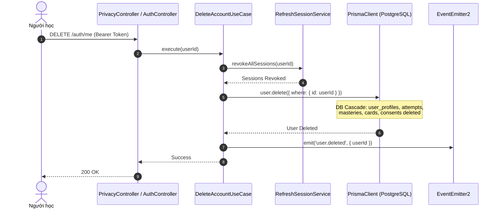

# RFC: Privacy Consent Ledger, Data Portability & Hard Erasure

## 1. Context & Background
Tuân thủ GDPR và các quy định bảo vệ dữ liệu cá nhân yêu cầu hệ thống LingoRoad phải lưu vết sự đồng thuận (Consent Ledger) có phiên bản rõ ràng, cung cấp API trích xuất dữ liệu máy đọc được (`GET /privacy/export`) và thực thi xóa tài khoản triệt để (`DELETE /auth/me`) theo cơ chế Hard Deletion.

## 2. Problem Statement
Việc xóa tài khoản người dùng nếu không được thiết kế cascade chuẩn xác sẽ để lại rác dữ liệu ở hàng chục bảng liên quan (`user_profiles`, `lesson_attempts`, `user_skill_masteries`, `review_cards`, `saved_words`, `refresh_sessions`). Ngoài ra, cần cơ chế gom toàn bộ dữ liệu người dùng thành định dạng chuẩn để phục vụ quyền di chuyển dữ liệu.

## 3. Goals & Non-Goals
- **Goals**:
  - Thiết kế bảng `user_consents` lưu vết trạng thái đồng thuận theo phiên bản điều khoản.
  - Xây dựng use case `ExportUserDataUseCase` gom dữ liệu đa bảng thành JSON có cấu trúc.
  - Xây dựng `DeleteAccountUseCase` xử lý thu hồi session và xóa người dùng qua Prisma `onDelete: Cascade`.
- **Non-Goals**:
  - Lưu trữ bản sao dữ liệu vào kho lưu trữ lạnh (Cold storage) sau khi đã xóa (Hard Delete theo yêu cầu GDPR).

## 4. Architectural & System Design



## 5. Domain & Database Changes

### 5.1 Prisma Schema
```prisma
enum ConsentType {
  TERMS_OF_SERVICE
  AI_VOICE_PROCESSING
  LEARNING_ANALYTICS
}

model UserConsent {
  id            String      @id @default(uuid()) @db.Uuid
  userId        String      @map("user_id") @db.Uuid
  consentType   ConsentType @map("consent_type")
  policyVersion String      @map("policy_version") @db.VarChar(20)
  isGranted     Boolean     @default(true) @map("is_granted")
  ipAddress     String?     @map("ip_address") @db.VarChar(45)
  grantedAt     DateTime    @default(now()) @map("granted_at")
  revokedAt     DateTime?   @map("revoked_at")

  user          User        @relation(fields: [userId], references: [id], onDelete: Cascade)

  @@unique([userId, consentType])
  @@map("user_consents")
}
```

## 6. API Design

### 6.1 Get Consents
- `GET /api/v1/privacy/consents`
- Response: `200 OK`
```json
{
  "success": true,
  "data": [
    {
      "consentType": "TERMS_OF_SERVICE",
      "policyVersion": "1.0",
      "isGranted": true,
      "grantedAt": "2026-10-01T08:00:00.000Z"
    },
    {
      "consentType": "AI_VOICE_PROCESSING",
      "policyVersion": "1.0",
      "isGranted": true,
      "grantedAt": "2026-10-01T08:00:00.000Z"
    }
  ]
}
```

### 6.2 Update Consent
- `POST /api/v1/privacy/consents`
- Body:
```json
{
  "consentType": "AI_VOICE_PROCESSING",
  "policyVersion": "1.0",
  "isGranted": false
}
```
- Response: `200 OK`

### 6.3 Export User Data (GDPR)
- `GET /api/v1/privacy/export`
- Response: `200 OK (application/json)`
```json
{
  "exportTimestamp": "2026-10-06T10:00:00.000Z",
  "profile": { "id": "uuid", "email": "learner@example.com", "targetCefr": "B2" },
  "consents": [...],
  "learningProgress": { "masteries": [...], "reviewCards": [...], "savedWords": [...] },
  "attemptHistory": [...]
}
```

### 6.4 Delete Account
- `DELETE /api/v1/auth/me`
- Response: `200 OK`
```json
{
  "success": true,
  "message": "Your account and all associated personal data have been permanently deleted."
}
```

## 7. Security & Failure Handling
- Xóa tài khoản yêu cầu Access Token hợp lệ của chính chủ tài khoản (`req.user.id`).
- Mọi quan hệ khóa ngoại (Foreign Keys) trỏ đến `User` bắt buộc cấu hình `onDelete: Cascade` trong Prisma Schema để đảm bảo giao dịch xóa diễn ra nguyên tử (atomic) và không bị lỗi foreign key constraint.

## 8. Migration & Rollout Plan
1. Chạy `npx prisma db push` cập nhật bảng `user_consents` và ràng buộc cascade.
2. Triển khai `PrivacyModule` và tích hợp vào `AppModule`.
3. Bật API cho Mobile Client.
