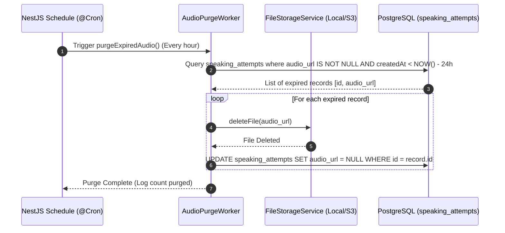

# RFC: Ephemeral Voice Data Retention & Purge Worker

## 1. Context & Background
Để tuân thủ chính sách bảo vệ dữ liệu sinh trắc học và tối ưu chi phí lưu trữ, các tệp ghi âm giọng nói trong phân hệ Speaking AI phải được tự động xóa sau 24 giờ kể từ khi hoàn tất đánh giá.

## 2. Problem Statement
Nếu không có cơ chế dọn dẹp định kỳ (Automated Cleanup Worker), số lượng tệp audio tích lũy theo số lượng người học làm bài tập hàng ngày sẽ làm tràn dung lượng đĩa hoặc gia tăng chi phí Object Storage (S3/MinIO), đồng thời vi phạm chính sách lưu trữ tạm thời đã cam kết với người học.

## 3. Goals & Non-Goals
- **Goals**:
  - Xây dựng NestJS Scheduled Worker sử dụng `@nestjs/schedule` (`@Cron('0 * * * *')`) chạy mỗi giờ.
  - Xóa vật lý các tệp âm thanh có `created_at < NOW() - INTERVAL '24 hours'`.
  - Cập nhật trường `audio_url = NULL` trong bảng `speaking_attempts` đối với các bản ghi đã được dọn tệp.
  - Lắng nghe event `UserDeletedEvent` để xóa ngay lập tức tất cả file ghi âm của user.
- **Non-Goals**:
  - Xóa dữ liệu điểm số hoặc phân tích lỗi phát âm dạng JSON/Text.

## 4. Architectural & System Design

## 5. Domain & Database Changes
Không cần thêm bảng mới. Sử dụng bảng `speaking_attempts` hiện có với câu lệnh cập nhật `audio_url = NULL`.

## 6. Implementation Details
- Module: `PrivacyModule` hoặc `StorageModule`.
- Worker Class: `AudioRetentionWorker`.
- Lắng nghe sự kiện: `@OnEvent('user.deleted')`.

## 7. Security, Privacy & Performance
- **Batch Processing**: Xử lý xóa theo từng batch 100 tệp để không gây nghẽn I/O hệ thống lưu trữ.
- **Graceful Error Handling**: Nếu một tệp không tìm thấy trên đĩa (đã bị xóa thủ công), worker vẫn cập nhật `audio_url = NULL` trong DB và tiếp tục tệp tiếp theo mà không làm gián đoạn tiến trình.

## 8. Migration & Rollout Plan
1. Cài đặt `@nestjs/schedule` trong backend NestJS.
2. Đăng ký `ScheduleModule.forRoot()` trong `AppModule`.
3. Triển khai `AudioRetentionWorker` và kích hoạt cron job.
