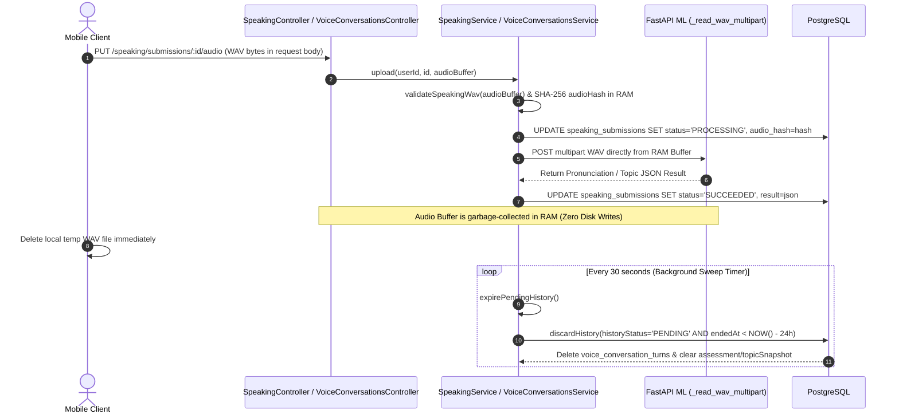

# RFC: Ephemeral Voice Data Retention & Purge Worker

## 1. Context & Background
Để tuân thủ chính sách bảo vệ dữ liệu sinh trắc học và tối ưu chi phí lưu trữ, các tệp ghi âm giọng nói trong phân hệ Speaking AI phải được tự động xóa sau 24 giờ kể từ khi hoàn tất đánh giá.

## 2. Problem Statement
Nếu không có cơ chế dọn dẹp định kỳ (Automated Cleanup Worker), số lượng tệp audio tích lũy theo số lượng người học làm bài tập hàng ngày sẽ làm tràn dung lượng đĩa hoặc gia tăng chi phí Object Storage (S3/MinIO), đồng thời vi phạm chính sách lưu trữ tạm thời đã cam kết với người học.

## 3. Goals & Non-Goals
- **Goals**:
  - Xử lý âm thanh WAV của người học hoàn toàn trên bộ nhớ RAM (`Buffer`) tại `SpeakingController` và `VoiceConversationsController`, chỉ lưu SHA-256 `audioHash` vào PostgreSQL và chuyển tiếp trực tiếp tới FastAPI ML (`_read_wav_multipart`).
  - Dọn dẹp tệp ghi âm tạm thời trên thiết bị Mobile ngay khi retake, thoát màn hình, hoàn tất, đăng xuất và khi mở app (`cleanStaleSpeakingAudio()`).
  - Duy trì tiến trình định kỳ 30 giây (`this.sweep = setInterval(..., 30000)` trong `VoiceConversationsService.onApplicationBootstrap`) gọi `expirePendingHistory()` để xóa toàn bộ lượt thoại `VoiceConversationTurn` và `assessment` của các phiên `PENDING` quá hạn 24 giờ (`pendingHistoryLifetimeMs = 24 × 60 × 60 × 1000`).
- **Non-Goals**:
  - Lưu trữ tệp âm thanh người học xuống ổ cứng máy chủ hoặc S3.

## 4. Architectural & System Design

## 5. Domain & Database Changes
- `SpeakingSubmission`: Lưu `audioHash` (SHA-256, `VarChar(64)`), không lưu đường dẫn file hay binary audio.
- `VoiceConversation`: Lưu `assessmentAudioHash` (`VarChar(64)`) và `historyStatus` (`PENDING`, `SAVED`, `DISCARDED`).

## 6. Implementation Details
- Backend:
  - `apps/backend/src/modules/speaking/speaking.controller.ts` & `speaking.service.ts`
  - `apps/backend/src/modules/speaking/voice-conversations.controller.ts` & `voice-conversations.service.ts` (`expirePendingHistory`, `discardHistory`)
- ML Service:
  - `apps/ml/lingoroad_ml/serving/speech_routes.py` (`_read_wav_multipart`)
- Mobile:
  - `apps/mobile/lib/features/speaking/speaking_recorder.dart` (`cleanStaleSpeakingAudio`)
  - `apps/mobile/lib/main.dart`

## 7. Security, Privacy & Performance
- **Batch Processing**: Xử lý xóa theo từng batch 100 tệp để không gây nghẽn I/O hệ thống lưu trữ.
- **Graceful Error Handling**: Nếu một tệp không tìm thấy trên đĩa (đã bị xóa thủ công), worker vẫn cập nhật `audio_url = NULL` trong DB và tiếp tục tệp tiếp theo mà không làm gián đoạn tiến trình.

## 8. Migration & Rollout Plan
1. Cài đặt `@nestjs/schedule` trong backend NestJS.
2. Đăng ký `ScheduleModule.forRoot()` trong `AppModule`.
3. Triển khai `AudioRetentionWorker` và kích hoạt cron job.
