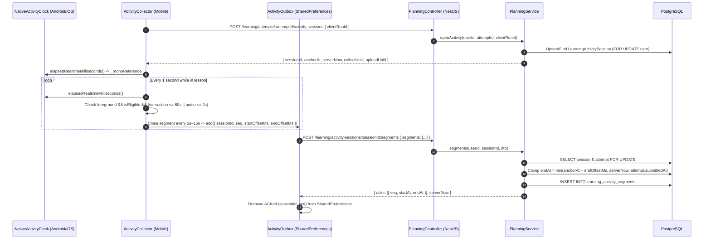

# Request for Comments (RFC) - Learning Activity Session & Segment Sync Architecture

## Mission (Sứ mệnh)

RFC định nghĩa kiến trúc kỹ thuật cho hệ thống đo và đồng bộ thời gian học tập thực tế giữa Mobile Flutter (`NativeActivityClock`, `ActivityCollector`, `ActivityOutbox`) và Backend NestJS (`PlanningController`, `PlanningService`, PostgreSQL `range_agg(tstzrange)`).

---

# 1. Context (Ngữ cảnh)

- Hiện thực hóa PRD Learning Activity Time Tracking (`docs/spec/features/27-learning-activity-time-tracking/01-activity-session-segment-sync/prd.md`).
- Phục vụ tính toán `activeSeconds` và `goalMet` cho kế hoạch học tập hàng ngày (`LearningDayPlan`) và bảng tiến độ 7 ngày (`GET /learning/progress`, `GET /learning/summary`).

---

# 2. Problem (Bài toán Kỹ thuật)

- Đồng hồ hệ thống (`DateTime.now()`) trên thiết bị di động có thể bị người dùng chỉnh tay hoặc bị nhảy giờ do đồng bộ NTP.
- Kết nối mạng di động không ổn định; nếu gửi heartbeat từng giây không có lưu trữ cục bộ sẽ làm mất thời gian học hoặc gây nghẽn mạng.
- Khi người dùng nộp bài (`POST /learning/attempts/:attemptId/submit`) đồng thời với request gửi segment, cần khóa dòng dữ liệu (`FOR UPDATE`) để không chấp nhận thời gian học phát sinh sau khi bài học đã hoàn tất.

---

# 3. Goals & Non-Goals (Mục tiêu & Ngoài mục tiêu)

- **Goals**:
  - Sử dụng `MethodChannel('lingoroad/activity_clock')` đọc `SystemClock.elapsedRealtime()` (Android) và `mach_continuous_time()` (iOS).
  - Đóng gói hoạt động thành các segment có độ dài ≤ 15 giây, lưu bền vững trong `ActivityOutbox` theo từng tài khoản (`learning.activity.v1.<accountId>`) và xác nhận (ACK) theo từng số thứ tự `seq` riêng lẻ.
  - Hợp nhất các khoảng thời gian chồng lấp từ nhiều phiên/thiết bị bằng hàm `range_agg(tstzrange(...))` của PostgreSQL.
- **Non-Goals**:
  - Dùng watermark ACK gộp (vì các batch gửi song song hoặc tách lẻ khi gặp lỗi 400/409 cần được ACK độc lập từng `seq`).

---

# 4. Proposed Architecture (Kiến trúc Đề xuất)



---

# 5. Data Model Changes (Mô hình Dữ liệu trong `schema.prisma`)

```prisma
model LearningActivitySession {
  id          String                    @id @default(uuid()) @db.Uuid
  userId      String                    @map("user_id") @db.Uuid
  attemptId   String                    @map("attempt_id") @db.Uuid
  clientRunId String                    @map("client_run_id") @db.Uuid
  anchorAt    DateTime                  @default(now()) @map("anchor_at")
  user        User                      @relation(fields: [userId], references: [id], onDelete: Cascade)
  attempt     LearningAttempt           @relation(fields: [attemptId], references: [id], onDelete: Cascade)
  segments    LearningActivitySegment[]

  @@unique([userId, attemptId, clientRunId])
  @@index([userId, anchorAt])
  @@map("learning_activity_sessions")
}

model LearningActivitySegment {
  id            String                  @id @default(uuid()) @db.Uuid
  sessionId     String                  @map("session_id") @db.Uuid
  seq           Int
  startOffsetMs Int                     @map("start_offset_ms")
  endOffsetMs   Int                     @map("end_offset_ms")
  startAt       DateTime?               @map("start_at")
  endAt         DateTime?               @map("end_at")
  session       LearningActivitySession @relation(fields: [sessionId], references: [id], onDelete: Cascade)

  @@unique([sessionId, seq])
  @@index([startAt, endAt])
  @@map("learning_activity_segments")
}
```

---

# 6. PostgreSQL Interval Union Query (`PlanningService.activeSeconds`)

```sql
WITH merged AS (
  SELECT range_agg(tstzrange(
    GREATEST(s.start_at AT TIME ZONE 'UTC', $from::timestamptz),
    LEAST(s.end_at AT TIME ZONE 'UTC', $to::timestamptz),
    '[)'
  )) AS ranges
  FROM learning_activity_segments s
  JOIN learning_activity_sessions a ON a.id = s.session_id
  WHERE a.user_id = $userId::uuid
    AND s.start_at IS NOT NULL
    AND (s.end_at AT TIME ZONE 'UTC') > $from::timestamptz
    AND (s.start_at AT TIME ZONE 'UTC') < $to::timestamptz
),
pieces AS (SELECT unnest(ranges) AS span FROM merged)
SELECT COALESCE(SUM(EXTRACT(EPOCH FROM (upper(span) - lower(span))) * 1000), 0)::double precision AS milliseconds
FROM pieces;
```

---

# 7. Security, Concurrency & Failure Handling

- **Row-Level Serialization**: Khi ghi nhận segments, `PlanningService.segments()` thực hiện `SELECT id FROM learning_activity_sessions WHERE id = ... FOR UPDATE` và `SELECT id FROM learning_attempts WHERE id = ... FOR UPDATE`, sau đó đọc lại `attempt.submittedAt` để đảm bảo không tính thời gian sau khi lượt học đã nộp.
- **Fault Isolation in Outbox**: Nếu một batch tối đa 100 segments gặp lỗi `400` hoặc `409`, `ActivityOutbox` tự động thử gửi từng segment đơn lẻ để cô lập bản ghi lỗi (`rejected = true`) mà không làm kẹt các segment hợp lệ khác trong hàng đợi.

# End

