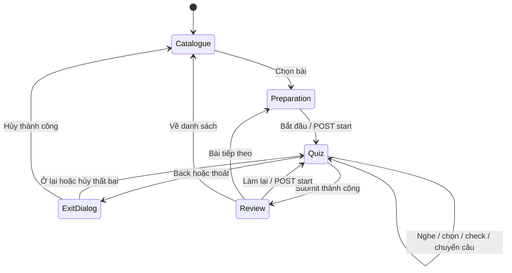

## Context

Thiết kế lập ngày 17/11/2026. Luồng đã được triển khai cục bộ; xem [bằng chứng và giới hạn nghiệm thu](implementation.md). Độc giả: người triển khai Flutter/NestJS, biên soạn bài nghe và kiểm thử.

Bổ sung học liệu: [bộ biên soạn 6 bài A1–A2](../../../docs/content/listening-a1-a2/README.md) có kịch bản và câu hỏi dạng bản thảo. Bài quán trong trường là bài mẫu v1; việc soạn đủ sáu bài không đồng nghĩa đã thu âm hoặc mở rộng phạm vi triển khai dưới đây.

### Hiện trạng khi lập đặc tả, trước thay đổi này

| Nội dung | Nguồn trong repository |
|---|---|
| Đăng nhập dùng LearningCatalogue cho Nghe; guest dùng preview riêng | `apps/mobile/lib/features/learning/learning_preview.dart`, nhánh `practice()` |
| Một bài nghe Anna A1, dùng cùng comprehension với bài Reading mẫu | `apps/backend/prisma/seed-learning.ts`, `loadLearningContent()` |
| Validator chung 3–10 câu, skillCode/evidence thiên về Reading | `apps/backend/src/modules/learning/learning.types.ts` |
| Transcript chỉ mở khi COMPLETED, answer khóa và retry check/submit | `apps/backend/src/modules/learning/learning.service.ts`, `publicContent/publicAttempt/check/submit` |
| Player có seek/pause nền nhưng key theo questionId; kết quả chưa có player | `apps/mobile/lib/features/learning/learning_pages.dart`, `LearningAttemptPage/LearningAudio/_result` |
| Kế hoạch ngày xét Listening Placement và bài ôn; evaluateReadingLevel chỉ xử lý Reading | `apps/backend/src/modules/planning/planning.service.ts` |
| Dữ liệu content/attempt snapshot lưu JSON, có answer exposure | `apps/backend/prisma/schema.prisma` |

Tài liệu nền [Instant Feedback Practice](../../../docs/spec/features/26-skill-practice-engine/01-instant-feedback-practice/spec.md) có phần Phase 2 mô tả PracticeSession và transcript ngay sau check. Listening v1 dùng LearningAttempt và trì hoãn toàn bộ transcript tới submit theo [đặc tả này](specs/listening-practice/spec.md). Không được lấy phần Phase 2 làm hợp đồng endpoint cho v1.

## Goals / Non-Goals

**Goals:** một vòng luyện/chữa bài có thể triển khai và kiểm thử từ đặc tả; bảo toàn lịch sử và lời giải theo snapshot; thay đổi nhỏ trên Learning đang có.

**Non-Goals:** triển khai tính năng trong lượt viết spec; bộ 6 bài; free-text dictation, SRS lưu từ mới, AI, DKT, Listening adaptive level; resume sau thoát; đưa item Placement sang luyện tập; tạo bảng/endpoint PracticeSession.

## Decisions

### 1. Dùng LearningAttempt và hợp đồng bổ sung trong JSON

Giữ bảng/route Learning. Không chọn Assessment practice/groups cho v1 vì nhánh đó chưa có vòng lưu/chấm tương đương trên mobile và trả danh sách dạng `data: []`, trong khi ApiClient hiện nhận object. Không cần migration mới cho segment trong contentSnapshot. Bổ sung validator theo kind/profile v1, giữ bài legacy và Reading hoạt động.

Trường mới đề xuất trong LearningContent:

| Trường | Kiểu và ý nghĩa | Trước submit |
|---|---|---|
| listeningVersion | literal 1, kích hoạt hợp đồng mới | Có |
| audioDurationMs | integer dương, khớp file | Có |
| preparation | object `{ situation, objective }`, chuỗi không rỗng | Có |
| keyVocabulary | 3–5 mục theo cấu trúc đang có | Có |
| transcript | chuỗi chuẩn hóa từ text segment | Ẩn |
| transcriptSegments | mảng `{ id, speaker, startMs, endMs, text, translationVi }` | Ẩn |
| questions[].skillCode | mã listening.* canonical | Có |
| questions[].evidenceSegmentIds | mảng id segment không rỗng | Ẩn |

Giữ `steps: []`, `questions` ở nội dung private và danh sách public như hiện hành. Các ràng buộc nội dung ở LP-09 áp dụng cho profile v1; không ép các bài legacy thành 5 câu. Không đưa bản dịch vào vocabulary/example nếu nó tiết lộ dữ kiện trả lời.

publicContent SHALL dùng allowlist rõ ràng cho metadata; chỉ map segment/transcript khi completed. publicQuestions không chứa evidenceSegmentIds. publicAttempt chỉ nối các id bằng chứng của câu khi completed. Giải thích tức thì được soạn ngắn bằng tiếng Việt, không chép nguyên transcript; rà soát để không trả lời hộ các câu còn lại. Không thêm `passage` chứa transcript để vượt validator Reading.

### 2. Chuẩn bị ở intro, không thêm phase

Màn giới thiệu tải lesson và hiển thị preparation/keyVocabulary. Chỉ start tạo attempt QUIZ. preparation đi vào snapshot để khi học lại lịch sử không phụ thuộc nội dung live. Intro không chấm hoặc cộng thời gian. Không tự tạo attempt khi mở thẻ bài.

### 3. Player sống theo attempt, có hai chế độ review

Tách thành phần player/controller ra khỏi widget câu hỏi. Danh tính player là attemptId/audioUrl; thao tác state câu hỏi không dispose player. Request start chưa hoàn tất phải khóa nút để tránh nhiều POST. Chuyển sang result dispose player luyện và tạo một player chữa bài tạm dừng ở 0.

Player quản lý position/duration/rate/loading/error, chế độ toàn bài hoặc hàng đợi segment. Chạm segment đặt hàng đợi một phần tử; Nghe đoạn trả lời đặt hàng đợi từ evidenceSegmentIds; đến endMs thì chuyển phần tử tiếp theo hoặc pause. Sai số dừng cho kiểm thử native tối đa 500 ms, không yêu cầu chính xác theo sample. Seek/đổi sang phát toàn bài xóa hàng đợi segment. Mọi lệnh async phải bỏ qua kết quả sau dispose hoặc đổi source; xử lý tốc độ lỗi bằng cách giữ rate thực trước đó và cho thử lại. Khôi phục app luôn tạm dừng.

Tái sử dụng audioplayers hiện có; cần smoke test tốc độ trên Android trước nghiệm thu. Không thêm package chỉ để vẽ waveform. Tên/nhãn/điều khiển theo LP-03/04/07/13; dùng design tokens hiện hành.

### 4. API giữ route, bổ sung trường response có điều kiện

Tất cả route dưới đây dùng xác thực hiện hành. JSON thành công giữ `{ success: true, data: object }`; bảng mô tả trạng thái sau triển khai v1, các trường bổ sung chưa có hôm nay.

| Method/route | Request | Response chính / HTTP |
|---|---|---|
| GET `/learning/lessons?kind=LISTENING` | Không body | `{ items: [...] }`, 200; item thêm audioDurationMs nếu có |
| GET `/learning/lessons/:lessonId` | Không body | metadata, public content, public questions, 200 |
| POST `/learning/lessons/:lessonId/attempts` | `{}` | attempt snapshot public, version, phase QUIZ; 201 |
| GET `/learning/attempts/:attemptId` | Không body | attempt theo quyền sở hữu, 200 |
| PATCH `/learning/attempts/:attemptId/progress` | expectedVersion, phase QUIZ, index; questionId/optionId đi cùng nếu lưu lựa chọn | attempt phiên bản mới, 200 |
| PUT `/learning/attempts/:attemptId/answers/:questionId/check` | expectedVersion, optionId | attempt và feedback câu vừa kiểm tra, 200 |
| POST `/learning/attempts/:attemptId/submit` | expectedVersion | attempt COMPLETED, result, transcript, segments, bằng chứng; 200 |
| DELETE `/learning/attempts/:attemptId` | Không body | cancelledAttemptId, 200 |
| GET `/learning/history?limit=20&cursor=...` | cursor tùy chọn | `{ items, nextCursor }`, 200 |
| GET `/learning/summary` | Không body | summary hiện hành, 200 |

Không thêm explain Listening; endpoint explain hiện dành Reading. Dùng catalog `latestResult` và `cefrLevel` sẵn có. `audioDurationMs` cần đi qua lessonInfo/snapshot/catalogue để thẻ/intro không tải audio chỉ để đo thời lượng.

Lỗi: 400 LEARNING_INVALID_INPUT cho lựa chọn/vị trí/submit thiếu câu; 404 LEARNING_LESSON_NOT_FOUND hoặc LEARNING_ATTEMPT_NOT_FOUND; 409 LEARNING_STATE_CONFLICT; 503 LEARNING_CONTENT_UNAVAILABLE cho nội dung v1 sai. UUID không hợp lệ do ValidationPipe trả 400; lỗi auth theo guard hiện hành. Mất phản hồi start khác check/submit: POST start hiện không idempotent, UI không tự retry và thông báo lượt mới có thể thay thế lượt dở cùng bài. Không tuyên bố start exactly-once.

### 5. Lịch sử và thời gian giữ nguồn máy chủ

Kết quả COMPLETED lưu một lần; UI refresh owner/daily sau submit theo kiến trúc hiện hành. Không gọi cơ chế tăng/giảm level Listening. Không tạo sự kiện DKT. Review không gắn ActivityCollector của lượt luyện; finish collector trước khi mở review. Điều kiện audio hoạt động dựa position tăng thật, không dựa animation/seek. Khi cancel lỗi sau discard, cần khởi tạo lại collector nếu còn ở bài; dữ liệu thời gian đã bỏ không tự dựng lại.

Từ kết quả, chọn bài tiếp theo cùng CEFR và chưa hoàn tất trong catalogue; đây là điều hướng cố định, không phải thuật toán chẩn đoán kỹ năng. Tập dữ liệu phải có cùng cấp độ mới hiển thị nút này. Điểm và số câu đúng không được mô tả thành CEFR được chứng nhận.

### 6. Nội dung v1 và media có phiên bản

Nghiệm thu bằng một bài mới “At the campus café” A1, chủ đề gọi đồ uống/đồ ăn, 2 người nói, 30–90 giây, 5 MCQ (1 gist, 4 thông tin cụ thể), 3–5 từ chuẩn bị. Bài này đã có runtime JSON và audio tổng hợp demo; xem manifest và giới hạn duyệt học liệu trong implementation.md. Không dùng lại tình tiết/câu hỏi Reading Anna. Ghi nguồn/quyền sử dụng, người rà soát và ngày rà soát trong manifest biên soạn; app không cần hiển thị metadata kỹ thuật này.

Đường dẫn dự kiến `/media/learning/v1/listening-campus-cafe-v1.wav`; seed allowlist cần chấp nhận dấu gạch nối/số trong tên file an toàn, từ chối traversal. Không ghi đè file này khi sửa nội dung: tạo tên phiên bản mới và tăng contentVersion. Giữ file cũ để lịch sử còn phát được. Validator WAV đầy đủ kiểm tra container/chunk, duration/PCM thay cho chỉ kiểm tra magic RIFF; không ép quy tắc duration Placement 15–45 giây vào bài luyện 30–90 giây.

### 7. Trạng thái giao diện

Buffering/error là trạng thái player nằm trong Quiz/Review; lỗi mạng không tự chuyển bước. Không gộp việc đã chọn đáp án với đã check.

## Risks / Trade-offs

- Phản hồi tức thì có thể gợi ý câu khác → biên soạn câu độc lập; không trả full transcript/segment trước submit; đây vẫn là luyện tập có hỗ trợ, không phải bài đo chuẩn hóa.
- Timestamp tự sinh có thể lệch → nghe rà soát từng đoạn và kiểm chứng native trong giới hạn 500 ms.
- Hủy/kill không resume → nêu trước khi bắt đầu; giữ chính sách hiện hành để không mở rộng vòng đời attempt trong v1.
- File audio bị đổi làm sai snapshot → URL bất biến theo phiên bản và giữ media của lịch sử.
- Tạo lại player vô tình mất vị trí → test chuyển câu/check và lifecycle; quan sát position trên MuMu.
- Working tree có thay đổi Reading/planning đang dở → khi triển khai chỉ sửa các nhánh Listening cần thiết, không hoàn tác hoặc hấp thụ thay đổi ngoài phạm vi.

## Migration Plan

1. Backend nhận cả content legacy và profile Listening v1; thêm trường public bằng allowlist và kiểm thử chống lộ dữ liệu.
2. Đưa file audio mới lên trước, kiểm định manifest/file và seed bài v1 bằng code mới ổn định. Không reseed DB đang dùng khi chưa chọn môi trường triển khai.
3. Mobile đọc trường mới tùy chọn; hỗ trợ legacy transcript-only, chưa bật tính năng timestamp khi thiếu segments.
4. Nghiệm thu bài mới trên DB thử và MuMu, gồm mất mạng và tài khoản khác.
5. Rollback: ngừng xuất bản bài v1 nếu client chưa tương thích, giữ attempts/media đã có; không xóa lịch sử hoặc rollback các thay đổi Reading khác.

## Open Questions

Không có câu hỏi chặn việc viết đặc tả. Các lựa chọn một bài A1, chỉ MCQ, transcript sau submit và hủy khi thoát là mặc định thiết kế đề xuất để người dùng duyệt qua tài liệu. Bản ghi âm/giọng đọc, câu chữ và timestamp thực phải được biên soạn, rà soát trong gói nội dung khi triển khai. Chưa có cam kết mở rộng 6 bài hoặc thay đổi cấp độ Listening.

## Verification and maintenance

Người sửa hợp đồng/UI cập nhật spec và checklist trong cùng thay đổi triển khai; người biên soạn tăng contentVersion và cập nhật manifest khi đổi bài/audio. Nguồn sự thật hiện trạng là source, các yêu cầu mới là [spec](specs/listening-practice/spec.md). Checklist [tasks](tasks.md) còn để trống cho tới khi có bằng chứng triển khai.
